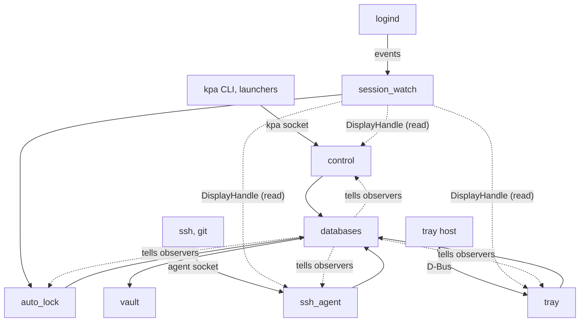

# kpa — architecture (proposal)

How the daemon is divided: one stateful module that holds the databases,
and front ends that each speak one protocol to the outside and use that
module through a small Rust API. This is a proposal: nothing here is built.

It applies [`module-structure.md`](./module-structure.md) and
[`portability.md`](./portability.md), and has to keep the guarantees of
[`threat-model.md`](./threat-model.md). Prompt routing is
[`headless.md`](./headless.md) § 3; the agent's own design is
[`ssh-agent.md`](./ssh-agent.md).

## 1. Summary

- **`databases` is the one stateful module.** It holds every configured
  database, whether each is unlocked, and what makes one lock: a lock
  request, the idle timer, a changed file. It knows nothing about a socket,
  a prompt, the clipboard, a display session, the SSH agent or the tray, and
  it depends on no other part of kpa except the pure KeePass reader
  (`vault`), the cancel tokens and the config types (§ 3).
- **Front ends call it.** `control` (kpa's own socket), `ssh_agent`, `tray`
  and `auto_lock` (the lock triggers) each hold a pointer to the one
  `Databases` and implement their own operations on it, with their own
  authorization (§ 5). None depends on another.
- **What must die with a lock is owned by whoever made it.** The agent's
  approvals and cached private keys, and the clipboard offer a `copy`
  started, live in the front end's own module. `databases` tells them when
  a database unlocks and locks through `Observer`s registered at startup,
  after its own lock is released and before the call that caused the change
  returns. Every such state is tagged with the unlock it belongs to, so a
  late notification about an old unlock can't touch the current one
  (§ 4).
- **A front end prompts; the core never does.** Unlocking is three steps
  on the core, `begin_unlock`, then whatever the front end does to get a
  password, then `finish`. The prompt text, where it may appear and what
  its answer means are the front end's (§ 6).
- **`daemon` is the one place that wires it together**, and the one place
  that lists what reacts to a lock (§ 8).



The dotted edges are calls the core makes through the `Observer` trait; they
are not dependencies (§ 4).

## 2. Modules

A subsystem is a top-level module, as in `module-structure.md`. Each row
lists what it may use, besides the leaves `log`, `io`, `output` and `cancel`
(logging, a byte counter, terminal-safe text, cancel tokens), which any
module may use and which use nothing in kpa.

| Module | Is | May use |
|---|---|---|
| `paths`, `config` | file locations, the config file's types and parser | nothing |
| `vault` | reads a `.kdbx` with the `keepass` crate; no side effect beyond reading the file | nothing |
| `ssh_keys` | finding SSH keys in a database, their config and the public-key cache | `config`, `paths`, `vault` |
| `authn` | `Requester`: who is on the other end of a socket | nothing |
| `session_watch` | the OS side of the lock triggers: logind events, the sleep inhibitor, and the current `DisplaySession` | `authn` |
| `authz` | the checks every front end shares: `may_connect`, `on_desktop`, `display_allows_prompt`, `may_prompt_on_screen` | `authn`, `session_watch` |
| `prompt` | the prompt queue, backends, outcomes | nothing |
| `wayland`, `clip` | the clipboard | `authn`, `authz`, `session_watch` |
| **`databases`** | **the databases, their lifecycle, `Observer`** | **`vault`, `config`** |
| `proto` | the wire types of kpa's own socket, and the client's side of it | `authn` |
| `control` | kpa's own socket: listener, authz for its requests, handlers, `CopyState`, the CLI client | `databases`, `proto`, `authz`, `authn`, `prompt`, `clip`, `ssh_keys`, `session_watch`, `vault`, `config` |
| `ssh_agent` | the SSH agent socket: protocol, policy, sign flow, `SshState` | `databases`, `ssh_keys`, `authz`, `authn`, `prompt`, `session_watch`, `config`, `paths` |
| `tray` | the status icon and its menu | `databases`, `prompt`, `session_watch` |
| `auto_lock` | when databases lock besides a request, and the sleep hold | `databases`, `session_watch` |
| `daemon` | wiring and threads (§ 8) | everything |
| `main` (the binary) | arguments, hardening | `daemon`, `control`'s client |

Between front ends there are no arrows: `control` doesn't use `ssh_agent`,
`tray` doesn't use `control`. What two of them share is a leaf below them
(`ssh_keys`, `authz`, `prompt`, `session_watch`).

Where the rest of the state lives:

| State | Lives in |
|---|---|
| each database, its path and file fingerprint, idle timer, unlock-in-progress flag, the source of its unlock tokens | `databases` |
| who is told of an unlock or a lock | `databases` (the list), `daemon` (what is on it) |
| the current `DisplaySession` | `session_watch`, read through a `DisplayHandle` |
| the sleep delay | `session_watch` (the inhibitor), `auto_lock::SleepHold` (what it is told) |
| the prompt queue, so one prompt is on screen at a time | built by `daemon`, shared by every `Prompt` |
| the unlock prompt (program, timeout) | built by `daemon`, shared by `control` and `tray` |
| the approval prompt | `ssh_agent` |
| the clipboard and where its offer came from | `control::CopyState` |
| served keys, private keys, approvals | `ssh_agent::SshState` |
| a connection's requester and `session-bind` state | the thread that serves it, in its front end |
| the tray's last failed unlock | `tray` |
| config | each module is handed what it uses: `databases` the database configs and the idle timeout, the others their own settings |

## 3. The core: `databases`

`Databases` is one `Mutex<HashMap<String, Slot>>` and the lifecycle around
it. It is `Send + Sync`, built once, shared as an `Arc`.

```rust
pub struct Databases { /* configs, idle_timeout, slots, observers */ }

impl Databases {
    pub fn new(configs: Vec<DatabaseConfig>, idle_timeout: Duration) -> Databases;
    /// Before the databases are shared.
    pub fn observe(&mut self, observer: Arc<dyn Observer>);
    /// Every configured database, in config order.
    pub fn configs(&self) -> &[DatabaseConfig];

    /// `name` if it is unlocked and its file is unchanged, for as long as
    /// the guard lives. A changed file locks it first and says `Stale`.
    pub fn open(&self, name: &str) -> Result<Open<'_>, OpenError>;
    /// Every database and its entry count if unlocked. Runs no freshness guard.
    pub fn snapshot(&self) -> Vec<Snapshot>;
    pub fn any_unlocked(&self) -> bool;

    /// Starts the one unlock `name` may have at a time.
    pub fn begin_unlock(&self, name: &str) -> Result<Begin<'_>, BeginError>;

    pub fn lock(&self, name: &str) -> Result<(), UnknownDb>;
    pub fn lock_all(&self);
    /// Locks each unlocked database idle for `idle_timeout` as of `now`.
    pub fn expire_idle(&self, now: Instant) -> Vec<String>;
    /// The freshness guard for `names`: locks each whose file changed.
    pub fn drop_stale<'a>(&self, names: impl IntoIterator<Item = &'a str>) -> Vec<String>;
}

pub enum OpenError { UnknownDb, Locked, Stale }
pub enum BeginError { UnknownDb, InProgress }
pub enum Begin<'a> { AlreadyUnlocked, Started(Unlocking<'a>) }
pub struct Snapshot { pub name: String, pub entries: Option<usize> }
```

An unlocked database is read through a guard:

```rust
/// Holds the core's lock. Don't call the core while it lives.
pub struct Open<'a> { /* guard */ }
impl Open<'_> {
    pub fn database(&self) -> &keepass::Database;
    /// The token of the unlock this database is in: cancelled by the lock
    /// that ends it (§ 4).
    pub fn unlock_token(&self) -> CancelToken;
    /// Counts as activity: resets the database's idle timer.
    pub fn touch(&mut self);
}
```

What it owns, per database: the `Database` while unlocked; the path and the
file's fingerprint taken when it was read (the freshness guard,
[`threat-model.md`](./threat-model.md) T-12); the idle timer; the unlock-in-
progress flag; and a `CancelSource` that every lock covering the database
replaces, which cancels every token taken from the one before. A token taken
from the current source is the unlock's token: it belongs to the unlock the
database is in, or the one that is starting, and the lock that ends that
unlock cancels it, for good.

What it decides, by itself: the freshness guard runs inside `open`,
`begin_unlock` and `drop_stale`, in the same hold as the access it protects;
a lock replaces the source even for a database that is already locked, which
ends a prompt still waiting for it; an unlock installs its database only if
its token is still live; idle expiry is per database. What counts as
activity is the front end's: it calls `touch` on a successful `list`, a
`copy`, a local signature, and not on `status`, `lock`, a refusal or a
forwarded signature.

What it never does: prompt, read the display session, classify a requester,
write a file, spawn a thread, or log vault content. It logs the lines only it
can truthfully write: that a database was unlocked, and that the idle timer
locked one. The cause of any other lock is logged by whoever asked for it.

What "depends on nothing" means for it: it uses the pure KeePass reader
(`vault`), the config's data types (it takes the database configs and the idle
timeout, and ignores the SSH settings the same struct carries), `cancel` and
`log`. It doesn't use `prompt`: whether and how to ask is a front end's
decision, and the core only hands out the token that ends the question. It
has no OS seam of its own beyond reading and `stat`ing the file `vault` names.

### Unlocking

```rust
pub struct Unlocking<'a> { /* name, unlock token; clears the flag on drop */ }
impl Unlocking<'_> {
    /// The unlock's token: cancelled when the database locks, so a prompt
    /// waiting on it ends.
    pub fn unlock_token(&self) -> &CancelToken;
    /// Reads the file with `password` and the configured keyfile (key
    /// derivation, outside the core's lock) and installs it, unless a lock
    /// came in meanwhile. The password is borrowed; the core keeps no copy.
    pub fn finish(self, password: Option<&Zeroizing<String>>) -> Result<(), UnlockFailure>;
}
pub enum UnlockFailure { Vault(VaultError), LockedMeanwhile }
```

`begin_unlock` runs the freshness guard, answers `AlreadyUnlocked` for an
unlocked database, `InProgress` if another unlock holds the flag, and
otherwise sets the flag and takes the unlock's token. Dropping the
`Unlocking` clears the flag, so every way out, early returns and panics
included, ends the unlock.

## 4. What dies with a lock

Several things must go when a database locks, immediately
([`threat-model.md`](./threat-model.md) G-5, G-6), and each belongs to a
front end:

| State | Owner |
|---|---|
| served keys, cached private keys, approvals | `ssh_agent::SshState` |
| the clipboard offer a `copy` started | `control::CopyState` |
| the sleep inhibitor's hold | `auto_lock::SleepHold` |
| the tray's display of what is unlocked | `tray::Changed` |
| an unlock's prompt and its answer | the unlock's token |

The first four are observers; the last is not.

```rust
pub trait Observer: Send + Sync {
    /// `db` was unlocked. May take the core's lock (`databases.open`).
    fn unlocked(&self, _databases: &Databases, _db: &str, _unlock: &CancelToken) {}
    /// A lock covered `db`, unlocked or not. `unlock` is the token of the
    /// unlock it ended.
    fn locked(&self, _databases: &Databases, _db: &str, _unlock: &CancelToken) {}
}
```

**When they run.** After the core's mutex is released, in the thread that
caused the change, before the call returns. So when `kpa lock` is answered
the clipboard offer has ended. Observers run in the order `daemon` registered
them, each told about every database the lock covered before the next is told
anything. `SleepHold` is registered after the ones that hold secrets, so when
a suspend's `lock_all` has let the sleep delay go, every offer has ended and
every private key is gone. An observer is free to block (ending an offer
waits for the compositor) and to call back into the core; the core's lock is
not held.

**The unlock's token makes them safe to run late.** A token is cancelled, for
good, by the lock that ends its unlock, under the core's mutex, and two
tokens are equal when they come from the same unlock. Each observer tags what
it holds with the token of the unlock it was made for and compares on every
use:

- `locked(db, unlock)` drops the state tagged with `unlock`, and nothing else.
  A notification for an old unlock that arrives after a new unlock has begun
  can't wipe the new state.
- A use that finds state tagged with another unlock's token than the one the
  core reports starts afresh.
- A front end that read or prompted during an unlock checks its token before
  it acts on the answer: "a lock beats an unlock" holds because the token
  check and the lock are ordered by the core's mutex.

**Lock order.** The core's lock, then a front end's own. `Observer::locked`
takes only its owner's lock. `Observer::unlocked` may take the core's lock
first (`SshState` does, to scan under it) and its own second. Nothing takes
them the other way round. A guard from `open` must not outlive a call that
needs the core.

An observer doesn't panic: a panic in one skips the observers after it. They
take their own mutex, recovering a poisoned one, and do bounded work.

**Why not the alternatives.** Keeping each front end's state in the core's
slot makes the core generic over every front end's state type, or aware of
it, and a third front end with state (passkeys) edits the core. Events over a
channel arrive after the lock call has returned: a `kpa lock` could be
answered with the offer still live, and suspend could be released with a
secret still on the clipboard. The tray is the one place an event channel is
right (§ 5.4).

## 5. Front ends

Each front end owns its listener (or equivalent), how it learns who is
asking (`authn`), what that requester may do (`authz`), and its handlers.
Everything below is per front end because none of it is shared logic:
two protocols with different refusals, prompts and consequences.

### 5.1 `control`: kpa's own socket

- **Transport**: bind, accept, the connection cap, the request size and I/O
  limits, the zeroizing request buffer, one request and one response per
  connection (`docs/design.md` § Protocol, threat-model G-11).
- **Authn**: `Requester::of(&stream)`, once per connection; a peer whose uid
  isn't the daemon's is dropped (`authz::may_connect`).
- **Authz**: `authorize_copy` (a requester on the desktop, display session
  active and unlocked) and `choose_unlock_prompt` (a request that carries its
  password needs no prompt; otherwise the screen where a prompt may appear,
  else `no_display`). Both are decisions over a `Requester` and a
  `DisplaySession`, and live here because they return this protocol's errors.
- **Handlers**: `status`, `unlock`, `lock`, `list`, `copy`, `ssh keys`. They
  hold `Arc<Databases>`, the unlock `Prompt`, the clipboard and the display
  handle.
- **State it owns**: `CopyState`, the clipboard and which unlock's database
  its current offer came from.

```rust
pub struct CopyState { /* clip: Arc<Clipboard>, from: Mutex<Option<(String, CancelToken)>> */ }
impl Observer for CopyState {
    /// A lock of the unlock the offer came from ends it; any other leaves it.
    fn locked(&self, _: &Databases, db: &str, unlock: &CancelToken);
}
```

`copy` reads the value under `open`, takes the unlock's token from the same
guard, hands the secret to the clipboard after the guard is dropped, then
records `(db, token)`. If the token was cancelled meanwhile, the lock that
ended the unlock didn't know of the offer, so `copy` ends it itself.

### 5.2 `ssh_agent`: the SSH agent socket

- **Transport**: the agent protocol, per-connection `session-bind` state,
  frame limits.
- **Authn/authz**: the same `Requester` and shared checks; its own policy
  (`policy::decide`, `authz::may_prompt_on_screen` for approval prompts). The
  sign flow itself is [`ssh-agent.md`](./ssh-agent.md)'s.
- **State it owns**: `SshState`, per database and per unlock: the served
  keys from the scan at unlock, private keys read at first use, approvals.
  State with another scope (a prompt backoff, per-connection bindings) lives
  next to it, in this module; a forwarding session's approvals are both, held
  per session and tagged with the unlock's token.

**Reading under the guard.** The agent reads a database through
`SshState::hold`:

```rust
impl SshState {
    /// `db`, unlocked and fresh, with the agent's state for the unlock it is
    /// in: the core's lock, then this one's. Refused if it is locked.
    fn hold<'a>(&'a self, databases: &'a Databases, db: &str) -> Result<SlotView<'a>, OpenError>;
}
```

It calls `databases.open(db)`, so the freshness guard has run in the same hold
as the read, then takes the state's own lock. If what it holds for `db` is
tagged with another unlock's token, it starts a fresh entry. The `SlotView`
gives the database, the agent's state and `unlock_token()`. A flow that
prompts between two reads takes the token in the first and checks
`is_cancelled()` in the second; that is how a lock that came in between is
seen. No trait stands between the agent and the databases, and its tests
build a real `Databases` (§ 11).

**Reaction to unlock and lock.** `unlocked` scans the database under the
core's lock and writes the public-key cache after releasing it; `locked`
drops the state tagged with the ended unlock's token, which zeroizes the
private keys.

```rust
impl Observer for SshState {
    fn unlocked(&self, databases: &Databases, db: &str, unlock: &CancelToken);
    fn locked(&self, _: &Databases, db: &str, unlock: &CancelToken);
}
```

A front end that unlocks on demand ([`ssh-agent.md`](./ssh-agent.md) § 6.6)
uses the same calls as § 6, with its own prompt text and its own consequence
for the answer.

### 5.3 `auto_lock`: when databases lock besides a request

The OS side stays in `session_watch`, which only reports: the display
session's state, a lock request, suspend, a lost watch, and the sleep
inhibitor. `auto_lock` holds the databases and says what each of those
means:

```rust
pub fn react(databases: &Databases, event: SessionEvent);   // lock everything
pub fn watch_idle(databases: Arc<Databases>, idle_timeout: Duration); // databases.expire_idle(now) on a tick
pub struct SleepHold { /* SleepDelay, a mutex that orders its answers */ }
impl Observer for SleepHold { /* hold_while(databases.any_unlocked()) after every change */ }
```

`SleepHold` reads `any_unlocked()` inside its own mutex, so the delay hears
the states in the order they happened whichever threads changed them. On
suspend, `react` locks everything, and the delay is released when `SleepHold`
is told, after the observers registered before it have run (§ 4).

**The display session** is `session_watch`'s. Its one watcher thread writes
the current `DisplaySession` into a `DisplayHandle` before it sends the
event that reports it, and every front end holds a read-only copy
(`display.get()`). So "marked before everything is locked" is true by
construction, and the core never sees a display session.

### 5.4 `tray`: the status icon

The tray is a front end like the others: it holds `Arc<Databases>`, the
unlock `Prompt` and a `DisplayHandle`, and calls the core directly. It has
no `Requester`.

- **Authorization**: it is the daemon itself, not a peer, and a click can't
  be traced to a caller (a same-uid process with session-bus access can
  trigger a menu entry, [`threat-model.md`](./threat-model.md) T-15). The
  requester's cgroup would decide nothing real, so the tray has one gate:
  `authz::display_allows_prompt(&display.get())`, a display session exists
  and isn't known to be locked. Lock needs no gate. Unlock always prompts on
  screen.
- **Learning of a lock or an unlock**: it is an observer. `Observer::locked`
  and `unlocked` send `()` on a channel; the tray's loop wakes and tells the
  StatusNotifierItem service to refresh from `databases.snapshot()`. The
  observer must not call the service's `update` itself: `update` takes the
  lock the service holds while it runs a menu callback, and a menu "Lock"
  runs `databases.lock`, which tells the observer, so doing it inline
  deadlocks. A lock by any cause, idle and changed files included, changes
  the icon at once.
- **Unlock**: `begin_unlock`, the display gate, `Prompt::ask` with the
  unlock's token, `finish`. Failures show as a label of the same names the
  wire uses.

## 6. The unlock flow

The core owns the steps that have to be atomic; the front end owns every
decision about the prompt. For `control`'s `unlock`:

```rust
let unlocking = match databases.begin_unlock(name) {
    Err(BeginError::UnknownDb) => return Err(UnlockError::UnknownDb { .. }),
    Err(BeginError::InProgress) => return Err(UnlockError::InProgress { .. }),
    Ok(Begin::AlreadyUnlocked) => return Ok(name),
    Ok(Begin::Started(unlocking)) => unlocking,
};
// Read the display session only now, after the unlock's token exists.
let prompt_on = authz::choose_unlock_prompt(request, requester, &display.get())?;
let password = match prompt_on {
    None => request.password.as_ref().map(Password::as_zeroizing), // the request carried it
    Some(PromptOn::Screen) => Some(ask(unlocking.unlock_token())?),
};
unlocking.finish(password.as_ref().filter(|p| !p.is_empty()))?;  // key derivation, then install
```

**Why the order.** A screen lock is "mark the display session locked, then lock
every database" (`session_watch` marks before it reports; `auto_lock` locks
on the report). An unlock that takes its token and then reads the display
session meets that in one of three ways:

- the lock came before the token: the read sees the mark, and the unlock
  refuses with `no_display`;
- the lock fell between the token and the read: the read sees the mark too
  (the mark precedes the lock), and the token is already cancelled;
- the lock comes after the read: it cancels the token the unlock holds, which
  kills the prompt it raised.

No interleaving raises a prompt behind the locker. An unlock that read the
display session first and took its token second would have one: read
"unlocked", the whole screen lock, then a token from the next unlock.

The order is a rule of the API, not something the types enforce: `begin_unlock`
comes first, and a test walks the three cases. Two shapes that would enforce
it were tried and left out. Gates that take the display handle and the
unlock's token, and read inside, stop being decisions over their arguments
(they read shared state) and take a token they don't use. And the plain read
has to stay for decisions that raise no prompt (`copy`'s check), so a gate
written with it would still compile.

**Why the front end prompts.** Where a prompt may appear is per requester
(authz), and its text and what its answer means differ per front end: the
agent's names the key and destination, `control`'s asks for a password. If the
core prompted it would depend on `prompt` and the display session, and authz
would be split between the core and the front end. The core never holds the
password: it is borrowed for the call into `vault`.

**The refusal order.** An unlock request from outside the desktop, for a
database whose unlock is already in progress, is answered `unlock_in_progress`,
not `no_display`: the in-progress claim is taken by `begin_unlock`, before
authorization.

## 7. Secrets

Which secrets leave the core, and in what form:

| Secret | How it crosses | Where it ends |
|---|---|---|
| master password, keyfile path | borrowed into `Unlocking::finish`; the core passes it to `vault::open` and keeps nothing | zeroized by the front end that read it (prompt buffer, request) |
| the decrypted database | a `&Database` borrowed through an `Open` guard; it can't outlive the guard | read only through `vault`'s functions and `ssh_keys` |
| a protected field's value | copied by `vault::entry_field` or `entry_totp` into a `Zeroizing<String>` | the clipboard offer |
| entry metadata | `vault::list_entries` into zeroize-on-drop summaries | a response, serialized into a zeroizing buffer |
| an SSH private key | parsed by `ssh_keys`/`ssh_agent` from an attachment, into a type that zeroizes on drop | `SshState`, until its unlock's token is cancelled |

The core has no output channel: it writes no file and no socket, and its
log lines carry database names only. So the places a secret can reach disk,
a log or another process are the front ends and the clipboard, and
the audit of "nothing persisted" ([`threat-model.md`](./threat-model.md) G-4)
is a search for `vault::` and `Open::database` call sites.

Where each lock-related goal is enforced, for an audit:

| Goal | Enforced in |
|---|---|
| G-5 locks on screen lock, suspend, idle, request, changed file; a lock beats an unlock; a lock ends a prompt | `databases` (idle, request, changed file, tokens), `auto_lock` (events, suspend) |
| G-6 a lock clears what kpa owns | `databases` drops the `Database`; every observer registered in `daemon` clears the rest |
| G-8 freshness | `databases::{open, begin_unlock, drop_stale}` |
| G-12 no prompt where nobody can see it | `authz` checks, each front end's use of them, the order in § 6 |
| G-11 robust socket | `control` and `ssh_agent` transports |

## 8. Wiring and threads

`daemon` builds the objects and starts the threads; nothing else decides
what reacts to a lock.

```rust
pub fn serve(config: Config, paths: Paths, control_socket: UnixListener, agent_socket: Option<UnixListener>) {
    let (session_events, sleep_delay, display) = session_watch::start(Bus::System);

    // What reacts to a lock or an unlock, registered before the core is shared.
    // Observers run in this order: the ones that hold secrets, then the sleep hold.
    let copies = Arc::new(control::CopyState::new(Clipboard::new(WaylandBackend)));
    let ssh = Arc::new(ssh_agent::SshState::new(paths.clone()));
    let (changed, wake) = mpsc::channel();
    let mut databases = Databases::new(config.databases.clone(), config.idle_timeout);
    databases.observe(copies.clone());
    databases.observe(ssh.clone());
    databases.observe(Arc::new(auto_lock::SleepHold::new(sleep_delay)));
    databases.observe(Arc::new(tray::Changed::new(changed)));
    let databases = Arc::new(databases);

    let queue = Arc::new(PromptQueue::new());          // one prompt on screen at a time
    let unlock = Arc::new(Prompt::new(queue.clone(), SecretProgram::new(config.prompt.clone()), config.prompt_timeout));

    spawn(|| for event in session_events { auto_lock::react(&databases, event) });
    spawn(|| auto_lock::watch_idle(databases.clone(), config.idle_timeout));
    spawn(|| tray::run(databases.clone(), display.clone(), unlock.clone(), wake));
    if let Some(listener) = agent_socket {
        spawn(|| ssh_agent::serve(Agent::new(databases.clone(), ssh, display.clone(), approval_prompt(&queue, &config), &paths), listener));
    }
    control::serve(Arc::new(control::Api::new(databases, display, unlock, copies, config.clipboard_timeout)), control_socket);
}
```

Threads: the daemon's main thread accepts on kpa's socket and spawns a thread
per connection (capped); the agent socket has its own accept thread and
per-connection threads; `auto_lock` has two (events, idle tick);
`session_watch` has two of its own (the logind watch, the inhibitor); the tray
has its service's thread and the loop that refreshes it; each clipboard offer
has its serving thread and an expiry thread. The core has none: it is plain
calls, so a test drives it from one thread.

The in-process daemon the integration tests use builds the same objects with
the same function and starts the listeners it needs.

## 9. Portability

The core is the part of kpa with no OS seam. It reads files through `vault`
(open, read, `fstat`, `stat`: POSIX calls macOS has) and keeps time with
`Instant`. Every seam in [`portability.md`](./portability.md) sits outside it:

| Seam | Where it sits |
|---|---|
| socket peer identity, request origin | `authn`, shared; `authz` shared checks |
| file locations | `paths`, `config` |
| lock triggers | `session_watch` reports, `auto_lock` reacts: a macOS `session_watch` changes nothing in `databases` or `auto_lock` |
| clipboard | `clip`, `wayland`; `control::CopyState` is OS-neutral |
| tray | `tray`: snapshots in, menu actions out |
| prompts | `prompt`; front ends choose |
| process hardening, service manager | `main` |

`DisplaySession` carries the logind session id the clipboard needs; only
`session_watch`, `clip`, `wayland` and `authz::on_desktop` read it.

## 10. Names

- **`databases`**: a module and type that say what they hold; call sites read
  `databases.open(name)`, `databases.lock_all()`. `core` compiles as a module
  name but shadows the standard library's `core` in the crate root.
- **`control`**: kpa's own socket, the API `kpa status`, `unlock`, `lock`,
  `list`, `copy` and `ssh keys` drive.
- **`auto_lock`**: what makes databases lock without a request: a screen
  lock, suspend, a lost logind watch, the idle timer, and the sleep hold that
  gives the lock time to finish before the machine sleeps.
- **`Unlocking`**, **`Open`**, **`Observer`**: an unlock in progress, an
  unlocked database held for reading, a callback for a change.

## 11. Tests

- **`databases`** is tested alone: the state machine (a lock beats an unlock,
  a token is cancelled when its unlock's lock happens, idle expiry per
  database, the freshness guard, `InProgress`), with in-memory databases
  installed through a `#[cfg(test)]` entry that stamps a temporary file, and
  observers that record what they are told and call back into the core.
  `vault::open`'s file reading is covered by the integration tests, because
  the library is built without save support and unit tests can't write a
  `.kdbx`.
- **`ssh_agent`** is tested against a real `Databases` with a real `SshState`
  registered, in-memory databases, and a scripted approval prompt
  (`prompt::Scripted`). The races the sign flow has to survive (a lock while
  its approval prompt is up, a lock and a fresh unlock after the answer, a
  file that changes between two reads) are tests against it. No fake host
  stands in for the databases, so there is no second implementation to drift
  from the real one.
- **`control`** is tested against a real `Databases`, `prompt::Scripted` for
  the unlock prompt, `clip::RecordingBackend` for the clipboard and a
  `DisplayHandle` the test sets: the unlock gates, a lock ending a prompt,
  and "a lock of the database a copy came from ends the offer; another doesn't".
- **`auto_lock`** is tested by calling `react` on a `Databases` with a
  `SleepDelay` whose receiver the test reads.
- **Integration tests** build the daemon with `daemon` and put the real CLI
  and the OpenSSH tools in front of it.
