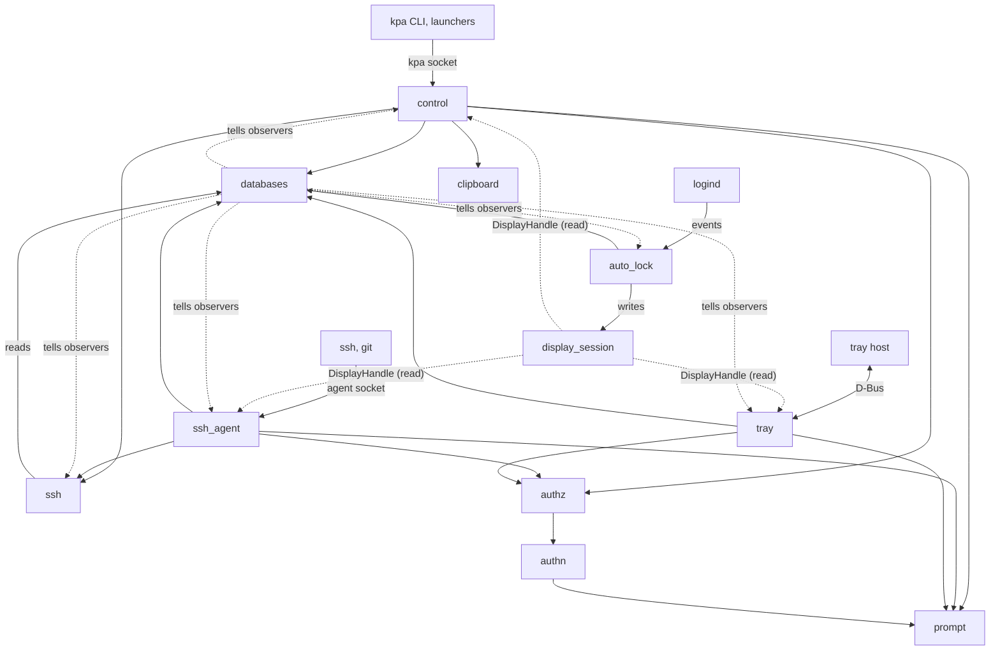

# kpa — architecture

How the daemon is divided: one stateful module that holds the databases,
and front ends that each speak one protocol to the outside and use that
module through a small Rust API. This is the structure the daemon is built
to and the spec its code is written against.

It applies [`module-structure.md`](./module-structure.md) and
[`portability.md`](./portability.md), and has to keep the guarantees of
[`threat-model.md`](./threat-model.md). Prompt routing is
[`headless.md`](./headless.md) § 3; the agent's own design is
[`ssh-agent.md`](./ssh-agent.md).

## 1. Summary

- **`databases` is the one stateful module.** It holds every configured
  database, whether each is unlocked, and what makes one lock: a lock
  request, the idle timer, a changed file. It knows nothing about a socket,
  a prompt, the clipboard, a display session, the SSH agent or the tray, and
  it depends on no other part of kpa except the config types, the cancel
  tokens and `log` (§ 3). The KeePass reader (`vault`) is inside it, and so
  is every `keepass` type: callers read through the `Open` guard's methods.
- **Front ends drive it.** `control` (kpa's own socket), `ssh_agent`, `tray`
  and `auto_lock` (the lock triggers) each hold a pointer to the one
  `Databases` and implement their own operations on it, with their own
  authorization (§ 5). None uses another. Only a front end unlocks or locks.
  Besides front ends, `ssh` reads the core (it is handed a guard and told of
  a lock) and `daemon` builds and wires it. Nothing else imports it.
- **What must die with a lock is owned by whoever made it.** The agent's
  cached private keys, the approvals and pending requests (`ssh::approvals`),
  and the clipboard offer a `copy` started, live in their owner's module.
  `databases` tells them when a database unlocks and locks through
  `Observer`s registered at startup, after its own lock is released and
  before the call that caused the change returns. Every such state is tagged
  with the unlock it belongs to, so a late notification about an old unlock
  can't touch the current one (§ 4).
- **A front end prompts; the core never does.** Unlocking is three steps
  on the core, `begin_unlock`, then whatever the front end does to get a
  password, then `finish`. The prompt text, where it may appear and what
  its answer means are the front end's (§ 6).
- **`daemon` is the one place that wires it together**, and the one place
  that lists what reacts to a lock (§ 8).



`control`, `ssh_agent`, `tray` and `auto_lock` are modules of `frontends`.
`vault` is inside `databases`. The dotted edges from `databases` are calls
the core makes through the `Observer` trait; they are not dependencies (§ 4).
The dotted edges from `display_session` are reads of a handle. `ssh` stands
for `ssh::keys` and `ssh::approvals` (§ 5.5).

## 2. Modules

A subsystem is a top-level module, as in `module-structure.md`, and so is
each module under `frontends/`. Each row lists what it may use, besides the
leaves `log`, `output` and `cancel` (logging, terminal-safe text, cancel
tokens), which any module may use and which use nothing in kpa.

| Module | Is | May use |
|---|---|---|
| `paths`, `config` | file locations, the config file's types and parser | nothing |
| `socket` | the owner-only bind, the socket directory check, a request with a file descriptor attached | nothing |
| `prompt` | the prompt queue, backends, outcomes, `PromptOn` | nothing |
| `authn` | `Requester`: who is on the other end of a socket, and where it asked to be prompted | `prompt` |
| `display_session` | `DisplaySession`, a `DisplayWriter` (the one writer) and `DisplayHandle`s (read-only copies) | nothing |
| `authz` | the checks every front end shares: `may_connect`, `on_desktop`, `display_allows_prompt`, `may_prompt_on_screen` | `authn`, `display_session` |
| `clipboard` | the clipboard, with its Wayland backend inside | `authn`, `authz`, `display_session` |
| **`databases`** | **the databases, their lifecycle, `Observer`; `vault` (reads a `.kdbx` with the `keepass` crate) inside** | **`config`** |
| `ssh` | what `control` and `ssh_agent` share about SSH: `keys` (finding keys in a database, their config, the public-key cache) and `approvals` (approvals, pending requests, their state per unlock) | `databases` (reads only), `config`, `paths` |
| `frontends::control` | kpa's own socket: listener, authz for its requests, handlers, `CopyState`, the wire types (`proto`), the CLI client | `databases`, `ssh`, `authz`, `authn`, `prompt`, `clipboard`, `display_session`, `socket`, `config`, `paths` |
| `frontends::ssh_agent` | the SSH agent socket: protocol, policy, sign flow, `SshState` | `databases`, `ssh`, `authz`, `authn`, `prompt`, `display_session`, `socket`, `config`, `paths` |
| `frontends::tray` | the status icon and its menu | `databases`, `authz`, `prompt`, `display_session` |
| `frontends::auto_lock` | when databases lock besides a request: the logind watcher, the sleep inhibitor, the idle tick, `SleepHold` | `databases`, `display_session` |
| `daemon` | wiring and threads (§ 8) | everything |
| `main` (the binary) | arguments, hardening, dispatch | `daemon`, `control`'s client |

Between front ends there are no arrows: `control` doesn't use `ssh_agent`,
`tray` doesn't use `control`. What two of them share is a module below them
(`ssh`, `authz`, `prompt`, `display_session`). Only `daemon` and `main`
import `frontends::`.

Only front ends drive the core. `ssh` reads it through the guard a front end
hands it and is told of a lock as an observer, and calls none of
`begin_unlock`, `lock`, `lock_all` and `expire_idle`. `daemon` builds the
core and registers the observers. `authz`, `clipboard`, `prompt` and the rest
never see it.

Where the rest of the state lives:

| State | Lives in |
|---|---|
| each database, its path and file fingerprint, idle timer, unlock-in-progress flag, the source of its unlock tokens | `databases` |
| who is told of an unlock or a lock | `databases` (the list), `daemon` (what is on it) |
| the current `DisplaySession` | `display_session` (the value), `auto_lock` (its one writer) |
| the sleep delay | `auto_lock` (the inhibitor in `logind`, `SleepHold` for what it is told) |
| the prompt queue, so one prompt is on screen at a time | built by `daemon`, shared by every `Prompt` |
| the screen unlock prompt (program, timeout) | built by `daemon`, shared by `control`, `tray` and `ssh_agent`; a terminal prompt is built per request by `control` |
| the confirm prompt | `ssh_agent` |
| the clipboard and where its offer came from | `control::CopyState` |
| served keys, private keys | `ssh_agent::SshState`, per database and per unlock |
| approvals and pending requests | `ssh::approvals`, per database and per unlock |
| the prompt backoff, the turn each database's prompts take | `ssh_agent` (the backoff outlives a lock) |
| a connection's requester and `session-bind` state | the thread that serves it, in its front end |
| the tray's last failed unlock | `tray` |
| config | each module is handed what it uses: `databases` the database configs and the idle timeout, the others their own settings |

## 3. The core: `databases`

`Databases` is one `Mutex<HashMap<String, Slot>>` and the lifecycle around
it. It is `Send + Sync`, built once, shared as an `Arc`.

```rust
pub struct Databases { /* configs, idle_timeout, slots, observers */ }

impl Databases {
    pub fn new(configs: Vec<DatabaseConfig>, idle_timeout: Duration) -> Databases;
    /// Before the databases are shared.
    pub fn observe(&mut self, observer: Arc<dyn Observer>);
    /// Every configured database, in config order.
    pub fn configs(&self) -> &[DatabaseConfig];

    /// `name` if it is unlocked and its file is unchanged, for as long as
    /// the guard lives. A changed file locks it first and says `Stale`.
    pub fn open(&self, name: &str) -> Result<Open<'_>, OpenError>;
    /// Every database and its entry count if unlocked. Runs no freshness guard.
    pub fn snapshot(&self) -> Vec<Snapshot>;
    pub fn any_unlocked(&self) -> bool;

    /// Starts the one unlock `name` may have at a time.
    pub fn begin_unlock(&self, name: &str) -> Result<Begin<'_>, BeginError>;

    pub fn lock(&self, name: &str) -> Result<(), UnknownDb>;
    pub fn lock_all(&self);
    /// Locks each unlocked database idle for `idle_timeout` as of `now`.
    pub fn expire_idle(&self, now: Instant);
    /// The freshness guard for `names`: locks each whose file changed.
    pub fn drop_stale<'a>(&self, names: impl IntoIterator<Item = &'a str>);
}

pub enum OpenError { UnknownDb, Locked, Stale }
pub enum BeginError { UnknownDb, InProgress }
pub enum Begin<'a> { AlreadyUnlocked, Started(Unlocking<'a>) }
pub struct Snapshot { pub name: String, pub entries: Option<usize> }
impl Snapshot { pub fn is_locked(&self) -> bool; }
```

An unlocked database is read through a guard. It carries the reads the front
ends need, and it never hands out the `keepass` database:

```rust
/// Holds the core's lock. Don't call the core while it lives.
pub struct Open<'a> { /* guard */ }
impl Open<'_> {
    /// The token of the unlock this database is in: cancelled by the lock
    /// that ends it (§ 4).
    pub fn unlock_token(&self) -> CancelToken;
    /// Counts as activity: resets the database's idle timer.
    pub fn touch(&mut self);

    /// Every current entry, index only: no password, no notes, and no
    /// protected field.
    pub fn entries(&self) -> Vec<EntrySummary>;
    pub fn entry_count(&self) -> usize;
    /// `None`: no such entry.
    pub fn entry(&self, uuid: Uuid) -> Option<Entry<'_>>;
    /// Every attachment on every current entry, borrowed for the call.
    pub fn for_each_attachment(&self, visit: impl FnMut(Attachment<'_>));
}

/// One entry of an open database.
impl Entry<'_> {
    /// For the operation log: `None` if absent, empty or protected.
    pub fn title(&self) -> Option<String>;
    /// One field's value, protected or not. `None`: absent or empty.
    pub fn field(&self, key: &str) -> Option<Zeroizing<String>>;
    /// The entry's current one-time code.
    pub fn totp(&self) -> Option<Zeroizing<String>>;
    pub fn for_each_attachment(&self, visit: impl FnMut(Attachment<'_>));
}
```

`EntrySummary` and `Attachment` are `databases`' own types. No `pub`
signature of `databases` names a `keepass` type, and no other subsystem
imports the crate: the audit of what reads vault content is the call sites of
these methods and `Entry`'s (§ 7). An attachment is borrowed, never copied, so a private
key in it is not left behind in a buffer nobody wipes.

What it owns, per database: the `Database` while unlocked; the path and the
file's fingerprint taken when it was read (the freshness guard,
[`threat-model.md`](./threat-model.md) T-12); the idle timer; the unlock-in-
progress flag; and a `CancelSource` that every lock covering the database
replaces, which cancels every token taken from the one before. A token taken
from the current source is the unlock's token: it belongs to the unlock the
database is in, or the one that is starting, and the lock that ends that
unlock cancels it, for good.

What it decides, by itself: the freshness guard runs inside `open`,
`begin_unlock` and `drop_stale`, in the same hold as the access it protects;
a lock replaces the source even for a database that is already locked, which
ends a prompt still waiting for it; an unlock installs its database only if
its token is still live; idle expiry is per database. What counts as
activity is the front end's: it calls `touch` on a successful `list`, `copy`,
`ssh keys` and local signature, and not on `status`, `lock`, a refusal or a
forwarded signature.

What it never does: prompt, read the display session, classify a requester,
write a file, spawn a thread, or log vault content. It logs the lines only it
can truthfully write: that a database was unlocked, and that the idle timer
locked one. The cause of any other lock is logged by whoever asked for it.

What "depends on nothing" means for it: it uses the config's data types (it
takes the database configs and the idle timeout, and ignores the SSH settings
the same struct carries), `cancel` and `log`, and `vault`, the KeePass reader
that lives inside it. It doesn't use `prompt`: whether and how to ask is a
front end's decision, and the core only hands out the token that ends the
question. It has no OS seam of its own beyond reading and `stat`ing the file
`vault` names.

**Test support.** Unit tests of other subsystems need unlocked databases
without a `.kdbx` file. `databases/testing.rs`, compiled for tests only,
gives `Databases::for_test` (each database's path is a placeholder file in a
temporary directory a test-only field keeps alive, so the freshness guard
passes), `install_for_test(name, Vec<TestEntry>)` (an in-memory database
installed through the path `finish` uses, built from plain data: a title,
fields, attachments) and `change_file_for_test(name)` (the guard sees a
change). It names no `keepass` type, so a test in `ssh` or `ssh_agent`
doesn't either. `vault::open`'s file reading is covered by the
integration tests, because the library is built without save support and unit
tests can't write a `.kdbx`.

### Unlocking

```rust
pub struct Unlocking<'a> { /* name, unlock token; clears the flag on drop */ }
impl Unlocking<'_> {
    /// The unlock's token: cancelled when the database locks, so a prompt
    /// waiting on it ends.
    pub fn unlock_token(&self) -> &CancelToken;
    /// Reads the file with `password` and the configured keyfile (key
    /// derivation, outside the core's lock) and installs it, unless a lock
    /// came in meanwhile. The password is borrowed; the core keeps no copy.
    pub fn finish(self, password: Option<&Zeroizing<String>>) -> Result<(), UnlockFailure>;
}
pub enum UnlockFailure { Vault(VaultError), LockedMeanwhile }
```

`begin_unlock` runs the freshness guard, answers `AlreadyUnlocked` for an
unlocked database, `InProgress` if another unlock holds the flag, and
otherwise sets the flag and takes the unlock's token. Dropping the
`Unlocking` clears the flag, so every way out, early returns and panics
included, ends the unlock.

## 4. What dies with a lock

Several things must go when a database locks, immediately
([`threat-model.md`](./threat-model.md) G-5, G-6), and each belongs to the
module that made it:

| State | Owner |
|---|---|
| served keys, cached private keys | `ssh_agent::SshState` |
| approvals and pending requests, entry titles included | `ssh::approvals::Approvals` |
| the clipboard offer a `copy` started | `control::CopyState` |
| the sleep inhibitor's hold | `auto_lock::SleepHold` |
| the tray's display of what is unlocked | `tray::Changed` |
| an unlock's prompt and its answer | the unlock's token |

The first five are observers; the last is not.

```rust
pub trait Observer: Send + Sync {
    /// `db` was unlocked. The core's lock is not held, so it may take it
    /// (`databases.open`).
    fn unlocked(&self, _databases: &Databases, _db: &str, _unlock: &CancelToken) {}
    /// A lock covered `db`, unlocked or not. `unlock` is the token of the
    /// unlock it ended.
    fn locked(&self, _databases: &Databases, _db: &str, _unlock: &CancelToken) {}
}
```

**When they run.** After the core's mutex is released, in the thread that
caused the change, before the call returns. So when `kpa lock` is answered
the clipboard offer has ended. Observers run in the order `daemon` registered
them, each told about every database the lock covered before the next is told
anything. `SleepHold` is registered after the ones that hold secrets, so when
a suspend's `lock_all` has let the sleep delay go, every offer has ended and
every private key is gone. An observer is free to block (ending an offer
waits for the compositor) and to call back into the core; the core's lock is
not held.

**The unlock's token makes them safe to run late.** A token is cancelled, for
good, by the lock that ends its unlock, under the core's mutex, and two
tokens are equal when they come from the same unlock. Each observer tags what
it holds with the token of the unlock it was made for and compares on every
use:

- `locked(db, unlock)` drops the state tagged with `unlock`, and nothing else.
  A notification for an old unlock that arrives after a new unlock has begun
  can't wipe the new state.
- A use that finds state tagged with another unlock's token than the one the
  core reports starts afresh.
- A front end that read or prompted during an unlock checks its token before
  it acts on the answer: "a lock beats an unlock" holds because the token
  check and the lock are ordered by the core's mutex.

**Lock order.** The core's lock, then the agent's state (`SshState`), then
approvals. Each takes only its own lock in `Observer::locked`.
`Observer::unlocked` may take the core's lock first (`SshState` does, to scan
under it) and its own second. Nothing takes them the other way round. A guard
from `open` must not outlive a call that needs the core.

An observer doesn't panic: a panic in one skips the observers after it. They
take their own mutex, recovering a poisoned one, and do bounded work.

**Why not the alternatives.** Keeping each front end's state in the core's
slot makes the core generic over every front end's state type, or aware of
it, and a third front end with state (passkeys) edits the core. Events over a
channel arrive after the lock call has returned: a `kpa lock` could be
answered with the offer still live, and suspend could be released with a
secret still on the clipboard. The tray is the one place an event channel is
right (§ 5.4).

## 5. Front ends

Each front end owns its listener (or equivalent), how it learns who is
asking (`authn`), what that requester may do (`authz`), and its handlers.
Everything below is per front end because none of it is shared logic:
two protocols with different refusals, prompts and consequences.

### 5.1 `control`: kpa's own socket

- **Transport** (`serve.rs`): bind, accept, the connection cap, the request
  size and I/O limits, the zeroizing request buffer (a byte counter sizes it
  exactly), one request and one response per connection (`docs/design.md`
  § Protocol, threat-model G-11).
- **Authn**: `Requester::of(&stream)`, once per connection; a peer whose uid
  isn't the daemon's is dropped (`authz::may_connect`).
- **Authz** (`authz.rs`): `authorize_copy` (a requester on the desktop,
  display session active and unlocked) and `choose_unlock_prompt` (where the
  password is asked: the place a requester prefers, if a prompt may appear
  there; else the screen where a prompt may appear; else the terminal the
  requester passed; else `no_prompt`). Both are decisions over a `Requester`
  and a `DisplaySession`, and live here because they return this protocol's
  errors. The root `authz` keeps the checks that return no wire type.
- **Handlers**: `Api` holds what they share (`Arc<Databases>`, the display
  handle, the screen unlock `Prompt`, the clipboard, `CopyState`, the
  approvals state) and has one plain method per operation: `status`,
  `unlock`, `lock`, `list`, `copy`, `ssh keys`, `ssh pending`, `ssh approve`.
  Dispatch is a `match` on the request. There is no trait per operation: a
  second implementor is the only reason for one, and there is only the
  daemon.
- **Unlock** (`unlock.rs`): begin, choose where to ask, ask, finish (§ 6).
  The screen prompt is the one `daemon` built and shares. A terminal prompt
  is built per request on the terminal the requester passed
  (`SecretTerminal` on its descriptor, in the shared queue).
- **`ssh keys`, `ssh pending`, `ssh approve`**: `ssh keys` scans the open
  database through the guard (`ssh::keys::scan(&open)`). `ssh pending` and
  `ssh approve` open each database, in config order, and call
  `ssh::approvals` with the guard (§ 5.5). Neither needs a terminal.
- **State it owns**: `CopyState`, the clipboard and which unlock's database
  its current offer came from (`copy.rs`).

```rust
pub struct CopyState { /* clipboard: Arc<Clipboard>, from: Mutex<Option<(String, CancelToken)>> */ }
impl Observer for CopyState {
    /// A lock of the unlock the offer came from ends it; any other leaves it.
    fn locked(&self, _: &Databases, db: &str, unlock: &CancelToken);
}
```

`copy` reads the value under `open`, takes the unlock's token from the same
guard, hands the secret to the clipboard after the guard is dropped, then
records `(db, token)`. If the token was cancelled meanwhile, the lock that
ended the unlock didn't know of the offer, so `copy` ends it itself.

### 5.2 `ssh_agent`: the SSH agent socket

- **Transport**: the agent protocol, per-connection `session-bind` state,
  frame limits.
- **Authn/authz**: the same `Requester` and shared checks; its own policy
  (`authorize_sign`, `may_prompt_on_screen` for prompts). The sign flow
  itself is [`ssh-agent.md`](./ssh-agent.md)'s.
- **State it owns**: `SshState`, per database and per unlock: the served keys
  from the scan at unlock and the private keys read at first use. Beside it,
  with another scope, in this module: the prompt backoff and the turn each
  database's prompts take. Approvals and pending requests are not here: they
  are `ssh::approvals`' (§ 5.5), shared with `control`. A forwarding
  session's approvals are scoped to the session as well as the unlock.
- **Collaborators**: `Arc<Databases>`, its `SshState`, the approvals state, a
  `DisplayHandle`, the screen unlock prompt and its confirm prompt.

**Reading under the guard.** The agent reads a database through
`SshState::hold`:

```rust
impl SshState {
    /// `db` as the agent sees it: the core's guard if it is unlocked and
    /// fresh, then this state's own lock, then (when it needs it) approvals.
    fn hold<'a>(&'a self, databases: &'a Databases, db: &str) -> Hold<'a>;
}
```

It calls `databases.open(db)`, so the freshness guard has run in the same hold
as the read, then takes the state's own lock. If what it holds for `db` is
tagged with another unlock's token, it starts a fresh entry. A hold on an
unlocked database gives the guard, the agent's state, `unlock_token()` and
the approvals calls that take the guard. A flow that prompts between two
reads takes the token in the first and checks `is_cancelled()` in the second;
that is how a lock that came in between is seen. No trait stands between the
agent and the databases, and its tests build a real `Databases` (§ 12).

**Reading on a locked database.** A locked database has no guard, and the
agent still has to read from it: the prompt backoff (which a lock doesn't
end), and what a request lacks (`Lacking::Unlock`). So the hold on a locked
database is a hold without a guard, over the state that outlives a lock.
Listing then comes from the public-key cache, and a signature is refused as
locked. A database that is unlocked but not yet scanned reads the same way:
it lists from the cache and a signature is refused as for a locked one.

**The sign flow** keeps its steps: policy (`authorize_sign`); sign if the
request is ready; check whether the requester may be prompted (and record it
as pending if what it lacks is an approval); take the database's turn; prompt
for what is lacking; sign. A request that is ready checks its approval,
signs, and spends a one-signature approval inside one hold. Two concurrent
retries of an approved one-signature request therefore sign once: the second
finds nothing to spend.

**Turns.** One signature at a time asks about a database. It takes the
database's turn before it prompts and keeps it until it has signed, so the
next one, looking again when the turn is its own, finds what this one got: an
unlocked database, an approval or a backoff. N identical requests for a key
that needs an approval show one confirm prompt. A request that needs no
prompt never waits for a turn, and a requester who may not be asked is
refused before it would wait.

**Unlock on demand.** A signature for a key whose database is locked unlocks
it with the agent's own steps (§ 6), not `control`'s:

1. `begin_unlock`: an unlock already in progress refuses the signature (a
   `kpa unlock` is prompting for it); an unlocked database goes on to
   the approval.
2. `authz::may_prompt_on_screen(requester, &display.get())`, read after the
   token exists. A requester outside the desktop, or a locked display
   session, is refused with no prompt.
3. Ask on the screen unlock prompt, with the agent's own message (the key,
   the destination, why), cancelled by the unlock's token.
4. `finish`.

Its refusals are the agent's own (the log line names them: locked, needs
approval, prompts held back, the prompt declined or failed, the unlock
failed, the signing failed), not `control`'s wire errors. The answer to this
prompt approves nothing: when the key needs an approval, the confirm prompt
follows.

**Backoff.** A cancelled or timed-out unlock or confirm prompt holds that
database's prompts back for `ssh_agent.backoff`. A deny, a prompt that fails
to run and a lock that ends the prompt don't. The backoff lives in the agent,
beside `SshState`, not in the core and not per unlock: a lock doesn't end it,
an unlock of the database (the user's `kpa unlock` included) does, and
`SshState::unlocked` clears it. While it lasts a signature that needs a
prompt is refused at once; one that needs none still signs.

**The hint.** For a requester outside the desktop, the key's comment in the
identities list also says what to run: `locked: kpa unlock <db>` for a locked
database, `needs approval: kpa ssh pending` for a key whose approval nothing
covers. Both come from the same read the sign flow's refusal comes from, so a
key is never listed with a hint its signature wouldn't earn. A forwarded
connection gets none, and the hint follows the key's escaped, capped name.

**Reaction to unlock and lock.** `unlocked` scans the database under the
core's lock and writes the public-key cache after releasing it; `locked`
drops the state tagged with the ended unlock's token, which zeroizes the
private keys.

```rust
impl Observer for SshState {
    fn unlocked(&self, databases: &Databases, db: &str, unlock: &CancelToken);
    fn locked(&self, _: &Databases, db: &str, unlock: &CancelToken);
}
```

### 5.3 `auto_lock`: when databases lock besides a request

`auto_lock` owns the OS side of the lock triggers and says what each trigger
means. It is a directory: `mod.rs` is OS-neutral and names no D-Bus type, and
`logind.rs` holds the logind watcher and the sleep inhibitor.

- **`logind.rs`** watches the user's display session, a lock request,
  suspend and the watch itself, and turns them into events (`Changed`,
  `LockRequested`, `Sleeping`, `WatchLost`); a second thread owns the
  inhibitor's `Inhibit` call and its descriptor, so no request ever waits on
  D-Bus.
- **`mod.rs`** reacts and holds the databases:

```rust
/// Where the lock triggers come from. Opaque; it wraps logind's own `Bus`.
pub struct Source { /* logind::Bus */ }
impl Source {
    pub fn system() -> Source;
    pub fn at(address: impl Into<String>) -> Source; // a private message bus, for tests
}
/// Starts the logind watcher and the inhibitor thread; returns the sleep hold
/// to register (after the secret holders) and the loop to run.
pub fn start(source: Source, display: DisplayWriter) -> (SleepHold, AutoLock);
pub struct AutoLock { /* Receiver<SessionEvent>, DisplayWriter */ }
impl AutoLock {
    /// Spawns the idle tick, then blocks reacting to events. `daemon` spawns it.
    pub fn run(self, databases: Arc<Databases>, idle_timeout: Duration);
}
pub struct SleepHold { /* SleepDelay, a mutex that orders its answers */ }
impl Observer for SleepHold { /* hold_while(databases.any_unlocked()) after every change */ }

fn react(databases: &Databases, display: &DisplayWriter, event: SessionEvent); // private
fn watch_idle(databases: &Databases, idle_timeout: Duration);                  // private: expire_idle(now) on a tick
```

`SessionEvent` and `SleepDelay` belong to `logind.rs`; `daemon` sees neither.

`react` locks everything for a lock request, a locked display session, a
suspend and a lost watch. `SleepHold` reads `any_unlocked()` inside its own
mutex, so the delay hears the states in the order they happened whichever
threads changed them. On suspend, `react` locks everything, and the delay is
released when `SleepHold` is told, after the observers registered before it
have run (§ 4).

**The display session** is `auto_lock`'s to write and everyone else's to
read. `display_session.rs` holds only the `DisplaySession` type and the pair
`channel()` returns: one `DisplayWriter` (`set`; not `Clone`), which
`auto_lock` holds, and `DisplayHandle`s (`get`; `Clone`) for `authz`, the
clipboard and the other front ends. Tests use the same pair. `react` writes
the writer for an event that carries the session's state
before it locks: a locked display session is marked locked before anything is
locked, a lock request alone doesn't mark it, and a lost watch forgets it
(the state is unknown until the watch is back). So "marked before everything
is locked" is true by construction, and the core never sees a display
session.

### 5.4 `tray`: the status icon

The tray is a front end like the others: it holds `Arc<Databases>`, the
screen unlock `Prompt` and a `DisplayHandle`, and calls the core directly. It
has no `Requester`.

- **Authorization**: it is the daemon itself, not a peer, and a click can't
  be traced to a caller (a same-uid process with session-bus access can
  trigger a menu entry, [`threat-model.md`](./threat-model.md) T-15). The
  requester's cgroup would decide nothing real, so the tray has one gate:
  `authz::display_allows_prompt(&display.get())`, a display session exists
  and isn't known to be locked. It is the display half of
  `may_prompt_on_screen`, which that function calls. Lock needs no gate.
  Unlock always prompts on screen.
- **Learning of a lock or an unlock**: it is an observer. `Observer::locked`
  and `unlocked` send `()` on a channel; the tray's loop wakes and tells the
  StatusNotifierItem service to refresh from `databases.snapshot()`. The
  observer must not call the service's `update` itself: `update` takes the
  lock the service holds while it runs a menu callback, and a menu "Lock"
  runs `databases.lock`, which tells the observer, so doing it inline
  deadlocks. A lock by any cause, idle and changed files included, changes
  the icon at once.
- **Unlock**: `begin_unlock`, the display gate, `Prompt::ask` with the
  unlock's token, `finish`. Failures show as a label of the same names the
  wire uses.

### 5.5 `ssh`: what `control` and `ssh_agent` share

`ssh::keys` finds the SSH keys in an open database (`scan(&open)`), resolves
them against the config, and reads and writes the public-key cache.
`ssh::approvals` holds what the user has approved and the requests that were
refused for want of an approval ([`ssh-agent.md`](./ssh-agent.md) § 6.7,
§ 6.8). Both are below the two front ends and import nothing from
`frontends`.

`approvals` owns its state, behind its own lock: per database and per
unlock, as an observer that drops what a lock ended.

```rust
pub struct Approvals { /* Mutex<HashMap<String, (CancelToken, Granted, Pending)>> */ }
impl Approvals {
    /// Each call takes the guard of the database it is about, so the caller
    /// shows it holds it; the state it reads is the one of that guard's unlock.
    pub fn covers(&self, open: &Open, scope: &Scope, now: Instant) -> bool;
    pub fn grant(&self, open: &Open, scope: Scope);
    /// Uses up the scope's one-signature approval; one kept until lock stays.
    pub fn spend(&self, open: &Open, scope: &Scope);
    pub fn record(&self, open: &Open, approval: SignatureApproval, key: ServedKey, request: RequestDetails, now: Instant);
    /// This database's pending requests, oldest first.
    pub fn pending(&self, open: &Open, now: Instant) -> Vec<PendingRequest>;
    /// Approves what the request `id` asked for, and answers every request
    /// pending for its scope. `false` if none has that id.
    pub fn approve(&self, open: &Open, id: Uuid, now: Instant, window: Duration) -> bool;
}
impl Observer for Approvals {
    fn locked(&self, _: &Databases, db: &str, unlock: &CancelToken);
}
```

- **Per unlock.** State is tagged with the unlock's token (§ 4): a call whose
  guard belongs to another unlock than the state's starts afresh, and a late
  `locked` for an old unlock leaves a new unlock's state. An approval until
  lock covers its scope until the lock that ends its unlock, and not the next
  unlock.
- **A one-signature approval** (`confirm = "always"`, approved by `ssh
  approve`) is kept for `ssh_agent.retry_window` and spent once. The sign flow
  checks it, signs and spends it inside one hold of the core's guard, so two
  concurrent retries sign once.
- **Pending requests** are recorded by the agent when a requester that can't
  be asked lacks an approval. Identical ones merge, at most 16 are kept, each
  for 5 minutes, and they are listed in config order, then oldest first. They
  hold entry titles, so a lock drops them with the approvals.
- **It reads the core and never drives it.** It calls none of `begin_unlock`,
  `lock`, `lock_all` and `expire_idle`, and takes the core's lock only through
  a guard it is handed. Its own lock is the last in the order (§ 4).
- **Who calls it.** `ssh_agent` records, checks, spends and grants inside its
  hold. `control`'s `ssh pending` and `ssh approve` open each database in
  config order and call `pending` and `approve` with the guard, so the
  freshness guard has run first.

## 6. The unlock flow

The core owns the steps that have to be atomic; the front end owns every
decision about the prompt. For `control`'s `unlock`:

```rust
let unlocking = match databases.begin_unlock(name) {
    Err(BeginError::UnknownDb) => return Err(UnlockError::UnknownDb { .. }),
    Err(BeginError::InProgress) => return Err(UnlockError::InProgress { .. }),
    Ok(Begin::AlreadyUnlocked) => return Ok(name),
    Ok(Begin::Started(unlocking)) => unlocking,
};
// Read the display session only now, after the unlock's token exists.
let prompt_on = authz::choose_unlock_prompt(requester, &display.get())?;
let password = match prompt_on {
    PromptOn::Screen => ask(&self.screen_unlock, unlocking.unlock_token())?,
    PromptOn::Terminal => ask(&terminal_prompt(requester)?, unlocking.unlock_token())?,
};
// An empty answer is "no password": the way to a keyfile-only database.
unlocking.finish(Some(&password).filter(|p| !p.is_empty()))?;  // key derivation, then install
```

The agent runs the same four steps with its own gate and its own words:
`may_prompt_on_screen` for `choose_unlock_prompt` (it only ever asks on the
screen), its message for the prompt's text, and its own refusals for the
errors (§ 5.2). `tray` runs them with `display_allows_prompt`.

**Why the order.** A screen lock is "mark the display session locked, then lock
every database" (`auto_lock::react` does both, in that order). An unlock that
takes its token and then reads the display session meets that in one of three
ways:

- the lock came before the token: the read sees the mark, so no prompt
  is raised on the screen: the unlock asks on the terminal the requester
  passed, or is refused with `no_prompt` if it passed none;
- the lock fell between the token and the read: the read sees the mark too
  (the mark precedes the lock), and the token is already cancelled;
- the lock comes after the read: it cancels the token the unlock holds, which
  kills the prompt it raised.

No interleaving raises a prompt behind the locker. An unlock that read the
display session first and took its token second would have one: read
"unlocked", the whole screen lock, then a token from the next unlock.

The order is a rule of the API, not something the types enforce: `begin_unlock`
comes first, and a test walks the three cases. Two shapes that would enforce
it were tried and left out. Gates that take the display handle and the
unlock's token, and read inside, stop being decisions over their arguments
(they read shared state) and take a token they don't use. And the plain read
has to stay for decisions that raise no prompt (`copy`'s check), so a gate
written with it would still compile.

**Why the front end prompts.** Where a prompt may appear is per requester
(authz), and its text and what its answer means differ per front end: the
agent's names the key and destination, `control`'s asks for a password. If the
core prompted it would depend on `prompt` and the display session, and authz
would be split between the core and the front end. The core never holds the
password: it is borrowed for the call into `vault`.

**The refusal order.** An unlock request from a requester outside the
desktop that passed no terminal, for a database whose unlock is already in
progress, is answered `unlock_in_progress`, not `no_prompt`: the in-progress claim is taken by `begin_unlock`, before
authorization.

## 7. Secrets

Which secrets leave the core, and in what form:

| Secret | How it crosses | Where it ends |
|---|---|---|
| master password, keyfile path | borrowed into `Unlocking::finish`; the core passes it to `vault::open` and keeps nothing | zeroized by the front end that read it (prompt buffer) |
| the decrypted database | never leaves `databases`; the front end gets what `Open`'s methods return | `Open`'s methods only |
| a protected field's value | copied by `Entry::field` or `Entry::totp` into a `Zeroizing<String>` | the clipboard offer |
| entry metadata | `Open::entries` into zeroize-on-drop summaries | a response, serialized into a zeroizing buffer |
| an SSH private key | parsed by `ssh::keys`/`ssh_agent` from an attachment `Open` lends, into a type that zeroizes on drop | `SshState`, until its unlock's token is cancelled |

The core has no output channel: it writes no file and no socket, and its
log lines carry database names only. So the places a secret can reach disk,
a log or another process are the front ends and the clipboard, and
the audit of "nothing persisted" ([`threat-model.md`](./threat-model.md) G-4)
is a search for the call sites of `Open`'s and `Entry`'s read methods, and for `keepass::`
outside `databases` (there are none).

Where each lock-related goal is enforced, for an audit:

| Goal | Enforced in |
|---|---|
| G-5 locks on screen lock, suspend, idle, request, changed file; a lock beats an unlock; a lock ends a prompt | `databases` (idle, request, changed file, tokens), `auto_lock` (events, suspend) |
| G-6 a lock clears what kpa owns | `databases` drops the `Database`; every observer registered in `daemon` clears the rest |
| G-8 freshness | `databases::{open, begin_unlock, drop_stale}` |
| G-12 no prompt where nobody can see it | `authz` checks, each front end's use of them, the order in § 6 |
| G-11 robust socket | `control` and `ssh_agent` transports |

## 8. Wiring and threads

`daemon` builds the objects and starts the threads; nothing else decides
what reacts to a lock. It names no D-Bus type: the lock triggers' OS side is
`auto_lock`'s, and `daemon` is handed an OS-neutral `auto_lock::Source`
(`Source::system()` in `main`, a private bus in a test).

```rust
pub fn serve(config: Config, paths: Paths, control_socket: UnixListener, agent_socket: Option<UnixListener>, triggers: auto_lock::Source) {
    let (writer, display) = display_session::channel(); // auto_lock writes it; the rest get clones of `display`
    let (sleep_hold, auto_lock) = auto_lock::start(triggers, writer);

    // What reacts to a lock or an unlock, registered before the core is shared.
    // Observers run in this order: the ones that hold secrets, then the sleep hold.
    let copies = Arc::new(control::CopyState::new(Clipboard::new(WaylandBackend)));
    let ssh = Arc::new(ssh_agent::SshState::new(paths.clone()));
    let approvals = Arc::new(ssh::approvals::Approvals::new());
    let (changed, wake) = mpsc::channel();
    let mut databases = Databases::new(config.databases.clone(), config.idle_timeout);
    databases.observe(copies.clone());
    databases.observe(ssh.clone());
    databases.observe(approvals.clone());
    databases.observe(Arc::new(sleep_hold));
    databases.observe(Arc::new(tray::Changed::new(changed)));
    let databases = Arc::new(databases);

    let queue = Arc::new(PromptQueue::new());          // one prompt on screen at a time
    let unlock = Arc::new(Prompt::new(queue.clone(), SecretProgram::new(config.prompt.clone()), config.prompt_timeout));

    spawn(|| auto_lock.run(databases.clone(), config.idle_timeout));
    spawn(|| tray::run(databases.clone(), display.clone(), unlock.clone(), wake));
    if let Some(listener) = agent_socket {
        let agent = Agent::new(databases.clone(), ssh, approvals.clone(), display.clone(), unlock.clone(), confirm_prompt(&queue, &config), &paths);
        spawn(|| ssh_agent::serve(agent, listener));
    }
    control::serve(Arc::new(control::Api::new(databases, display.clone(), unlock, queue, copies, approvals, &config)), control_socket);
}
```

Threads: the daemon's main thread accepts on kpa's socket and spawns a thread
per connection (capped); the agent socket has its own accept thread and
per-connection threads; `auto_lock` has four (the logind watch, the inhibitor,
the event loop that reacts, the idle tick); the tray has its service's thread
and the loop that refreshes it; each clipboard offer has its serving thread
and an expiry thread. The core has none: it is plain calls, so a test drives
it from one thread.

The in-process daemon the integration tests use builds the same objects with
the same function and starts the listeners it needs.

## 9. Layout

kpa is one Cargo package with two crates: the library (`src/lib.rs`), which
holds every module in § 2 but `main`, and the binary (`src/main.rs`).

```
src/
  main.rs               arguments, hardening, dispatch
  lib.rs
  daemon.rs             wiring: builds everything, starts the threads
  databases/            the core
    mod.rs              Databases and its slots: open / Open (with the read
                        methods), snapshot, lock, lock_all, expire_idle, drop_stale
    unlock.rs           begin_unlock, Unlocking, finish
    observer.rs         Observer, and telling observers in their order
    vault.rs            reading a .kdbx
  frontends/
    mod.rs
    control/            kpa's own socket
      mod.rs            Api (what the handlers share) and the small handlers:
                        status, lock, list, ssh keys / pending / approve
      serve.rs          listener, connection cap, read one request, write one response
      unlock.rs         the unlock handler: begin, choose where to ask, ask, finish
      copy.rs           the copy handler, and CopyState (ends the offer on lock)
      authz.rs          authorize_copy, choose_unlock_prompt
      proto/            the wire types
      client/           the CLI's side: mod.rs, tty.rs, ssh_keys_report.rs,
                        ssh_requests_report.rs
    ssh_agent/          the agent socket: protocol, policy, sign flow;
                        agent/state.rs holds SshState and the guard
    tray.rs
    auto_lock/
      mod.rs            react, watch_idle, SleepHold (OS-neutral)
      logind.rs         the logind watcher and the sleep inhibitor
  ssh/                  what control and ssh_agent share about SSH
    mod.rs
    keys.rs             finding keys, their config, the public-key cache
    approvals.rs        approvals and pending requests, and their state per unlock
  display_session.rs    DisplaySession, DisplayWriter, DisplayHandle: what authz, clipboard
                        and the front ends read
  clipboard/            mod.rs, and wayland/
  authn.rs  authz.rs  prompt/  config.rs  paths.rs  socket.rs
  cancel.rs  log.rs  output/
tests/
  control.rs            the integration tests of kpa's own socket; the others
                        are named for what they drive
```

- **The binary is thin.** It parses arguments, hardens the process, and
  dispatches: `kpa serve` goes to `daemon::serve`, and every client
  subcommand goes to `control`'s client.
- **Each subsystem is a module of the library**: one file, or a directory
  once it has parts, as [`module-structure.md`](./module-structure.md) says.
  Each module under `frontends/` is a subsystem. There is no `states/`,
  `util/` or `os/` directory.
- **Tests.** Unit tests sit inline in the file they test. Integration tests
  are in `tests/` and build the daemon through `daemon`. The fuzz targets stay
  their own package under `fuzz/`.
- **One package, not a workspace.** The dependency rules between subsystems
  are `module-structure.md`'s, kept by review rather than by crate boundaries,
  and test fakes (`prompt::Scripted`, `clipboard::RecordingBackend`,
  `Databases::for_test`) stay usable from every subsystem's unit tests, which
  separate crates would put behind a feature or a test-support crate.

## 10. Portability

The core is the part of kpa with no OS seam. It reads files through `vault`
(open, read, `fstat`, `stat`: POSIX calls macOS has) and keeps time with
`Instant`. Every seam in [`portability.md`](./portability.md) sits outside it:

| Seam | Where it sits |
|---|---|
| socket peer identity, request origin | `authn`, shared; `authz` shared checks |
| file locations | `paths`, `config` |
| lock triggers | `auto_lock`: `mod.rs` reacts, `logind.rs` reports; a macOS watcher changes nothing in `databases` or in `auto_lock/mod.rs` |
| clipboard | `clipboard`, its Wayland backend; `control::CopyState` is OS-neutral |
| tray | `tray`: snapshots in, menu actions out |
| prompts | `prompt`; front ends choose |
| process hardening, service manager | `main` |

`DisplaySession` carries the logind session id the clipboard needs; only
`auto_lock/logind.rs`, `clipboard` and `authz::on_desktop` read it.

**A second OS.** A seam with one implementation is a file or a module. When a
second OS arrives, the seam becomes a directory with an OS-neutral `mod.rs`
and one file per OS (`auto_lock/{mod,logind,macos}.rs`), and nothing outside
the directory changes. Until then no macOS code or stubs are written.

## 11. Names

- **`databases`**: a module and type that say what they hold; call sites read
  `databases.open(name)`, `databases.lock_all()`. `core` compiles as a module
  name but shadows the standard library's `core` in the crate root.
- **`frontends`**: the modules that speak a protocol to the outside and call
  the core. **`control`**: kpa's own socket, the API `kpa status`, `unlock`,
  `lock`, `list`, `copy` and `ssh keys`, `pending` and `approve` drive.
- **`ssh`**: what `control` and `ssh_agent` both need to know about SSH keys
  and approvals, below both.
- **`auto_lock`**: what makes databases lock without a request: a screen
  lock, suspend, a lost logind watch, the idle timer, and the sleep hold that
  gives the lock time to finish before the machine sleeps.
- **`Unlocking`**, **`Open`**, **`Observer`**: an unlock in progress, an
  unlocked database held for reading, a callback for a change.

## 12. Tests

- **`databases`** is tested alone: the state machine (a lock beats an unlock,
  a token is cancelled when its unlock's lock happens, idle expiry per
  database, the freshness guard, `InProgress`), with in-memory databases
  installed through `install_for_test` and observers that record what they
  are told and call back into the core.
- **No front-end test uses a mock of `Databases`.** A mock needs a trait in
  front of the core and a second implementation of its lock and token
  semantics, which can drift from the real one. The stand-in sits at the
  lowest seam, the file read: the real core holding an in-memory database.
- **`ssh::approvals`** is tested against a real `Databases`: an approval's
  scope and life, a one-signature approval spent once, pending requests
  (merged, capped, expired, ordered), and a lock dropping the state of the
  unlock it ended and no other.
- **`ssh_agent`** is tested against a real `Databases` with a real `SshState`
  and approvals state registered, in-memory databases, and scripted prompts
  (`prompt::Scripted`). The races the sign flow has to survive (a lock while
  its confirm prompt is up, a lock and a fresh unlock after the answer, a
  file that changes between two reads, two concurrent signers, two concurrent
  retries of a one-signature approval) are tests against it.
- **`control`** is tested against a real `Databases`, `prompt::Scripted` for
  the unlock prompt, `clipboard::RecordingBackend` for the clipboard and a
  `DisplayWriter` the test sets: the unlock gates, a lock ending a prompt,
  and "a lock of the database a copy came from ends the offer; another doesn't".
- **`auto_lock`** is tested by unit tests of `react`, `watch_idle` and
  `SleepHold` on a `Databases` with a `SleepDelay` whose receiver the test
  reads; the logind watcher and `auto_lock::start` by `tests/logind.rs`
  against a private bus.
- **Integration tests** build the daemon with `daemon` and put the real CLI
  and the OpenSSH tools in front of it.
