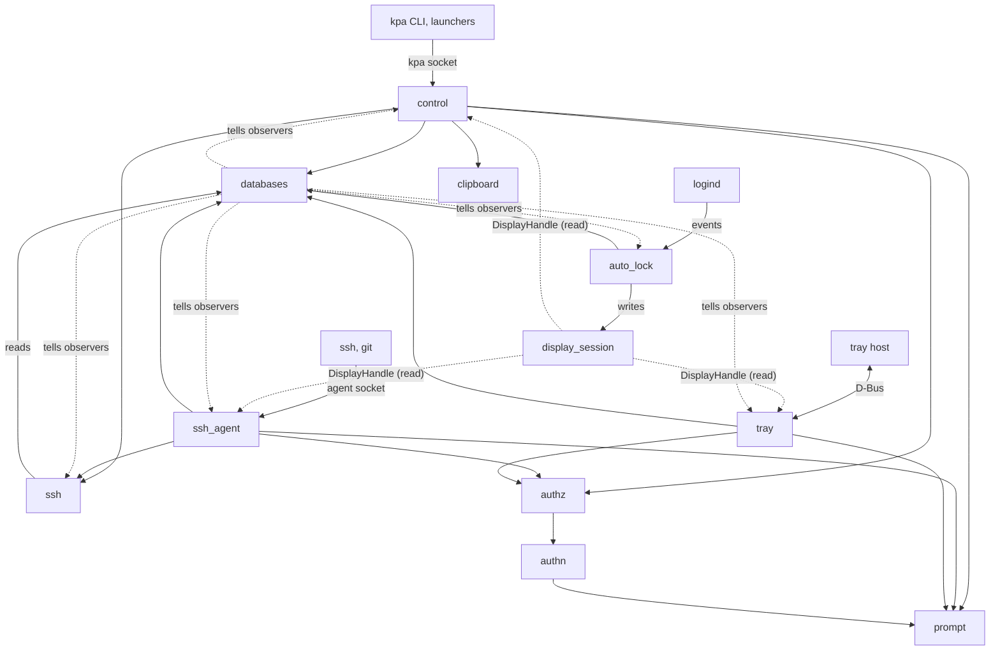

# kpa — design

A small, read-only KeePass agent: holds one or more `.kdbx` files unlocked
in memory, and serves lookups and secret-copy to a launcher and a CLI over a
Unix socket, SSH signatures to `ssh` and `git` over an agent socket, and its
lock state to a tray icon.

This doc says how kpa is put together and why. The docs it leans on:

| Doc | Owns |
|---|---|
| [`protocol.md`](./protocol.md) | the wire: requests, responses, errors |
| [`module-structure.md`](./module-structure.md) | the subsystems, who uses whom, the file layout, how tests are built |
| [`headless.md`](./headless.md) | where a request is asked and where a copy lands, for a requester outside the desktop |
| [`ssh-agent.md`](./ssh-agent.md) | the SSH agent: policy, approvals, the sign flow |
| [`threat-model.md`](./threat-model.md) | what kpa claims to protect, against whom |
| [`portability.md`](./portability.md) | the OS seams, and the rules for keeping them replaceable |
| [`background.md`](./background.md) | the research this rests on |
| [`config.example.toml`](../config.example.toml) | every config key |

## Scope

**Is:** a read-only index and secret-copier for `.kdbx` files, an SSH agent
that signs with the keys stored in them, and a tray icon showing lock state.

**Is not:** a vault editor, a Secret Service provider, a browser backend, or a
replacement for a full-featured KeePass client. A client like that already
covers browser autofill and its own tray. kpa adds what nothing in that
ecosystem provides: free-text search over all entries, a CLI that reuses an
already-unlocked session, and an SSH agent that serves the keys straight from
the daemon instead of pushing them into a separate agent ([`ssh-agent.md`](./ssh-agent.md)).

**Read-only is the defining property.** It is what makes this design safe to
run alongside any KeePass client that already has write access to the same
files (see `background.md` § Direction for why that guarantee matters). The
guarantee is structural: the protocol's op enum (`Op`, in
`src/frontends/control/proto/request.rs`) has no write variants, the agent's
wire layer answers every message that adds, removes, locks or unlocks keys
with a failure, and `keepass` is built without its `save_kdbx4` feature, so
there is no code path that can modify a database.

## Settled decisions

| #   | Decision | Rationale |
| --- | --- | --- |
| 1   | **Rust** | `keepass` (the crate) covers KDBX3/4 + Argon2 + keyfile; `zeroize`; single binary. |
| 2   | **JSON over a Unix socket**, serde | Fewest moving parts; hand-debuggable with `socat`; self-describing. Protobuf was considered and is defensible, but costs `protoc`, a second type system, and ~150 LoC of conversion boilerplate for no benefit at this scale. |
| 3   | **Single binary, two roles** — `kpa serve` + client subcommands | No client/daemon version skew within a release; one build artifact. |
| 4   | **No `get` — `copy` only** | The daemon owns the clipboard, so the secret never enters the client's address space. `get` would print secrets to stdout, into shell history and scrollback. |
| 5   | **Keys: master password + keyfile only** | Challenge-response is deferred. |
| 6   | **TOTP via `keepass`'s `totp` feature, read-only** | `copy` generates the current code from the `otp` field at copy time; the seed never leaves the process. HOTP is permanently out — counters need writes. |
| 7   | **Idle timeout 30 min per database**, config-overridable | logind's `Lock` signal already covers screen-lock; this only catches walking away without locking. |
| 8   | **Daemon autostarts locked** | A tray should show state from login onward, and nothing prompts until something actually asks. |
| 9   | **The daemon asks for the password, never the client**: on screen through a configured `--dmenu`-style program (e.g. `fuzzel --password --dmenu`), or on the terminal the request passed | Trivial to wire up and fits most Wayland setups out of the box. `pinentry` is the better long-term answer for secure memory, but driving Assuan is fiddly, so the prompt is swappable from day one rather than hardcoded. A request from outside the desktop is never asked on screen; the daemon asks on the terminal `kpa unlock` passed, so the password never crosses the socket (§ Unlocking, [`headless.md`](./headless.md) § 4). |
| 10  | **Multiple databases**, TOML array of tables | Per-database unlock, per-database tray state. |
| 11  | **Linux only, with OS-neutral interfaces** | macOS support is planned, so each OS-specific part sits behind an interface a macOS implementation can share. Windows is out of scope. Rules and the list of OS seams: [`portability.md`](./portability.md). |
| 12  | **Subsystem dependencies form a DAG** | Each top-level module exports a small API and depends on others in one direction, with decisions kept pure, so it reads and tests on its own. Rules: [`module-structure.md`](./module-structure.md). |
| 13  | **One stateful core, driven by front ends** | `databases` holds every database and what locks it. `control`, `ssh_agent`, `tray` and `auto_lock` call it through a small Rust API, and none uses another. A new front end is a new module that touches no other, and the core is tested alone (§ The core). |
| 14  | **Observers, not events, tell what a lock must clear** | State that must die with a lock belongs to the module that made it, and the core tells it through an `Observer` after releasing its own lock and before the call returns. A `kpa lock` is then answered with the clipboard offer already ended; an event on a channel would arrive after (§ Locking). |
| 15  | **The front end prompts; the core never does** | Where a prompt may appear is per requester, and its text and what its answer means differ per front end. The core hands out the token that ends the question (§ Unlocking). |
| 16  | **Threads, not async** | `std::thread`, a core behind one mutex, and `ksni`'s blocking API. Most requests are sub-millisecond and the slow ones wait on a human, so a runtime would buy nothing. |

## How it is put together

One long-lived daemon, `kpa serve`, and short-lived clients (every other
`kpa <subcommand>`, and whatever speaks the socket protocol). "Your launcher"
is deliberately generic: kpa doesn't ship or assume a particular launcher,
tray host or keybinding scheme.



`control`, `ssh_agent`, `tray` and `auto_lock` are modules of `frontends`.
The dotted edges from `databases` are calls the core makes through the
`Observer` trait; they are not dependencies. The dotted edges from
`display_session` are reads of a handle. `ssh` stands for `ssh::keys` and
`ssh::approvals`. [`module-structure.md`](./module-structure.md) lists every
subsystem and what it uses.

Five rules shape it:

- **`databases` is the one stateful module.** It holds every configured
  database, whether each is unlocked, and what makes one lock: a lock
  request, the idle timer, a changed file. It knows nothing about a socket, a
  prompt, the clipboard, a display session, the SSH agent or the tray, and it
  uses only the config types, the cancel tokens and `log`. The KeePass reader
  is inside it, and so is every `keepass` type.
- **Front ends drive it.** Each holds a pointer to the one `Databases`, speaks
  one protocol to the outside, and has its own authorization. Only a front
  end unlocks or locks. Besides them, `ssh` reads the core (it is handed a
  guard and told of a lock) and `daemon` builds and wires it.
- **What must die with a lock is owned by whoever made it**, and told through
  an observer (§ Locking).
- **A front end prompts; the core never does** (§ Unlocking).
- **`daemon` is the one place that wires it together**, and the one place
  that lists what reacts to a lock.

### Wiring and threads

`daemon::build` makes the core and registers its observers in this order:

1. what holds a secret: the clipboard offers (`CopyState`), the approvals
   (`ssh::approvals`), the agent's keys (`SshState`);
2. the sleep hold, which tells the sleep inhibitor whether anything is
   unlocked;
3. the tray's `Changed`, which holds nothing.

The order is the point: when a suspend's `lock_all` has let the sleep delay
go, every offer has ended and every private key is gone. `build` also makes
the daemon's one prompt queue (so only one prompt is on screen at a time),
the screen unlock prompt that the agent and the tray share, and the agent's
confirm prompt. It returns the tray beside the daemon, because the tray runs
once on a thread of its own and holds the receiving end of a channel.
`daemon::serve` starts the threads. The in-process daemon the integration
tests use is built by the same function.

| Thread | Does |
|---|---|
| main | accepts on kpa's socket; a thread per connection, capped, and a failed spawn drops that connection and nothing else |
| agent | accepts on the agent socket, if a database serves SSH keys; a thread per connection, capped |
| `auto_lock` | four: the logind watcher, the sleep inhibitor's, the loop that reacts to events, the idle tick |
| tray | the status icon service, and the loop that refreshes it |
| each clipboard offer | a serving thread, and an expiry thread that sleeps `clipboard_timeout` |

The core has no thread: it is plain calls, so a test drives it from one.

## The core: `databases`

`Databases` is one mutex over a slot per configured database, plus the
lifecycle around it. It is `Send + Sync`, built once, shared as an `Arc`. An
unlocked database is read through the `Open` guard, which holds the core's
lock and carries the reads the front ends need and never hands out the
`keepass` database: the index (`entries`), one entry's field, TOTP and
attachments, the entry count, and `touch` (activity: resets the idle timer).
`EntrySummary` and `Attachment` are the core's own types, so no public
signature of `databases` names a `keepass` type and no other subsystem imports
the crate: the audit of what reads vault content is the call sites of these
methods. An attachment is borrowed, never copied, so a private key in it is
not left behind in a buffer nobody wipes.

**What it owns, per database:** the `Database` while unlocked; the path and
the file's fingerprint taken when it was read; the idle timer; the
unlock-in-progress flag; and a source of cancel tokens that every lock
covering the database replaces, which cancels every token taken from the one
before. A token from the current source is *the unlock's token*: it belongs to
the unlock the database is in, or the one that is starting, and the lock that
ends that unlock cancels it for good. Two tokens are equal when they come from
the same unlock.

**What it decides by itself:**

- the freshness guard runs in `open`, `begin_unlock` and `drop_stale`, before
  the access it protects (§ Files and freshness);
- a lock replaces the token source even for a database that is already
  locked, which ends a prompt still waiting for it;
- an unlock installs its database only if its token is still live, so a lock
  beats an unlock;
- idle expiry is per database. What counts as activity is the front end's: it
  calls `touch` on a successful `list`, `copy`, `ssh keys` and local
  signature, and not on `status`, `lock`, a refusal or a forwarded signature.

**What it never does:** prompt, read the display session, classify a
requester, write a file, spawn a thread, or log vault content. It logs the
lines only it can truthfully write: that a database was unlocked, and that the
idle timer locked one. The cause of any other lock is logged by whoever asked
for it.

**Test support.** Unit tests of other subsystems need unlocked databases
without a `.kdbx` file. `databases/testing.rs`, compiled for tests only,
installs an in-memory database through the same path `finish` uses, stages
one for the next unlock, and makes the file look changed, all from plain data
that names no `keepass` type. There is no mock of `Databases`: a mock needs a
trait in front of the core and a second implementation of its lock and token
semantics, which can drift from the real one. The stand-in sits at the lowest
seam, the file read.

## Unlocking

The core owns the steps that have to be atomic; the front end owns every
decision about the prompt. `control`'s `unlock`:

```rust
let unlocking = match databases.begin_unlock(name) {
    Err(BeginError::UnknownDb) => return Err(UnknownDb),
    Err(BeginError::InProgress) => return Err(InProgress),
    Ok(Begin::AlreadyUnlocked) => return Ok(name),
    Ok(Begin::Started(unlocking)) => unlocking,
};
// Read the display session only now, after the unlock's token exists.
let place = authz::choose_unlock_prompt(requester, &display.get())?;
let password = ask(place, unlocking.unlock_token())?;   // screen, or the passed terminal
// An empty answer is "no password": the way to a keyfile-only database.
unlocking.finish(Some(&password).filter(|p| !p.is_empty()))?;  // key derivation, then install
```

`begin_unlock` runs the freshness guard, answers `AlreadyUnlocked` for an
unlocked database, `InProgress` if another unlock holds the claim, and
otherwise takes the claim and the unlock's token. Dropping the `Unlocking`
clears the claim, so every way out, an early return or a panic included, ends
the unlock. `finish` derives the key outside the core's lock and installs the
database only if no lock has ended the unlock meanwhile.

The three front ends that unlock run the same four steps with their own gate
and their own words:

| Front end | Gate | Asks | Refusals |
|---|---|---|---|
| `control` | `choose_unlock_prompt`: the place the request prefers, if a prompt may appear there; else the screen where one may; else the terminal it passed; else `no_prompt` | the screen unlock prompt, or a terminal prompt built for the request | wire errors ([`protocol.md`](./protocol.md)) |
| `ssh_agent` | `may_prompt_on_screen`: the requester is on the desktop and the display session allows a prompt | the screen, with its own message naming the key and destination | its own, in its log line |
| `tray` | `display_allows_prompt`: there is a display session and it isn't known to be locked. A click has no requester | the screen | a label in the tooltip |

Where a request may be asked, how a requester is classified as on or outside
the desktop, and how a terminal is asked are in [`headless.md`](./headless.md)
§§ 2–4. The password is borrowed for the call into the reader and the core
keeps no copy; it never rides a request or a response.

**Why this order.** A screen lock is "mark the display session locked, then
lock every database" (`auto_lock::react` does both, in that order). An unlock
that takes its token and then reads the display session meets that in one of
three ways:

- the lock came before the token: the read sees the mark, so no prompt is
  raised on screen (the unlock asks on the terminal the requester passed, or
  is refused with `no_prompt`);
- the lock fell between the token and the read: the read sees the mark too,
  and the token is already cancelled;
- the lock comes after the read: it cancels the token the unlock holds, which
  kills the prompt it raised.

No interleaving raises a prompt behind the locker. An unlock that read the
display session first and took its token second would have one: read
"unlocked", the whole screen lock, then a token from the next unlock. The order
is a rule of the API, not something the types enforce, and a test walks the
three cases.

**The refusal order.** An unlock for a database whose unlock is already in
progress is answered `unlock_in_progress` even from a requester who couldn't
be asked: the claim is taken by `begin_unlock`, before authorization.

**Prompts are bounded.** A prompt left unanswered for `prompt_timeout`
(default 60 s) is ended and the unlock fails with `prompt_cancelled`. A lock
of the database ends its prompt, on screen or on a terminal. A prompt on screen
runs in its own process group, which is killed with it, so a wrapper script's
own window goes too. Only one prompt is on screen at a time: prompts for
different databases share a queue, and one still waiting its turn is
cancelled the moment a lock lands on its database.

## Locking

Locking means: drop the `Database`, zeroize what can be zeroized, end what
the database's unlock made (next), and tell the tray. A lock also cancels any
unlock still in flight for that database, and ends its prompt.

### What dies with a lock

Each of these goes at once ([`threat-model.md`](./threat-model.md) G-5, G-6),
and each belongs to the module that made it:

| State | Owner |
|---|---|
| served keys, cached private keys | `ssh_agent::SshState` |
| approvals and pending requests, entry titles included | `ssh::approvals::Approvals` |
| the clipboard offers a `copy` started | `control::CopyState` |
| the sleep inhibitor's hold | `auto_lock::SleepHold` |
| the tray's display of what is unlocked | `tray::Changed` |
| an unlock's prompt and its answer | the unlock's token |

The first five are observers; the last is not.

```rust
pub trait Observer: Send + Sync {
    /// `db` was unlocked. The core's lock is not held, so it may take it.
    fn unlocked(&self, _databases: &Databases, _db: &str, _unlock: &CancelToken) {}
    /// A lock covered `db`, unlocked or not. `unlock` is the token of the
    /// unlock it ended.
    fn locked(&self, _databases: &Databases, _db: &str, _unlock: &CancelToken) {}
}
```

**When they run.** After the core's mutex is released, in the thread that
caused the change, before the call returns. So when `kpa lock` is answered the
clipboard offer has ended. They run in the order `daemon` registered them, each
told of every database the lock covered before the next is told anything. An
observer is free to block (ending an offer waits for the compositor) and to
call back into the core; it doesn't panic, because a panic skips the observers
after it.

**The unlock's token makes them safe to run late.** Each observer tags what it
holds with the token of the unlock it was made for and compares on every use:
`locked(db, unlock)` drops the state tagged with `unlock` and nothing else, so
a notice for an old unlock that arrives after a new unlock began can't wipe
the new state; a use that finds state tagged with another unlock's token
starts afresh; and a front end that read or prompted during an unlock checks
its token before it acts on the answer. "A lock beats an unlock" holds because
the token check and the lock are ordered by the core's mutex. A `copy`'s
clipboard offers are recorded one per offer, and a lock ends every offer of the
unlock it ended, so two overlapping copies leave nothing a lock can't end.

**Lock order.** The core's lock, then the agent's state (`SshState`), then
approvals. Each takes only its own lock in `Observer::locked`; `unlocked` may
take the core's lock first (`SshState` does, to scan under it) and its own
second. Nothing takes them the other way round, and a guard from `open` must
not outlive a call that needs the core.

### Triggers

| Trigger | Source |
|---|---|
| Screen lock | logind session `Lock` signal, or `LockedHint` becoming true, on the user's display session (`User.Display` of `Manager.GetUser(uid)`). Covers `loginctl lock-session` and `IdleAction=lock`; a locker that calls neither is invisible (threat model ASM-7) |
| Suspend | logind `PrepareForSleep(true)`: lock everything, then release the `delay` sleep inhibitor. kpa holds it while anything is unlocked. Logind allows `InhibitDelayMaxUSec` (5 s default) before sleeping regardless |
| Lost watch | the connection to the bus drops, or logind's name changes owner (a restart): every database locks, and the subscription is re-established with backoff, resolving the new owner |
| Idle | per database: no successful `list` of it (a `list` of all counts for each database it reads), and no `copy`, `ssh keys`, local signature or unlock that installed it, for `idle_timeout` (default 30m); `status` and `lock` don't count |
| Explicit | `kpa lock`, or the tray menu |
| File changed | the freshness guard, at the next request that reads the database, `status` included (§ Files and freshness) |

### The display session

`display_session.rs` holds the `DisplaySession` type (no display session, or
one with its logind id, whether its `LockedHint` is set and whether it is
`Active`) and the pair `channel()` returns: one `DisplayWriter`, which
`auto_lock` holds, and `DisplayHandle`s for `authz`, the clipboard and the other
front ends, which read it. `auto_lock` writes the display session *before* it
locks: a locked display session is marked locked before anything is locked, a
lock request alone doesn't mark it, and a lost watch forgets it (the state is
unknown until the watch is back). So "marked before everything is locked" is
true by construction, and the core never sees a display session. `Active`
never locks anything and never feeds the prompt gate: counting a session you
VT-switched away from as locked would lock the vault for that. Only
`LockedHint` locks, and only `copy`'s gate reads `Active`.

### What a lock clears

- **Cleared:** protected field values (`secrecy` types), `DatabaseKey`'s own
  copies of the password and keyfile, and every copy kpa itself makes — the
  prompt's output buffer, `list` entries, the serialized response buffer, the
  agent's private keys — all zeroized on drop; and a clipboard offer still
  served by the unlock being locked, which is ended at once rather than left to
  its own `clipboard_timeout`. A lock of a different database leaves the
  clipboard alone.
- **Not cleared, upstream:** unprotected field values (plain `String`s inside
  `keepass`), the decrypted and decompressed payload buffers `keepass` parses
  from, its key-derivation intermediates, its XML keyfile parser's working
  copies. These persist in freed heap pages until the allocator reuses them.

Lock stops serving the database and clears what kpa owns; it is not a
guarantee that no trace of the plaintext remains in the process's memory.

## Front ends

Each front end owns its listener (or equivalent), how it learns who is asking
(`authn`: a `Requester`, read once per connection), what that requester may do
(`authz`: pure functions of a `Requester` and the display session, judged each
time they are asked), and its handlers. None of it is shared logic: they are
different protocols with different refusals, prompts and consequences.

### `control`: kpa's own socket

- **Transport** (`serve.rs`): bind, accept, the connection cap, the request
  size and I/O limits, a zeroizing request buffer, one request and one response
  per connection. A peer whose uid isn't the daemon's is dropped without a
  reply.
- **Handlers**: `Api` holds what they share (the core, the display handle, the
  screen unlock prompt, `CopyState`, the approvals state) and has one plain
  method per op, dispatched by a `match`. There is no trait per op: a second
  implementor is the only reason for one.
- **Unlock** (`unlock.rs`): begin, choose where to ask, ask, finish
  (§ Unlocking). **`copy`** reads the value under the guard, takes the unlock's
  token from the same guard, hands the secret to the clipboard after the guard
  is dropped, and records the offer for that unlock; a lock that overtook it
  ends the offer itself.
- **`ssh keys`, `ssh pending`, `ssh approve`** scan or call `ssh::approvals`
  with the guard of each database in config order.
- It owns `CopyState`: the clipboard backend, and a record of every live offer
  and the unlock it came from.

### `ssh_agent`: the SSH agent socket

The agent protocol, per-connection `session-bind` state and frame limits; its
own policy (`authorize_sign`, `may_prompt_on_screen`); and the state it owns:
`SshState`, per database and per unlock, holding the served keys from the scan
at unlock and the private keys read at first use, with the prompt backoff
beside it, which outlives a lock. It reads a database through a `Hold`: the
core's guard, then its own lock, then approvals. A locked database, or one
unlocked but not yet scanned, is held without the guard: it lists from the
public-key cache and a signature is refused as locked. A one-signature
approval is checked, signed with and spent inside one hold of the guard.
Unlock on demand is its own four steps with its own refusals. The sign flow,
the turns, the backoff and the hints are [`ssh-agent.md`](./ssh-agent.md)'s.

### `tray`: the status icon

`ksni`, a StatusNotifierItem over D-Bus: any host (a bar, a KDE/GNOME panel)
picks it up with no extra work on kpa's side. The icon reflects aggregate state
(all locked, some unlocked, error), the tooltip lists each database, and the
menu is a per-database submenu (Lock, Unlock), then Lock all, then Quit. No tray
host at all, including `kpa serve` starting before one exists or one
disappearing and coming back, is a normal state: kpa keeps running and
registers as soon as a host is there.

The tray calls the core directly and has no requester: a click can't be traced
to a caller, so its one gate is `authz::display_allows_prompt`, and a lock needs
none. It learns of every lock and unlock through an observer that only sends on
a channel; its loop then has the service re-read `databases.snapshot()`. The
observer must not call the service itself: the service holds its lock while it
runs a menu callback, and a menu "Lock" runs `databases.lock`, which tells the
observer.

### `auto_lock`: when databases lock besides a request

The OS side of the lock triggers, and what each means. `logind.rs` watches the
user's display session, a lock request, suspend and the watch itself, turns
them into `Event`s, and holds the sleep inhibitor on a thread of its own, so no
request ever waits on D-Bus. It accepts a logind message only from the unique
name that owns `org.freedesktop.login1`, and a change of that owner ends the
watch. `mod.rs` is OS-neutral and names no D-Bus type: a loop with one reader
of one channel of events. A display change is written to the display session
first, and locks everything if it says locked; a lock request, a suspend and a
lost watch lock everything (a lost watch first forgets the display session).
Then the loop decides the inhibitor. `SleepHold`, an observer,
sends after every change whether anything is unlocked, so the loop hears the
states in the order they happened. The inhibitor is held exactly while
something is unlocked and the machine is awake, and on suspend it is released
only after everything is locked.

### `ssh`: what `control` and `ssh_agent` share

`ssh::keys` finds the SSH keys in an open database, resolves them against the
config and reads and writes the public-key cache. `ssh::approvals` holds what
the user approved and the requests refused for want of an approval, per
database and per unlock, behind its own lock, as an observer that drops what a
lock ended. Its calls take the core's guard, so a caller shows it holds it, and
the state a call sees is the one of that guard's unlock. It reads the core and
never unlocks or locks.

## Protocol

kpa's own socket speaks line-delimited JSON, **exactly one request and one
response per connection**: "which response is this?" is answered by which
socket it arrived on, and a client that wants several ops opens several
connections. `v` is checked on every request and a mismatch is rejected, not
negotiated. The ops are `status`, `unlock`, `lock`, `list`, `copy`,
`ssh_keys`, `ssh_pending` and `ssh_approve`. No request carries the master
password.

**`list` never returns secrets** — it is an index. A field the user marked
protected is omitted, not de-protected, and `fields` names what `copy` can be
asked for, never a value.

A `list` or `ssh keys` for every database reads each one under its own guard of
the core, one after another, so a lock can land between two of them.

Requests, responses, errors, the field collision rule and version skew are in
[`protocol.md`](./protocol.md).

## Files and freshness

A KeePass client and kpa can both have the file open at once. Clients write
through a temp file and a rename, so a reader never sees a half-written file,
and there is no per-database lock file to contend with (`background.md`
§ Direction has what was checked). So the rules are:

1. **Never create a lock file. Never hold an fd.** Open, read the whole file,
   close, parse: a few MB, once per unlock. One known exception, upstream: a
   file with pathological KDF parameters can make `keepass` hang mid-unlock, and
   that unlock holds its fd (and a core) for as long as it hangs.
2. **Never write.** Guaranteed by the shape of `Op` and the agent's wire layer.
3. **Freshness guard** (threat model T-12, G-8). The core records the file's
   `(dev, ino, size, mtime, ctime)`, with nanoseconds on both times, by `fstat`
   on the fd that was read, before and after the read; a difference fails the
   unlock with `stale`. Before each use of an unlocked database it `stat`s the
   path, and any difference locks the database and answers `stale`: another
   client saving, or a sync tool landing a new copy, both cause this, and
   serving stale entries silently is the worse failure. The check happens at
   the next request that reads the database (`status` included), not at the
   moment the file changes.

   The `stat` runs without the core's lock, on a thread per file, under a
   2 s deadline, and a file that hasn't answered by then counts as changed: a
   mount that stops answering must not hold up a lock. The check copies what it
   needs and the unlock's token under the lock, releases it, `stat`s, takes the
   lock again and applies the verdict only if the token is still the slot's.
   `open` returns its guard from the hold that applied the verdict, so the check
   comes before the guard.

   ctime catches a restored mtime, since user space can't set ctime, and the
   `fstat` on the read fd closes the window between the read and the stat. What
   the guard doesn't catch (a same-size write inside one coarse timestamp,
   substitution or rollback while locked) is T-12's and T-17's.

4. **Concurrency.** Connections are accepted concurrently (bounded: a flood is
   refused rather than turned into unbounded threads) and the core is one
   mutex. Most requests are sub-millisecond. `unlock` is the exception —
   milliseconds to seconds, waiting on the prompt and the KDF — and it releases
   the mutex for that slow part, which is what the unlock's token guards: a
   lock cancels it, and an unlock installs only if it is still live.

## Clipboard

kpa's own Wayland client (`src/clipboard/wayland/`), in-process — **not** by
spawning `wl-copy`. The Wayland clipboard is pull-based: the owning client must
stay alive to serve bytes on paste, which is why `wl-copy` forks. Since kpa is
already long-lived it owns the offer itself. The client speaks
`ext-data-control`, falling back to `wlr-data-control`, so it can own the
clipboard without ever holding keyboard focus, which a daemon never has. Each
offer has its own connection and serving thread.

**Which compositor.** The daemon usually starts before the compositor, and a
process's environment never changes after it starts, so its own
`WAYLAND_DISPLAY` is no use. Each `copy` reads `WAYLAND_DISPLAY` from the
service manager's environment instead (`org.freedesktop.systemd1.Manager`'s
`Environment`, on the session bus), where the compositor exports it. The name
is a hint, checked before any secret is sent: it must be a bare socket name,
resolved in the daemon's own `$XDG_RUNTIME_DIR` (a path is refused), and the
process listening on that socket must be the daemon's uid and on the desktop.
The copy then runs over the connection that was checked. A compositor that
doesn't export `WAYLAND_DISPLAY` to the service manager can't be copied to.

Two MIME types are offered: `text/plain;charset=utf-8` and
`x-kde-passwordManagerHint` with value `secret`, which clipboard-history
managers check to skip passwords.

**`copy` needs a desktop requester on an active, unlocked display session**
([`headless.md`](./headless.md) § 5). Anything else fails with `no_display` and
the clipboard is never touched.

**Expiry is correct by construction because we own the source.** After
`clipboard_timeout`, an expiry thread ends the offer. If the user copied
something else meanwhile, the compositor already replaced our source and ending
it does nothing: no content comparison, no race, no risk of wiping someone
else's clipboard. A lock of the unlock the offer came from ends it earlier.

## Secrets

**Boundary: the user account.** Inside it, optimise for blast radius and time,
not caller identity (`background.md` § "Security boundary").

Held while unlocked:

| Item | Held? |
|---|---|
| Master password | No — kpa's copies zeroized after key derivation¹ |
| Keyfile path | Yes (a path; harmless) |
| Keyfile contents | No — kpa's buffer zeroized; `keepass`'s parse copies not² |
| Decrypted database | **Yes** — the real exposure, same as any KeePass client |

¹The password arrives on the prompt command's stdout, or from a terminal the
daemon reads, and kpa reads it into a fixed-size `Zeroizing` buffer that never
grows (a growing buffer would leave unwiped copies behind each time it
reallocates), then into a `Zeroizing<String>`. The CLI never holds it, and it
is in no request or response. Two copies are outside kpa's reach: whatever the
prompt program itself held, and `keepass`'s key-derivation intermediates (e.g.
the SHA-256 of the password, which is password-equivalent), which are not
zeroized upstream.

²`DatabaseKey`'s keyfile bytes are zeroized, but `keepass`'s XML keyfile parser
makes several unzeroized intermediate copies, which together can cover the whole
key and can survive a lock. Upstream.

**How secrets cross the core's edge:**

| Secret | How it crosses | Where it ends |
|---|---|---|
| master password, keyfile path | borrowed into `Unlocking::finish`; the core keeps nothing | zeroized by the front end that read it |
| the decrypted database | never leaves `databases`; a front end gets what `Open`'s methods return | those methods only |
| a protected field's value | copied by `Entry::field` or `totp` into a `Zeroizing<String>` | the clipboard offer |
| entry metadata | `Open::entries` into zeroize-on-drop summaries | a response, serialized into a zeroizing buffer |
| an SSH private key | parsed from an attachment `Open` lends, into a type that zeroizes on drop | `SshState`, until its unlock's token is cancelled |

The core has no output channel: it writes no file and no socket, and its log
lines carry database names only. So the places a secret can reach disk, a log
or another process are the front ends and the clipboard, and the audit of
"nothing persisted" (G-4) is a search for the call sites of `Open`'s and
`Entry`'s read methods, and for `keepass::` outside `databases` (there are
none). Where each lock-related goal is enforced:

| Goal | Enforced in |
|---|---|
| G-5 locks on screen lock, suspend, idle, request, changed file; a lock beats an unlock; a lock ends a prompt | `databases` (idle, request, changed file, tokens), `auto_lock` (events, suspend) |
| G-6 a lock clears what kpa owns | `databases` drops the `Database`; every observer registered in `daemon` clears the rest |
| G-8 freshness | `databases::{open, begin_unlock, drop_stale}` |
| G-12 no prompt where nobody can see it | `authz` checks, each front end's use of them, the order in § Unlocking |
| G-11 robust socket | `control` and `ssh_agent` transports |

**Hardening.** Every kpa process sets `PR_SET_DUMPABLE=0` at startup, before
dispatching to any subcommand and before `kpa serve` reads its config. That
keeps a crash from writing a user-readable core dump of whatever secret the
process holds, and makes `/proc/<pid>/mem` root-owned, which blocks same-uid
ptrace regardless of Yama. Properties of the machine rather than of kpa, worth
verifying: `/proc/sys/kernel/yama/ptrace_scope` is `1` on most distros; zram
swap reduces the chance that key material is paged to disk but hibernation or a
disk-backed swap defeat it; with `fs.suid_dumpable = 2` the kernel still writes
a root-owned dump.

**What a log line may contain.** The operation, the database name, the error
kind, and for a copy the field name and the entry's title (so the log says which
secret left, not just which field). Never passwords, protected fields (a
protected title is replaced by the entry's uuid), usernames, URLs or any other
vault content, at any level: a log outlives the unlocked session and ends up
somewhere far less guarded than the socket (threat model TB-7). Reads (`status`,
`list`) are not logged at all. Control characters in a line are escaped, so a
crafted name in a request can't forge a second line. Every line goes through
`log::log`, so that is the one function to audit.

**Non-goals, stated explicitly:** kpa does not defend against an attacker who
already has code execution as the user running it. Nothing at this layer can
([`threat-model.md`](./threat-model.md) NG-1). It reduces casual exposure —
clipboard leakage into history managers, an unlocked vault overnight, secrets in
shell scrollback — and that is the whole claim.

## Configuration and logging

`$XDG_CONFIG_HOME/kpa/config.toml`. Every setting is a plain TOML value, so the
file can be generated rather than hand-edited; [`config.example.toml`](../config.example.toml)
documents every key.

```toml
idle_timeout = "30m"
prompt = ["sh", "-c", "exec fuzzel --dmenu --password --prompt \"$KPA_PROMPT_MESSAGE\""]
prompt_timeout = "60s"         # an unanswered prompt is killed after this
clipboard_timeout = "30s"
log_level = "info"             # error | warn | info | debug

[[database]]
name    = "personal"           # stable id used in requests and the tray
path    = "~/vault/personal.kdbx"
keyfile = "~/.keys/personal.key"   # optional

[[database]]
name = "work"
path = "~/vault/work.kdbx"
```

`prompt` runs exactly as configured, and what the unlock is about reaches the
program through `KPA_PROMPT_MESSAGE` in its environment, not its argv. A leading
`~/` in `path` or `keyfile` expands to `$HOME` when the daemon starts; `~user/`
is refused, and other relative paths resolve against the daemon's working
directory.

`serve` writes one line per event to stderr at `error`, `warn`, `info` (the
default) or `debug`; `log_level` in the config sets it and `serve --log-level`
overrides it. `info` carries every unlock, lock (idle, screen-lock and suspend
included) and copy; `warn` failed or refused requests and connections; `debug`
why. Under systemd each line carries a `<N>` syslog priority prefix so
`journalctl -p warning` filters by level, and journald stamps the time; elsewhere
a line starts with a local RFC 3339 timestamp. What a line may contain is under
§ Secrets.

## Deferred

- YubiKey challenge-response (note for whenever this lands: don't reuse the
  key's own PIN as a vault credential — it collapses a two-factor property into
  one)
- `kpa get` behind an explicit flag
- `pinentry` as the prompt
- The legacy KeeOtp `TimeOtp-*` fields: a different, older convention from the
  de-facto-standard `otp` field, which `keepass`'s `totp` feature does not parse

What comes next is in [`TODO.md`](../TODO.md).
