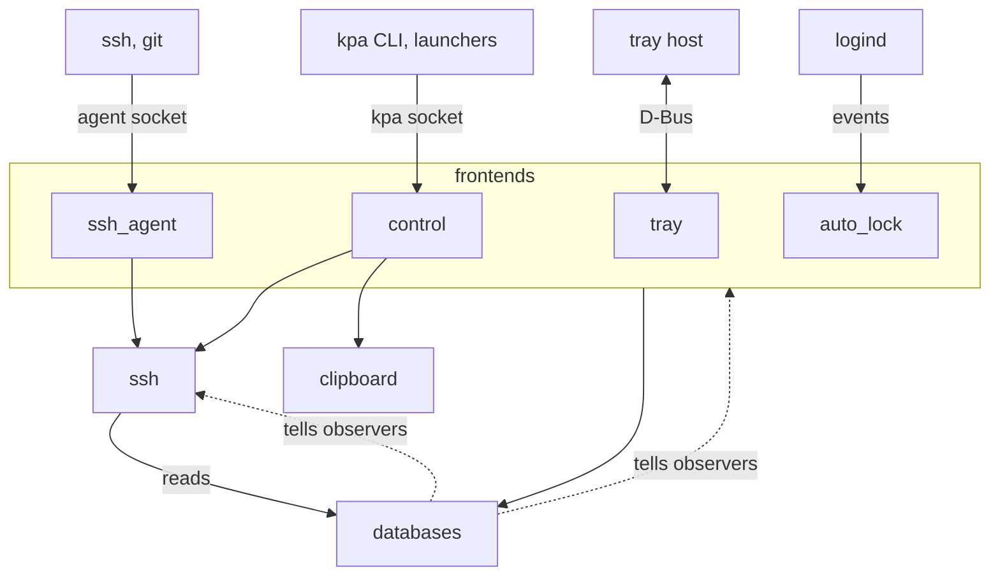

# kpa — design

A small, read-only KeePass agent: holds one or more `.kdbx` files unlocked
in memory, and serves lookups and secret-copy to a launcher and a CLI over a
Unix socket, SSH signatures to `ssh` and `git` over an agent socket, and its
lock state to a tray icon.

This doc says how kpa is put together and why; the detail of each piece is in
the doc or the module that owns it:

| Doc | Owns |
|---|---|
| [`protocol.md`](./protocol.md) | the wire: requests, responses, errors |
| [`module-structure.md`](./module-structure.md) | the subsystems, who uses whom, the file layout, how tests are built |
| [`headless.md`](./headless.md) | where a request is asked and where a copy lands, for a requester outside the desktop |
| [`ssh-agent.md`](./ssh-agent.md) | the SSH agent: policy, approvals, the sign flow |
| [`threat-model.md`](./threat-model.md) | what kpa claims to protect, against whom |
| [`portability.md`](./portability.md) | the OS seams, and the rules for keeping them replaceable |
| [`config.example.toml`](../config.example.toml) | every config key |

## Scope

**Is:** a read-only index and secret-copier for `.kdbx` files, an SSH agent
that signs with the keys stored in them, and a tray icon showing lock state.
It reads KDBX3 and KDBX4 files and no other format. `keepass` also parses
KeePass 1.x (KDB), but that format's header, with the counts of groups and
entries that decide how much of the file is read, is covered by no hash or
MAC, so a file whose header was edited without the key would open with
entries missing; kpa refuses it (`unlock` answers `corrupt`, with a `detail`
that says the format is not read) before the key is used.

**Is not:** a vault editor, a Secret Service provider (an unlocked Secret
Service collection takes new items from any app, ungated), a browser backend,
or a replacement for a full-featured KeePass client, which already covers browser
autofill and its own tray. kpa adds free-text search over all entries, a CLI
that reuses an already-unlocked session, and an SSH agent that serves the keys
straight from the daemon instead of pushing them into a separate agent.

**Read-only is the defining property.** It is what makes this design safe to
run alongside any KeePass client that already has write access to the same
files. The guarantee is structural: the
protocol's op enum (`Op`, in `src/frontends/control/proto/request.rs`) has no
write variants, the agent's wire layer answers every message that adds,
removes, locks or unlocks keys with a failure, and `keepass` is built without
its `save_kdbx4` feature, so no code path can modify a database.

## Settled decisions

| #   | Decision | Rationale |
| --- | --- | --- |
| 1   | **Rust** | `keepass` (the crate) covers KDBX3/4 + Argon2 + keyfile; `zeroize`; single binary. |
| 2   | **JSON over a Unix socket**, serde | Fewest moving parts; hand-debuggable with `socat`; self-describing. Protobuf was considered and is defensible, but costs `protoc`, a second type system, and ~150 LoC of conversion boilerplate for no benefit at this scale. |
| 3   | **Single binary, two roles** — `kpa serve` + client subcommands | No client/daemon version skew within a release; one build artifact. |
| 4   | **No `get` — `copy` only** | The daemon owns the clipboard, so the secret never enters the client's address space. `get` would print secrets to stdout, into shell history and scrollback. |
| 5   | **Keys: master password + keyfile only** | Challenge-response isn't supported. |
| 6   | **TOTP via `keepass`'s `totp` feature, read-only** | `copy` generates the current code from the `otp` field at copy time; the seed never leaves the process. HOTP is permanently out — counters need writes. |
| 7   | **Idle timeout 30 min per database**, config-overridable | logind's `Lock` signal already covers screen-lock; this only catches walking away without locking. |
| 8   | **Daemon autostarts locked** | A tray should show state from login onward, and nothing prompts until something actually asks. |
| 9   | **The daemon asks for the password, never the client**: on screen through a configured `--dmenu`-style program (e.g. `fuzzel --password --dmenu`), or on the terminal the request passed | Trivial to wire up and fits most Wayland setups out of the box. The prompt is a command in config, so any program that prints the password works, `pinentry` included through a short wrapper that speaks its Assuan protocol. A request from outside the desktop is never asked on screen; the daemon asks on the terminal `kpa unlock` passed, so the password never crosses the socket (§ Unlocking). |
| 10  | **Multiple databases**, TOML array of tables | Per-database unlock, per-database tray state. |
| 11  | **Linux only, with OS-neutral interfaces** | macOS support is planned, so each OS-specific part sits behind an interface a macOS implementation can share. Windows is out of scope. Rules and the OS seams: [`portability.md`](./portability.md). |
| 12  | **Subsystem dependencies form a DAG** | Each top-level module exports a small API and depends on others in one direction, with decisions kept pure, so it reads and tests on its own. Rules: [`module-structure.md`](./module-structure.md). |
| 13  | **One stateful core, driven by front ends** | `databases` holds every database and what locks it. The front ends call it through a small Rust API and none uses another, so a new one is a new module that touches no other, and the core is tested alone. |
| 14  | **Observers, not events, tell what a lock must clear** | State that must die with a lock belongs to the module that made it, and the core tells it through an `Observer` before the lock call returns. A `kpa lock` is then answered with the clipboard offer already ended; an event on a channel would arrive after. |
| 15  | **The front end prompts; the core never does** | Where a prompt may appear is per requester, and its text and what its answer means differ per front end. The core hands out the token that ends the question. |
| 16  | **Threads, not async** | `std::thread`, a core behind one mutex, and `ksni`'s blocking API. Most requests are sub-millisecond and the slow ones wait on a human, so a runtime would buy nothing. |
| 17  | **`kpa pick` runs the user's `fzf`, found on `PATH`, with no preview pane** | `list` is an index and the matching is the picker's (`protocol.md` § What `list` returns), so kpa borrows one instead of writing a matcher. A package dependency would make every install carry a program only `pick` runs. Each line already shows the title, username and database, and a preview would add only the URL and field names, at the cost of a program run and a request per cursor move. |

## How it is put together

One long-lived daemon, `kpa serve`, and short-lived clients (every other
`kpa <subcommand>`, and whatever speaks the socket protocol). "Your launcher"
is deliberately generic: kpa doesn't ship or assume a particular launcher or
tray host. It ships one terminal picker, `kpa pick` (§ The picker), and the
home-manager module offers an optional shell key binding for it, off by default.



`ssh` is what the first two front ends share about SSH keys and approvals. The
dotted edges are calls the core makes through `Observer`; they are not
dependencies. The front ends also use `prompt`, `authn` and `authz`, and read the
display session `auto_lock` writes; [`module-structure.md`](./module-structure.md)
has every subsystem and what it uses.

`databases` is the one stateful module: it holds every database and what makes
one lock, and knows nothing about a socket, a prompt, the clipboard, a display
session, the SSH agent or the tray (§ The core). The front ends drive it, and
only they unlock or lock; `ssh` only reads it, through a guard a front end hands
it. What must die with a lock is owned by whoever made it and told through an
observer (§ Locking), and a front end prompts, never the core (§ Unlocking).
`daemon` is the one place that wires it together and lists what reacts to a
lock.

`daemon::build` registers the observers in this order: what holds a secret
(the clipboard offers, the approvals, the agent's keys), then the sleep hold,
then the tray's. The order is the point: when a suspend's `lock_all` has let
the sleep delay go, every offer has ended and every private key is gone. The
integration tests build the daemon with the same function; the threads `serve`
starts are listed in `daemon.rs`.

## The core: `databases`

`Databases` is one mutex over a slot per configured database, `Send + Sync`,
shared as an `Arc`. An unlocked database is read through the `Open` guard,
which holds the core's lock and carries the reads the front ends need (the
index, one entry's field, TOTP and attachments, `touch` for activity) and never
hands out the `keepass` database. No public signature names a `keepass` type
and no other subsystem imports the crate, so the audit of what reads vault
content is the call sites of those methods.

Per database it owns the `Database` while unlocked, the file's fingerprint
taken when it was read, the idle timer, an unlock-in-progress flag, and a
source of cancel tokens that every lock covering the database replaces,
cancelling every token taken from the one before. A token from the current
source is *the unlock's token*: it belongs to the unlock the database is in,
and the lock that ends that unlock cancels it for good.

It decides by itself that the freshness guard runs before any access (§ Files
and freshness); that a lock replaces the token source even for a database
already locked, which ends a prompt still waiting for it; that an unlock
installs only if its token is still live, so a lock beats an unlock; and that
idle expiry is per database. What counts as activity is the front end's: it
calls `touch`.

It never prompts, reads the display session, classifies a requester, writes a
file, spawns a thread or logs vault content. Other subsystems' tests use its
in-memory stand-in; there is no mock of it (`module-structure.md` § Testing).

## Unlocking

The core owns the steps that have to be atomic; the front end owns every
decision about the prompt. `control`'s `unlock`:

```rust
let unlocking = match databases.begin_unlock(name) {
    Err(BeginError::UnknownDb) => return Err(UnknownDb),
    Err(BeginError::InProgress) => return Err(InProgress),
    Ok(Begin::AlreadyUnlocked) => return Ok(name),
    Ok(Begin::Started(unlocking)) => unlocking,
};
// Read the display session only now, after the unlock's token exists.
let place = authz::choose_unlock_prompt(requester, &display.get())?;
let password = ask(place, unlocking.unlock_token())?;   // screen, or the passed terminal
// An empty answer is "no password": the way to a keyfile-only database.
unlocking.finish(Some(&password).filter(|p| !p.is_empty()))?;  // key derivation, then install
```

`begin_unlock` runs the freshness guard and takes the database's one unlock
and its token; dropping the `Unlocking` gives the claim back, so every way out,
a panic included, ends the unlock. `finish` derives the key outside the core's
lock and installs only if no lock has ended the unlock meanwhile. The password
is borrowed for the call and the core keeps no copy.

The three front ends that unlock run the same four steps with their own gate:

| Front end | Gate | Asks |
|---|---|---|
| `control` | `choose_unlock_prompt`: the place the request prefers, if a prompt may appear there; else the screen where one may; else the terminal it passed; else `no_prompt` | the screen, or a terminal prompt built for the request |
| `ssh_agent` | `may_prompt_on_screen`: the requester is on the desktop and the display session allows a prompt | the screen, with a message naming the key and destination |
| `tray` | `display_allows_prompt`: there is a display session and it isn't known to be locked (a click has no requester) | the screen |

How a requester is classified as on or outside the desktop, and how a terminal
is asked, are [`headless.md`](./headless.md) §§ 2–4.

**Why this order.** A screen lock is "mark the display session locked, then
lock every database". An unlock that takes its token and then reads the
display session meets that in one of three ways: the lock came before the
token (the read sees the mark, so no prompt is raised on screen), between the
token and the read (the read sees the mark, and the token is already
cancelled), or after the read (it cancels the token, which kills the prompt).
No interleaving raises a prompt behind the locker; reading first and taking the
token second would (read "unlocked", the whole screen lock, then a token from
the next unlock). The order is a rule of the API, not of the types, and a test
walks the three cases.

**Refusals and bounds.** An unlock for a database whose unlock is already in
progress is `unlock_in_progress` even from a requester who couldn't be asked:
the claim is taken before authorization. A prompt is ended by `prompt_timeout`
(default 60 s) or by a lock of its database, and prompts share one queue, so a
prompt still waiting its turn is cancelled the moment its database locks.

## Locking

A lock drops the `Database`, cancels any unlock still in flight for it (which
ends its prompt), and ends what that unlock made. Each of these goes at once
([`threat-model.md`](./threat-model.md) G-5, G-6), and each belongs to the
module that made it:

| State | Owner |
|---|---|
| served keys, cached private keys | `ssh_agent::SshState` |
| approvals and pending requests, entry titles included | `ssh::approvals::Approvals` |
| the clipboard offers a `copy` started | `control::CopyState` |
| the sleep inhibitor's hold | `auto_lock::SleepHold` |
| the tray's display of what is unlocked | `tray::Changed` |
| an unlock's prompt and its answer | the unlock's token |

The first five are observers; the last is not.

```rust
pub trait Observer: Send + Sync {
    /// `db` was unlocked. The core's lock is not held, so it may take it.
    fn unlocked(&self, _databases: &Databases, _db: &str, _unlock: &CancelToken) {}
    /// A lock covered `db`, unlocked or not. `unlock` is the token of the
    /// unlock it ended.
    fn locked(&self, _databases: &Databases, _db: &str, _unlock: &CancelToken) {}
}
```

Observers run after the core's mutex is released, in the thread that caused
the change, before the call returns: when `kpa lock` is answered, the clipboard
offer has ended. Each tags what it holds with the token of the unlock it was
made for and compares on every use, so a notice that arrives late for an old
unlock can't touch a new one's state; "a lock beats an unlock" holds because
the core's mutex orders the token check and the lock. The order they are told
in, and the lock order between the core, the agent's state and approvals, are
`databases/observer.rs`'s.

Triggers:

| Trigger | Source |
|---|---|
| Screen lock | logind session `Lock` signal, or `LockedHint` becoming true, on the user's display session (`User.Display` of `Manager.GetUser(uid)`). Covers `loginctl lock-session` and `IdleAction=lock`; a locker that calls neither is invisible (threat model ASM-7) |
| Suspend | logind `PrepareForSleep(true)`: lock everything, then release the `delay` sleep inhibitor, which kpa holds while anything is unlocked. Logind allows `InhibitDelayMaxUSec` (5 s default) before sleeping regardless |
| Lost watch | the connection to the bus drops, or logind's name changes owner (a restart): every database locks, and the subscription is re-established with backoff, resolving the new owner |
| Idle | per database: no successful `list` of it (a `list` of all counts for each database it reads), and no `copy`, `ssh keys`, local signature or unlock that installed it, for `idle_timeout` (default 30m); `status` and `lock` don't count. The timer runs on a clock that counts the time the machine sleeps, so a suspend kpa wasn't told of still counts toward it |
| Explicit | `kpa lock`, or the tray menu |
| File changed | the freshness guard, at the next request that reads the database, `status` included (§ Files and freshness) |

The display session (`display_session.rs`) has one writer, `auto_lock`, and
read-only handles for everyone else. `auto_lock` writes it *before* it locks,
so a locked display session is marked before anything is locked and the core
never sees a display session. Only `LockedHint` locks anything; `Active` (a VT
switch away) never does, and only `copy`'s gate reads it.

## Front ends

Each front end owns its listener (or equivalent), its handlers, and how it
learns who is asking (`authn`) and what that requester may do (`authz`: pure
functions of a `Requester` and the display session, judged each time they are
asked). They are different protocols with different refusals.

- **`control`** is kpa's own socket: bounded transport, an `Api` with a plain
  method per op, and `CopyState`, which keeps a record per clipboard offer and
  ends every offer of an unlock when it is locked (a `copy` a lock overtakes
  ends its own).
- **`ssh_agent`** is the agent socket and its own policy. It reads a database
  through a `Hold` (the core's guard, then its own state, then approvals); a
  locked database lists from the public-key cache. Its unlock on demand is its
  own four steps with its own refusals. The sign flow, turns, backoff and hints
  are [`ssh-agent.md`](./ssh-agent.md)'s.
- **`tray`** is a StatusNotifierItem over D-Bus (`ksni`): icon, tooltip and a
  per-database Lock / Unlock menu. No tray host, or one that disappears and
  returns, is a normal state. It has no requester, so its one gate is
  `display_allows_prompt`, and it learns of every lock through an observer that
  only sends on a channel, since a menu "Lock" runs inside the service's lock.
- **`auto_lock`** is the OS side of the lock triggers: `logind.rs` watches the
  display session, a lock request, suspend and the watch itself, and holds the
  sleep inhibitor; `mod.rs` is OS-neutral and turns each event into locks. The
  inhibitor is held exactly while something is unlocked and the machine is
  awake, and released on suspend only after everything is locked.
- **`ssh`** is what `control` and `ssh_agent` share: `ssh::keys` finds the keys
  in an open database and keeps the public-key cache; `ssh::approvals` holds
  approvals and pending requests per database and unlock, behind its own lock,
  with calls that take the core's guard. It reads the core and never locks it.

## Protocol

kpa's own socket speaks line-delimited JSON, **exactly one request and one
response per connection**: "which response is this?" is answered by which
socket it arrived on, and a client that wants several ops opens several
connections. `v` is checked on every request and a mismatch is rejected, not
negotiated. The ops are `status`, `unlock`, `lock`, `list`, `copy`,
`ssh_keys`, `ssh_pending`, `ssh_approve` and `ssh_grants`. No request carries
the master password.

**`list` never returns secrets** — it is an index. A field the user marked
protected is omitted, not de-protected, and `fields` names what `copy` can be
asked for, never a value.

A `list` or `ssh keys` for every database reads each one under its own guard of
the core, one after another, so a lock can land between two of them.

Requests, responses, errors, the field collision rule and version skew are in
[`protocol.md`](./protocol.md).

## Files and freshness

A KeePass client and kpa can both have the file open at once. Clients write
through a temp file and a rename, and there is no per-database lock file. So:

1. **Never create a lock file. Never hold an fd.** Open, read the whole file,
   close, parse. (Upstream, a file with pathological KDF parameters can make
   `keepass` hang mid-unlock, holding its fd.)
2. **Never write.** Guaranteed by the shape of `Op` and the agent's wire layer.
3. **Freshness guard** (threat model T-12, G-8). The core records the file's
   `(dev, ino, size, mtime, ctime)` when it reads it, and before each use of an
   unlocked database `stat`s the path again: any difference locks the database
   and answers `stale`. Another client saving, or a sync tool landing a new copy,
   both cause this, and serving stale entries silently is the worse failure. The
   check happens at the next request that reads the database (`status`
   included), not when the file changes. The `stat` runs without the core's lock,
   on a thread per file, under a 2 s deadline, and a file that hasn't answered
   counts as changed: a mount that stops answering must not hold up a lock. What
   the guard misses is T-12's and T-17's.
4. **Concurrency.** `unlock` is the slow request, waiting on a human and the
   KDF, and releases the core's mutex for that part: the unlock's token guards it.

## Clipboard

kpa's own Wayland client (`src/clipboard/wayland/`), in-process — **not** by
spawning `wl-copy`. The Wayland clipboard is pull-based: the owning client must
stay alive to serve bytes on paste, and kpa is already long-lived, so it owns the
offer. It speaks `ext-data-control`, falling back to `wlr-data-control`, so it
needs no keyboard focus, which a daemon never has.

**Which compositor.** The daemon usually starts before the compositor, so each
`copy` reads `WAYLAND_DISPLAY` from the service manager's environment, where the
compositor exports it, and checks the socket it names before any secret is sent.
A compositor that doesn't export it to the service manager can't be copied to.

Two MIME types are offered: `text/plain;charset=utf-8` and
`x-kde-passwordManagerHint` with value `secret`, which clipboard-history
managers check to skip passwords. **`copy` needs a desktop requester on an
active, unlocked display session** ([`headless.md`](./headless.md) § 5);
anything else fails with `no_display` and the clipboard is never touched.

**Expiry is correct by construction because we own the source.** After
`clipboard_timeout`, an expiry thread ends the offer. If the user copied
something else meanwhile, the compositor already replaced our source and ending
it does nothing: no content comparison, no race, no risk of wiping someone
else's clipboard. A lock of the unlock the offer came from ends it earlier.

**A lock is authoritative where the secret is served.** Every offer is started
with the `CancelToken` of the unlock its secret was read from, and the thread
that answers pastes checks it before each answer: a lock cancels the token
before it returns, so no paste asked after that is answered with the secret,
whether or not the offer has been recorded and ended yet. That covers a `copy`
still being handed to the compositor, where the selection is set before the
offer is returned. A lock doesn't wait for that thread, so a paste whose answer
had already begun when the lock landed may finish.

## The picker: `kpa pick`

`kpa pick [QUERY...]` picks an entry in a terminal and copies one of its
fields. It is a client subcommand of the `control` front end
(`src/frontends/control/client/`) and adds no op: it asks `status`, `list`
and `copy`. `QUERY` is fzf's initial query.

1. It reads `status`. If a `copy` from this requester couldn't land (its
   `can_copy` is false: [`protocol.md`](./protocol.md) § Responses,
   [`headless.md`](./headless.md) § 5), it stops with `no_display` before it
   lists anything or opens fzf, since a pick that can't copy is wasted. The
   field is advisory: `copy` decides again, and a daemon that doesn't report
   it is taken to allow the copy.
2. If every database is locked, it fails with an error that tells the user to
   unlock one (`kpa unlock <name>`). If some are unlocked, it lists those and
   names the locked ones on a line of fzf's header. It never unlocks anything.
3. It reads `list`, builds one line per entry in memory (the entry's title,
   its username when it has one, and its database) and pipes the lines to
   `fzf`. Each line carries a hidden index into that in-memory list, and the
   answer is read back through the index, never parsed out of the displayed
   text.
4. The key fzf exits with names the field to `copy`. fzf opens below the
   prompt (`--height=60% --layout=reverse`), and its header lists these keys:

| Key | Copies |
|---|---|
| Enter | `password` |
| Ctrl+U | `username` |
| Ctrl+L | `url` |
| Ctrl+T | `totp` |
| Ctrl+O | a field chosen in a second fzf over the entry's own `fields`, custom ones included, headed by the entry's title: the first line of the list on the pipe, which fzf shows and can't choose (`--header-lines=1`), cut to 64 bytes. No text of an entry is ever on fzf's command line |

`fzf` is looked up on `PATH` when `pick` runs. It is not a dependency of the
package, and there is no setting to point at another binary. Without it `pick`
fails with an error naming fzf.

**Nothing from a database is written to disk.** The list lives in `pick`'s
memory and reaches fzf through a pipe, and `pick` creates no temporary file.
It passes `--no-history` and `--no-preview`, which win over the user's
`FZF_DEFAULT_OPTS` and `FZF_DEFAULT_OPTS_FILE`: a `--history` file named there
is never written to (fzf may still create it, empty) and a `--preview` named
there never runs. The rest of those defaults, colours and key bindings
included, apply, and a binding that runs a program is the user's own (threat
model T-5, T-24). Every string `pick` shows is vault text, so each goes
through kpa's own escaping (`src/output/escape.rs`, the one the other
subcommands use, [`protocol.md`](./protocol.md) § CLI output) before it
reaches fzf (T-13). There is no preview pane.

## Secrets

**Boundary: the user account.** Inside it, optimise for blast radius and time,
not caller identity: anything running as the user can already read the `.kdbx`
or log keystrokes, so checking which program asks stops nothing that targets
the user. Held while unlocked:
the decrypted database, the real exposure, same as any KeePass client. Not held:
the master password and the keyfile's contents, whose copies kpa makes are
zeroized after key derivation. The password arrives from the prompt command or a
terminal the daemon reads, into a fixed-size `Zeroizing` buffer that never grows,
and the CLI never holds it.

**What a lock clears.** Every copy kpa itself makes (protected field values,
`DatabaseKey`'s copies of the password and keyfile, the prompt's output buffer,
`list` entries, the serialized response buffer, the agent's private keys) is
zeroized on drop, and the unlock's clipboard offers are ended. Not cleared,
upstream: unprotected field values, `keepass`'s decrypted payload buffers, its
key-derivation intermediates and its XML keyfile parser's working copies persist
in freed heap pages until the allocator reuses them. Lock stops serving the
database and clears what kpa owns; it does not promise that no trace of the
plaintext remains in the process's memory.

**The core has no output channel**: it writes no file and no socket. So the
places a secret can reach disk, a log or another process are the front ends and
the clipboard, and the audit of "nothing persisted" (G-4) is a search for the
call sites of `Open`'s and `Entry`'s read methods, and for `keepass::` outside
`databases` (there are none). [`threat-model.md`](./threat-model.md) has the
goals.

**Hardening.** Every kpa process sets `PR_SET_DUMPABLE=0` at startup, before
dispatching to any subcommand and before `kpa serve` reads its config: a crash
writes no user-readable core dump, and `/proc/<pid>/mem` is root-owned, which
blocks same-uid ptrace regardless of Yama. Whether swap or hibernation can page
key material to disk, and `fs.suid_dumpable`, are properties of the machine, not
of kpa.

**What a log line may contain.** The operation, the database name, the error
kind, and for a copy the field name and the entry's title (so the log says which
secret left). For a signature: the key's fingerprint and the `name` its
`[[database.ssh_key]]` override gives it, never the entry's title; its purpose,
connection class, destination and, on a forwarded connection, forwarding host
(each by fingerprint, led by the name the daemon's `known_hosts` gives it, if it
gives one); and the outcome. Never passwords,
protected fields (a protected title is replaced by the entry's uuid), usernames,
URLs or any other vault content, at any level: a log outlives the unlocked
session and ends up somewhere far less guarded than the socket (threat model
TB-7). Reads (`status`, `list`, the agent's `REQUEST_IDENTITIES`) are not
logged, and control characters are escaped, so a crafted name can't forge a
second line.
Every line goes through `log::log`, the one function to audit.

**Non-goals:** kpa does not defend against an attacker who already has code
execution as the user running it (threat model NG-1). It reduces casual exposure
— clipboard leakage into history managers, an unlocked vault overnight, secrets
in shell scrollback — and that is the whole claim.

## Configuration and logging

`$XDG_CONFIG_HOME/kpa/config.toml`. Every setting is a plain TOML value, so the
file can be generated rather than hand-edited; [`config.example.toml`](../config.example.toml)
documents every key.

```toml
idle_timeout = "30m"
prompt = ["sh", "-c", "exec fuzzel --dmenu --password --prompt \"$KPA_PROMPT_MESSAGE\""]
prompt_timeout = "60s"         # an unanswered prompt is killed after this
clipboard_timeout = "30s"
log_level = "info"             # error | warn | info | debug

[[database]]
name    = "personal"           # stable id used in requests and the tray
path    = "~/vault/personal.kdbx"
keyfile = "~/.keys/personal.key"   # optional

[[database]]
name = "work"
path = "~/vault/work.kdbx"
```

`prompt` runs exactly as configured; what the unlock is about reaches it through
`KPA_PROMPT_MESSAGE` in its environment, not its argv. A leading `~/` in `path`
or `keyfile` expands to `$HOME`; `~user/` is refused, and other relative paths
resolve against the daemon's working directory.

**What a prompt program is given.** Every prompt kpa runs as a program (`prompt`,
for `kpa unlock`, the tray and an unlock the SSH agent raises, and
`ssh_agent.confirm_prompt`) runs with two environment variables, and never with
anything in its argv:

- `KPA_PROMPT_MESSAGE`: the question as one line of text.
- `KPA_PROMPT_DATA`: the pieces the message is made of, as one line of JSON, for
  a program that renders more than a line. kpa builds the message from the same
  pieces, so the two agree. A prompt on a terminal runs no program and gets
  neither.

The data is an object. `v` is always there; the other members are what kpa's
prompts are about, each absent when it doesn't apply:

| Member | What it is |
| --- | --- |
| `v` | Always `1`. A change a consumer can't ignore bumps it; a new member doesn't. |
| `database` | The database the prompt is about. |
| `key` | The key a signature asks to use: `name`, `fingerprint` and `type` (its algorithm, `ssh-ed25519` for one). |
| `purpose` | What the key is for: `"login"`, `"sshsig"` or `"other"`. |
| `user` | The remote user of a login. |
| `namespace` | The namespace of an `SSHSIG` request. |
| `destination`, `forwarding_host` | Where the signature is accepted, and the host a forwarded connection comes through: each `{"name"?, "fingerprint"}`, `name` being the name the daemon gives the host (`docs/ssh-agent.md` § 6.2, "Naming a host"), when it finds one. |
| `forwarding_chain` | Every host a forwarded connection comes through, in order, as a list of the same `{"name"?, "fingerprint"}`: `forwarding_host` first, then the hosts it relayed on. The hosts after the first are reported by the first (`docs/ssh-agent.md` § 6.7). Present on a forwarded connection only. |

A plain `kpa unlock personal` is `{"v":1,"database":"personal"}`.
A confirm prompt for a forwarded login is
`{"v":1,"database":"personal","key":{"name":"github","fingerprint":"SHA256:…","type":"ssh-ed25519"},"purpose":"login","user":"git","destination":{"name":"github.com","fingerprint":"SHA256:…"},"forwarding_host":{"name":"build-box","fingerprint":"SHA256:…"},"forwarding_chain":[{"name":"build-box","fingerprint":"SHA256:…"}]}`.

Some of the text isn't kpa's own (a key's name, a login user, a host name), so
each string, nested ones too, is made display-safe the way the message is:
control, bidi and zero-width characters are written as `\uXXXX`. The prompts
that ask about a key also cut each piece to the same length budget as its piece
in the message; the message leaves a host after the first in `forwarding_chain`
out when it has no room for it, and the data never does. Strings are not quoted
for the sentence: a `"` or a `\` in a key's name or a namespace is itself, as a
JSON string holds it, where the message writes it `\"` or `\\` so neither can
end its own quotation. Nor is a login's user escaped further: the message
writes each of its characters that isn't an ASCII letter, digit, `.`, `_` or
`-` as an escape, and the data holds the user as the other strings are.

A program knows how it is asked from the setting it is configured in (`prompt`
asks for a value it prints, `ssh_agent.confirm_prompt` for one of the lines on
its stdin), so one program used for both takes an argument to tell them apart.

Both variables are in the program's environment, readable by processes of the
same user; a wrapper that puts a piece into its own argv makes it visible to
every user through `/proc/<pid>/cmdline` (threat model T-24).

`serve` writes one line per event to stderr at `error`, `warn`, `info` (the
default) or `debug`; `log_level` sets it and `serve --log-level` overrides it.
`info` carries every unlock, lock, copy and signature, and the tray starting
and its host coming and going; `warn` failed or refused requests; `debug` why. Under systemd
each line carries a `<N>` syslog priority prefix, so `journalctl -p warning`
filters by level. What a line may contain is under § Secrets.
