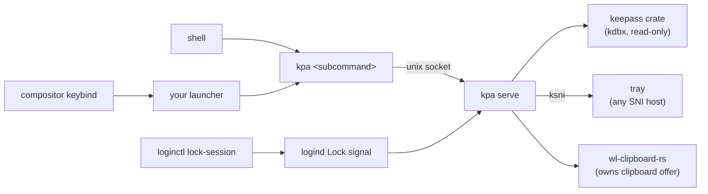

# kpa — design

A small, read-only KeePass agent: holds one or more `.kdbx` files unlocked
in memory and serves lookups to a launcher and a CLI over a Unix socket.

Background and the research this rests on is in [`background.md`](./background.md).
Staging is in [`plan.md`](./plan.md).

## Scope

**Is:** a read-only index and secret-copier for `.kdbx` files, plus a tray icon
showing lock state.

**Is not:** a vault editor, an SSH agent, a Secret Service provider, a browser
backend, or a replacement for a full-featured KeePass client. A client like
that already covers browser autofill, an SSH agent, and its own tray. kpa
adds the two things nothing in that ecosystem provides — free-text search
over all entries, and a CLI that reuses an already-unlocked session.

**Read-only is the defining property.** It is what makes this design safe to
run alongside any KeePass client that already has write access to the same
files (see `background.md` § Direction for why that guarantee matters). The
guarantee is structural: the protocol's op enum (`Op`, in
`src/proto/request.rs`) has no write variants, so there is no code path
that can modify a database. `keepass` is also built without its
`save_kdbx4` feature, which gives the claim a second leg.

## Settled decisions

| #   | Decision                                                                                                  | Rationale                                                                                                                                                                                                                     |
| --- | --------------------------------------------------------------------------------------------------------- | ----------------------------------------------------------------------------------------------------------------------------------------------------------------------------------------------------------------------------- |
| 1   | **Rust**                                                                                                  | `keepass` (the crate) covers KDBX3/4 + Argon2 + keyfile + (later) challenge-response; `zeroize`; single binary.                                                                                              |
| 2   | **JSON over a Unix socket**, serde                                                                        | Fewest moving parts; hand-debuggable with `socat`; self-describing. Protobuf was considered and is defensible, but costs `protoc`, a second type system, and ~150 LoC of conversion boilerplate for no benefit at this scale. |
| 3   | **Single binary, two roles** — `kpa serve` + client subcommands                                           | No client/daemon version skew within a release; one build artifact.                                                                                                                                                           |
| 4   | **No `get` in v1 — `copy` only**                                                                          | The daemon owns the clipboard, so the secret never enters the client's address space. `get` would print secrets to stdout, into shell history and scrollback. Deferred, and will be opt-in behind a flag if added.            |
| 5   | **v1 keys: master password + keyfile only**                                                               | Challenge-response deferred.                                                                                                                                                                                                  |
| 6   | **No TOTP in v1**                                                                                         | Cheap to add later (`keepass`'s `totp` feature, read-only). HOTP is permanently out — counters need writes.                                                                                                                   |
| 7   | **Idle timeout 30 min per database**, config-overridable                                                               | logind's `Lock` signal already covers screen-lock; this only catches walking away without locking.                                                                                                                            |
| 8   | **Daemon autostarts locked**                                                                              | A tray should show state from login onward, and nothing prompts until something actually asks.                                                                                                                                |
| 9   | **Unlock prompt: a `--dmenu`-style password prompt** (e.g. `fuzzel --password --dmenu`) in v1, config key | Trivial to wire up and fits most Wayland setups out of the box. `pinentry` is the better long-term answer for secure memory, but driving Assuan is fiddly — so the prompt is swappable from day one rather than hardcoded.    |
| 10  | **Multiple databases**, TOML array of tables                                                              | Per-database unlock, per-database tray state.                                                                                                                                                                                 |

## Architecture



One long-lived daemon (`kpa serve`); short-lived clients (every other
`kpa <subcommand>`). "Your launcher" and "compositor keybind" are
deliberately generic — kpa doesn't ship or assume a particular launcher,
tray host, or keybinding scheme. Anything that can shell out to `kpa` or
speak the socket protocol directly works.

## Configuration

`$XDG_CONFIG_HOME/kpa/config.toml`.

```toml
idle_timeout = "30m"
prompt = ["fuzzel", "--dmenu", "--password", "--prompt"]
clipboard_timeout = "30s"
log_level = "info"             # error | warn | info | debug

[[database]]
name    = "personal"           # stable id used in requests and the tray
path    = "~/vault/personal.kdbx"
keyfile = "~/.keys/personal.key"   # optional

[[database]]
name = "work"
path = "~/vault/work.kdbx"
```

A leading `~/` in `path` or `keyfile` expands to `$HOME` when the daemon
starts; `~user/` is refused rather than taken literally, and other relative
paths resolve against the daemon's working directory.

If you manage your system declaratively (Nix, Ansible, whatever), this shape
is meant to be generated rather than hand-edited — every setting is a plain
TOML value, nothing requires clicking through a GUI.

## Logging

`serve` writes one line per event to stderr, at one of four levels:
`error`, `warn`, `info` (the default) and `debug`. `log_level` in the config
sets it and `serve --log-level` overrides it. Under systemd, where stderr is
the journal, each line carries a `<N>` syslog priority prefix so
`journalctl -p warning` filters by level; the daemon decides that by
comparing `$JOURNAL_STREAM` against its own stderr. Elsewhere a line reads
`<local timestamp> <LEVEL> <message>` (RFC 3339 with the UTC offset), with the timestamp dimmed and the level
coloured when stderr is a terminal (not when `NO_COLOR` is set or `TERM` is
`dumb`). Under journald there is no timestamp of kpa's own: the journal
stamps its own.

| Level   | What it carries                                                           |
| ------- | ------------------------------------------------------------------------- |
| `info`  | Every unlock, lock (including idle, screen-lock and suspend), and copy (field, entry title, database) |
| `warn`  | Failed or refused requests and connections, and the tray or logind failing |
| `debug` | Why: prompt launches, logind subscription, sleep inhibitor, tray start    |

**What a line may contain.** The operation, the database name, the error
kind, and for a copy the field name and the entry's title (so the log says
which secret left, not just which field). Never passwords, protected fields
(a protected title is replaced by the entry's uuid), usernames, URLs or any
other vault content, at any level: a log outlives the unlocked session and
ends up somewhere far less guarded than the socket (threat model TB-7).
Reads (`status`, `list`) are not logged at all.
Control characters in a line are escaped, so a crafted name in a request
can't forge a second line. Every line goes through `log::log`, so that is
the one function to audit.

## Protocol

Line-delimited JSON over `$XDG_RUNTIME_DIR/kpa/sock`, mode `0600`.

**Exactly one request and one response per connection, then the connection
closes.** This is deliberate, not a limitation to work around later:
multiplexing multiple requests over one long-lived connection would need a
request-ID field so responses could be matched back to their requests, plus
ordering and partial-read handling. One-shot connections make that whole
class of problem not exist — "which response is this?" is answered by which
socket it arrived on. Unix-socket connects are cheap enough (no handshake,
no meaningful round-trip cost) that there's no performance reason to keep a
connection open across multiple requests either. A client that wants to
issue several ops just opens several connections.

Both requests and responses carry `"v": 1`. On the request side, a mismatch
is rejected rather than negotiated — the daemon's response still carries its
own `v`, which is how the client learns which version the daemon is
actually running without a separate pair of fields for it. This is
deliberate too: rather than engineer backward compatibility, we make skew
impossible to ignore. The daemon holds only a cache of decrypted data, so
restarting it costs one re-unlock.

### Requests

```json
{"v":1,"op":"status"}
{"v":1,"op":"unlock","db":"personal"}
{"v":1,"op":"lock","db":"personal"}          // db omitted = lock all
{"v":1,"op":"list"}                          // db omitted = all unlocked
{"v":1,"op":"copy","db":"personal","uuid":"…","field":"password"}
```

`field` is an allow-list: `password`, `username`, `url`, `notes`. No arbitrary
custom-attribute dump in v1.

### Responses

```json
{"ok":true,"v":1,"databases":[{"name":"personal","locked":false,"entries":341},
                              {"name":"work","locked":true}],"version":"v1.2.3"}

{"ok":true,"v":1,"entries":[{"db":"personal","uuid":"…","title":"GitHub",
                             "username":"alice","url":"https://github.com",
                             "group":"Dev"}]}

{"ok":true,"v":1,"copied":"password","expires_in":30}

{"ok":false,"v":1,"error":"locked","db":"personal"}
{"ok":false,"v":1,"error":"unlock_in_progress","db":"personal"}
{"ok":false,"v":1,"error":"stale","db":"personal","detail":"database changed on disk"}

{"ok":false,"v":2,"error":"version_mismatch","detail":"client sent v1; restart the daemon or upgrade the client"}
```

The last one is the version-skew rejection: the client sent `"v":1`, the
daemon is actually on `2`, and its own `v` in the response is what makes
that visible — no extra `client_v`/`daemon_v` fields needed. `v` is the
*protocol* version, not the build: `status`'s `version` field is the
running daemon's build version (the same string `kpa version` prints for
the CLI itself), piggybacked on `status` rather than given its own op since
it's the one extra thing `kpa version` needs and `status` is already the
no-argument "what's the daemon's state" round trip. `kpa version` sends it
and prints both versions, so an upgrade that replaces the binary but leaves
the old daemon running still shows up as a mismatch rather than silently
serving the previous build. An older daemon that predates this field simply
omits it; `kpa version` reports that it's reachable but doesn't say which
build it's running, rather than failing.

Two `unlock` errors exist because unlocking is slow (it waits on a human
and a KDF) and happens outside the vault mutex:

- **`unlock_in_progress`** — an `unlock` for the same database is already
  prompting. The second request is refused rather than opening a second
  prompt; retry once the first resolves.
- **`locked`** from `unlock` — a `lock` arrived while this `unlock` was
  prompting or deriving. The lock wins: the database the unlock opened is
  discarded rather than silently reopening a vault the user just locked.

A request line is capped at 64 KiB and must arrive within 5 seconds; a
line over the cap is answered `malformed_request`, and a connection that
sends nothing is dropped.

**`list` never returns secrets** — it is an index. That holds for any field
the user marked protected in their KeePass client, not just `Password`: a
protected `Title`/`UserName`/`URL` is omitted, not de-protected — protection
is a property of the field, not of which field name it happens to be. A
field counts as protected when its XML carries `Protected="True"` or
`ProtectInMemory="True"`, matching KeePassXC. The pinned `keepass` crate
(0.15.0) reads only `Protected`, so until it reads `ProtectInMemory` too,
`list` can return a field that carries only that marker; the threat model
(A-2, G-3) records this as a known gap. The launcher does its own fuzzy
matching; kpa stays dumb and returns everything else.

## Concurrency and file freshness

A KeePass client and kpa can both have the file open at once. The
specifics below were checked against KeePassXC 2.7.12's source specifically
(it's what this design was developed against) — worth re-verifying against
a different client, though most modern KeePass clients follow the same
general pattern: open, decrypt into memory, and save through a temp-file-plus-
rename rather than an in-place write.

- **There is no per-database lock file** in KeePassXC. Its only `QLockFile` is
  a single-instance lock in `/tmp` (`gui/Application.cpp:79-84`), not next to
  the `.kdbx`. Nothing to contend with.
- **Saves are atomic.** KeePassXC writes through `QSaveFile`
  (`core/Database.cpp:361`); the non-atomic fallback for cloud-sync directories
  still ends in a rename (`:409`). A reader never sees a half-written file.

Rules:

1. **Never create a lock file. Never hold an fd.** Open, read whole file, close,
   parse. A few MB, once per unlock. One known exception, upstream: a file
   with pathological KDF parameters can make `keepass` hang mid-unlock, and
   that unlock holds its fd (and a core) for as long as it hangs.
2. **Never write.** Guaranteed by the `Op` enum in `src/proto/request.rs`.
3. **Freshness guard** (`docs/threat-model.md` T-12): record
   `(dev, ino, size, mtime, ctime)`, with nanoseconds on both times, by `fstat`
   on the fd that was read. Take it before the read and again after it; if the
   two differ, the unlock fails with `stale`. Before each use of an unlocked
   database, re-check by `stat` on the path. Any difference drops the in-memory
   database and returns `stale`, requiring re-unlock (`list` of all databases
   fails naming the stale one; `status` reports it as locked). Another client saving, or
   a sync tool landing a new copy, both cause this. Serving stale entries
   silently is the worse failure. Anyone syncing their vault across machines
   makes this a real case, not a theoretical one.

   ctime catches a restored mtime, since user space cannot set ctime. The
   `fstat` on the read fd, rather than a `stat` by path, closes the window
   between the read and the stat. ctime is only as reliable as the filesystem
   reports it. On coarse-timestamp, FUSE or network mounts the guard is best
   effort. A chmod, a link change, or a backup tool that hard-links the file
   also moves ctime and causes a spurious `stale`, which fails safe.

   **Not caught:**
   - A same-size write that leaves mtime and ctime equal to the recorded values.
     A tool that sets times cannot set ctime, and ctime moves on every write
     and every time change. So the tuple misses such a write only if the
     kernel's timestamp for that write equals the recorded one. That needs a
     filesystem with coarse timestamps, where the write lands in the same tick
     as the recorded one, or a writer that sets the system clock back, which
     requires root.
   - Substitution or rollback while the database is locked. The tuple is taken
     at unlock, so a file replaced with an older copy of the same vault, or
     with another vault sharing the password, before the next unlock is never
     compared against anything. This is T-17, and it is not addressed.
4. **Concurrency:** accept connections concurrently (bounded — a flood is
   refused rather than turned into unbounded threads, and a failed thread
   spawn drops that one connection instead of the daemon), serialize vault
   access behind a `Mutex`. Most requests are sub-millisecond. `unlock` is
   the exception — milliseconds to seconds, waiting on the prompt and the
   KDF — and it deliberately releases the mutex for that slow part so other
   requests keep being answered. That window is what the per-database lock
   epoch guards: every `lock` bumps it, and an `unlock` only installs its
   database if the epoch is unchanged since it started.

## Clipboard

`wl-clipboard-rs`, in-process — **not** by spawning `wl-copy`.

The Wayland clipboard is pull-based: the owning client must stay alive to serve
bytes on paste, which is why `wl-copy` forks. Since kpa is already long-lived it
should own the offer itself. The crate speaks `ext-data-control`/`wlr-data-control`
(advertised by compositors like niri and sway), so it can own the clipboard
without ever holding keyboard focus — which a daemon never has.

Two MIME types are offered: `text/plain;charset=utf-8` and
`x-kde-passwordManagerHint` with value `secret`. That's what clipboard-history
managers check to skip passwords. (`wl-copy --sensitive` offers exactly this —
`wl-clipboard/src/types/copy-action.c:76-80` — so the CLI is a viable stage-1
shortcut.)

**Expiry is correct by construction because we own the source.** After
`clipboard_timeout`, drop it. If the user copied something else meanwhile, the
compositor already replaced our source and the drop is a no-op — no content
comparison, no race, no risk of wiping someone else's clipboard. This is the
strongest argument for owning it natively rather than shelling out.

## Lock policy

Locking means: drop the `Database`, zeroize what can be zeroized, end any
clipboard offer that database's `copy` started, and update the tray icon.
A lock also cancels any `unlock` still in flight for that database (see §
Protocol). "What can be zeroized" is narrower than it sounds:

- **Cleared:** protected field values (`secrecy` types), `DatabaseKey`'s
  own copies of the password and keyfile, and every copy kpa itself makes
  — the prompt's output buffer, `list` entries, and the serialized
  response buffer are all zeroized on drop. A clipboard offer still being
  served by the database being locked is ended immediately rather than
  left to its own `clipboard_timeout`; a lock of a different database, or
  of none while nothing is on the clipboard, leaves the clipboard alone.
- **Not cleared, upstream:** unprotected field values (plain `String`s
  inside `keepass`), the decrypted and decompressed payload buffers
  `keepass` parses from, its key-derivation intermediates, its XML
  keyfile parser's working copies, and the clipboard backend's own
  `Box<[u8]>` copy of whatever was last offered (`wl-clipboard-rs` takes
  ownership of it; kpa has no way to reach in and zero it, only to ask the
  backend to stop serving it). These persist in freed heap pages until the
  allocator reuses them.

Lock stops serving the database and clears what kpa owns; it is not a
guarantee that no trace of the plaintext remains in the process's memory.

| Trigger      | Source                                                                        |
| ------------ | ----------------------------------------------------------------------------- |
| Screen lock  | logind session `Lock` signal, or `LockedHint` becoming true, on the user's display session (`User.Display` of `Manager.GetUser(uid)`), via `zbus`. Covers `loginctl lock-session` and `IdleAction=lock`; a locker that calls neither is invisible (threat model ASM-7) |
| Suspend      | logind `PrepareForSleep(true)`: lock everything, then release the `delay` sleep inhibitor. kpa holds it while anything is unlocked. Logind allows `InhibitDelayMaxUSec` (5 s default) before sleeping regardless |
| Bus loss     | every database locks; the subscription is re-established with backoff        |
| Idle         | per database: no successful `list` of it (`list` of all counts for each database it reads), and no `copy` or unlock that installs it, for `idle_timeout` (default 30m); `status` and `lock` don't count |
| Explicit     | `kpa lock`, or the tray menu                                                  |
| File changed | freshness guard (above)                                                       |

## Tray

`ksni` — StatusNotifierItem over D-Bus, with menus, dynamic icons and
tooltips. Any StatusNotifierItem host (waybar, quickshell, a KDE/GNOME panel,
...) picks it up with no extra work on kpa's side.

- Icon reflects aggregate state: all locked / some unlocked / error.
- Tooltip lists each database and its state.
- Menu: a per-database submenu (Lock, Unlock), then Lock all, then Quit.

This satisfies "autostarts, lives in the background until needed" directly
rather than by proxy through another application's tray.

## Security

**Boundary: the user account.** Inside it, optimise for blast radius and
time, not caller identity — see `background.md` § "Security boundary".

Held while unlocked:

| Item               | Held?                                                    |
| ------------------ | --------------------------------------------------------- |
| Master password    | No — kpa's copies zeroized after key derivation¹          |
| Keyfile path       | Yes (a path; harmless)                                     |
| Keyfile contents   | No — kpa's buffer zeroized; `keepass`'s parse copies not²  |
| Decrypted database | **Yes** — the real exposure, same as any KeePass client    |

¹The password arrives on the prompt command's stdout, which kpa reads into
a fixed-size `Zeroizing` buffer that never grows (a growing buffer would
leave unwiped copies behind each time it reallocates), then into a
`Zeroizing<String>`. `DatabaseKey` zeroizes its own copy. Two copies are
outside kpa's reach: whatever the prompt program itself held, and
`keepass`'s key-derivation intermediates (e.g. the SHA-256 of the
password, which is password-equivalent), which are not zeroized upstream.

²`DatabaseKey`'s keyfile bytes are zeroized, but `keepass`'s XML keyfile
parser makes several unzeroized intermediate copies, which together can
cover the whole key and can survive a lock. Upstream.

Two Linux properties that help here, worth verifying on the machine
running kpa:

- **`/proc/sys/kernel/yama/ptrace_scope` is `1`** on most modern distros —
  only a parent can ptrace a child, so a random same-uid process cannot
  attach to kpa.
- **zram swap** (RAM-backed, compressed) reduces the chance that key
  material is paged to disk, but doesn't eliminate it — hibernation, a zram
  writeback device, or any secondary disk-backed swap all defeat it. This is
  a property of the machine's configuration, not one kpa's process can
  guarantee about itself.

`kpa serve` sets `PR_SET_DUMPABLE=0` at startup, before reading its config
or unlocking anything. That keeps a crash from writing a user-readable core
dump of the decrypted database, and also makes `/proc/<pid>/mem` root-owned,
which blocks same-uid ptrace regardless of the Yama setting above. One host
caveat, like the two bullets above: with `fs.suid_dumpable = 2` the kernel
still writes a root-owned dump.

**Non-goals, stated explicitly:** kpa does not defend against an attacker who
already has code execution as the user running it. Nothing at this layer can. It reduces
casual exposure — clipboard leakage into history managers, an unlocked vault
overnight, secrets in shell scrollback — and that is the whole claim.

## Dependencies

`keepass` (KDBX + Argon2; `challenge_response` feature off in v1),
`serde`/`serde_json`, `toml`, `clap`, `zbus` (logind), `ksni` (tray),
`wl-clipboard-rs`, `zeroize`. Threads over async unless `ksni`'s runtime choice
makes tokio simpler.

## Staging

See [`plan.md`](./plan.md) — several sequential steps, each with a testable
intermediate state. Total is roughly 900 LoC of Rust.

## Deferred

- YubiKey challenge-response (note for whenever this lands: don't reuse the
  key's own PIN as a vault credential — it collapses a two-factor property
  into one)
- TOTP
- `kpa get` behind an explicit flag
- `pinentry` as the prompt
- Custom-attribute access

## Open questions

None blocking. Which launcher or frontend you build on top of kpa is
independent of this design — anything that can shell out to `kpa` or speak
the socket protocol works.
