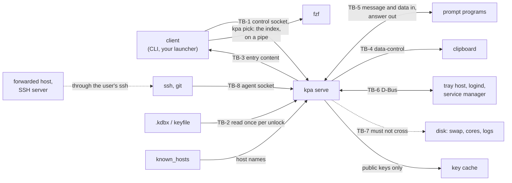

# kpa — threat model

What kpa defends, against whom, and what it deliberately doesn't. Written
to be the reference for triaging security findings: a finding is assessed
by which goal it breaks, via which actor, across which boundary.

Structure follows the four threat-modeling questions (what are we building,
what can go wrong, what do we do about it, did we do a good job); threats
were enumerated per trust boundary with STRIDE. The ID prefixes (`A-`,
`ACT-`, `TB-`, `ASM-`, `G-`, `T-`, `NG-`) are local to this document — cite
them in findings. IDs are stable: retire an entry rather than renumber.

Mechanisms and their rationale live in [`design.md`](./design.md),
[`headless.md`](./headless.md) and [`ssh-agent.md`](./ssh-agent.md). This
file states *claims*, not implementation status — whether the code meets a
claim is exactly what a review checks.

## 1. System

kpa is a long-lived daemon (`kpa serve`) that holds one or more `.kdbx`
files decrypted in memory. It has four front ends:

| Front end | What it carries |
| --- | --- |
| Control socket | One JSON request per connection, from the CLI (`kpa <subcommand>`) or anything else speaking the protocol: `status`, `unlock`, `lock`, an entry index (`list`), one field of one entry to the clipboard (`copy`), the SSH keys a database holds (`ssh_keys`), the signatures waiting for an approval (`ssh_pending`, `ssh_approve`), and the approvals in force (`ssh_grants`). A request can pass a terminal along with it, for the daemon to ask for the master password on, instead of prompting on screen |
| SSH agent socket | The SSH agent protocol, from `ssh`, `git` and whatever else is pointed at it: list the SSH keys stored in databases that opt in, sign with them, bind a connection to an SSH session. It exists only while a database opts in. A remote host reaches it when the user forwards the agent |
| Tray | A status icon on the session bus: lock state, and a menu to lock and unlock |
| Lock triggers | logind on the system bus (screen lock, suspend), an idle timer per database, and a vault file that changed on disk |

The CLI's subcommands send a request and print the answer. `kpa pick` is
the one that also runs a program: it hands the index to the user's `fzf`,
found on `PATH`, through a pipe, and sends a `copy` for the entry and field
chosen there.

The daemon asks the user two things: the master password, on screen through
a configured prompt program or on the terminal a request passed, and whether
a signature may be made, on screen through a second program. A prompt
program is handed the question as a line of text, and the pieces it is made
of as data.

There is no operation that returns a secret to the caller (a signature is
not the key), and none that writes a database. Besides its two sockets, the
one file kpa creates is a cache of the SSH keys' public halves, so they are
listed while their database is locked. Besides its config, the databases
and their keyfiles, the files it reads are the `known_hosts` files config
lists, to show the host a signature is for by its name.

## 2. Assets

| ID  | Asset                                                                           | Sensitivity |
| --- | ------------------------------------------------------------------------------- | ----------- |
| A-1 | Credentials: master password, keyfile contents, anything password-equivalent (e.g. derived keys) | Highest |
| A-2 | Secret entry content. Every field value except an unprotected title, username or URL: passwords, Notes, custom fields, TOTP seeds and the codes made from them, and any field whose value carries `Protected="True"` or `ProtectInMemory="True"` (KeePass clients honour both). Every attachment, the SSH private keys the agent signs with among them. Old versions of entries | High |
| A-3 | Entry metadata: titles, usernames, URLs, groups, custom field *names* (`list`'s `fields` array — never a custom field's *value*, which is A-2 like any other field value), attachment names, and the database's own name and description stored in the `.kdbx`. kpa's config `name` labels are not A-3 | Medium |
| A-4 | Integrity of the `.kdbx` and keyfile on disk, and of their directories          | High        |
| A-5 | The user's clipboard contents that kpa didn't put there                         | Low         |
| A-6 | Signing capability: a signature the user didn't intend. It authenticates as the user elsewhere, or signs commits and files | High |

The daemon's availability is deliberately not an asset: when kpa is down
it releases nothing, and the user falls back to their main client.
Denial-of-service findings are triaged against G-9 and G-11.

The keyfile is plaintext at rest: its protection is the filesystem's
(ASM-1, ASM-6), not kpa's.

Public keys are not assets. They are public by design, which is what lets
the key cache hold them. Lock state, entry counts and entry UUIDs are not
assets either: the tray shows the first two, and the log names an entry by
its UUID. Nor are the hosts a key is used for: a host key is public, and
the name shown for it is one a `known_hosts` file gives in the clear.
Prompts, listings and the log name them.

## 3. Actors

| ID     | Actor                                                                                                                 | In scope? |
| ------ | --------------------------------------------------------------------------------------------------------------------- | --------- |
| ACT-1  | Another local uid (other user, system service account)                                                                | Yes       |
| ACT-2  | Network attacker                                                                                                      | Yes — kpa has no network surface of its own, and must not gain one. What a remote party sends reaches kpa only inside the agent protocol, through the user's own `ssh` (ACT-11, ACT-12) |
| ACT-3  | Whoever can write the `.kdbx` or keyfile but doesn't know the key: a sync service or sync peer, a backup restore, a shared drive | Yes |
| ACT-4  | Author of entry content in a database the user can open — titles, fields, attachments: a colleague in a shared vault, an imported file | Yes |
| ACT-5  | Careless same-uid software: clipboard-history managers, shell history, terminal scrollback, log collectors, crash reporters, backup/indexing tools — records what passes by, doesn't target kpa | Yes |
| ACT-6  | Same-uid code running in a sandbox (Flatpak-style, container, browser renderer) that has been granted neither socket, or the agent socket alone | Yes |
| ACT-7  | Someone with physical access: to a locked session, an unattended unlocked session (without the master password), a suspended machine, or a powered-off disk | Yes |
| ACT-8  | Malicious code running unsandboxed as the user, persistently: it can wait for an unlock, log keystrokes, replace binaries | **No** — NG-1 |
| ACT-9  | root, the kernel, firmware, hardware                                                                                  | **No** — NG-2 |
| ACT-10 | Short-lived malicious code running unsandboxed as the user: a package install script, a one-off exploited process. It runs once, briefly, and doesn't persist | Partly — T-18 |
| ACT-11 | A host the user forwards the agent to: its root, or anything there that can reach the forwarded socket. It sends what it likes on the forwarded connection, session-binds for further hosts included | Yes, for keys allowed on forwarded connections |
| ACT-12 | An SSH server the user's `ssh` connects to, from this machine or from a forwarded host. It chooses the host key or host certificate, the session identifier and the signature that reach kpa in a session-bind, and which of the offered keys it asks a signature from | Yes |

## 4. Trust boundaries

| ID   | Boundary                                                                                       | Untrusted side |
| ---- | ---------------------------------------------------------------------------------------------- | -------------- |
| TB-1 | The control socket under `$XDG_RUNTIME_DIR`: uid separation via filesystem permissions. It accepts one inbound file descriptor with a request, a terminal, which the daemon writes a prompt to and reads A-1 from | Request bytes and the descriptor (ACT-1, ACT-6 must not reach it; ACT-5 clients may be buggy, and a same-uid client can pass any terminal it can open); for a client, whoever answers at the path (ACT-1 must not) |
| TB-2 | Reading `.kdbx` and keyfile: header and KDF parameters before authentication, payload after     | File bytes (ACT-3) |
| TB-3 | Decrypted entry content flowing out: to control clients and what they print, from `kpa pick` to `fzf`, to agent clients as identity comments, into prompt messages and their data, into the log | Entry content (ACT-4) |
| TB-4 | The clipboard (Wayland data-control): visible to every client of the compositor                | Readers (ACT-5) |
| TB-5 | The prompt subprocesses: each is handed a message and the data behind it, in its environment; the unlock prompt's stdout carries the password, the confirm prompt's an `Allow` or a `Deny` | The user's view of a prompt: anything that can draw on screen (ACT-6) can imitate it (NG-8). The programs themselves are trusted (ASM-3) |
| TB-6 | D-Bus: session bus (the tray menu, the service manager's environment naming the compositor), system bus (logind `Lock`, `LockedHint`, `PrepareForSleep`) | Callers and signal senders: a sandboxed peer on either bus (ACT-6), and on the system bus any local uid, which the stock bus policy lets send a signal to any connection (ACT-1) |
| TB-7 | Process memory → anything persistent: files, logs (including kpa's own operation log, which a supervisor may persist), stderr, swap, core dumps, child argv/env | Everything persistent (ACT-5, ACT-7) |
| TB-8 | The agent socket under `$XDG_RUNTIME_DIR/kpa/`, bound and checked like TB-1. Same-uid clients reach it directly; remote hosts reach it through a forwarding channel the user opened | Request bytes, session-bind contents (a host key or host certificate, a session identifier, a signature), and the data to be signed (ACT-5, ACT-6, ACT-10, ACT-11; inside a session-bind, ACT-12) |

## 5. Assumptions

Findings that only work by breaking one of these are not vulnerabilities in
kpa (see §9).

- **ASM-1** — The kernel enforces uid separation, file permissions, and
  process isolation between uids.
- **ASM-2** — `$XDG_RUNTIME_DIR` is per-user, owned by the user, mode
  `0700`, and on a non-persistent filesystem.
- **ASM-3** — The config file, the prompt programs it names (`prompt`, or
  the built-in default, and `ssh_agent.confirm_prompt`), the `fzf` that
  `kpa pick` runs, every `$PATH` directory searched to find them, the paths
  the config points to, the `known_hosts` files it lists (by default the
  user's and the system's) and kpa's cache directory are chosen by the user
  and writable only by them, or by root. The prompt programs are trusted:
  the unlock prompt with the master password, which it doesn't store or
  send, and the confirm prompt to report the answer the user gave. Where
  their output channels lead is kpa's responsibility, not theirs (T-4).
  What they do with the message and the data kpa hands them is theirs
  (T-24). `fzf` is trusted with the index: to show it, and to report the
  line the user chose. Its options are the user's, read from the
  environment `kpa pick` runs in, except its history and its preview,
  which kpa turns off (T-5, T-24). kpa trusts a `known_hosts` file as `ssh`
  does: an entry to name its key, and a certificate authority to name
  hosts under the patterns of its line.
- **ASM-4** — The compositor is trusted. Clipboard contents are visible to
  the session by design; kpa can only tag and expire them. The compositor
  is the one named by `WAYLAND_DISPLAY` in the service manager's
  environment, read on each `copy`. kpa hands it a secret only if that
  name is a bare socket name in the daemon's `$XDG_RUNTIME_DIR` and the
  socket's listener is the daemon's uid and on the desktop, judged like a
  requester (`docs/headless.md` § 3). That tells the desktop's compositor
  from a stale or foreign socket, not from a same-uid process serving one
  of its own (T-6).
- **ASM-5** — Dependencies are part of kpa: a bug in one that is reachable
  through kpa is a bug in kpa. Only their memory-hygiene limits are
  accepted (NG-4). `keepass` documents no security properties and fixes
  only its current major version, so tracking it is part of keeping these
  claims. The agent's key parsing and signatures are RustCrypto's
  (`ssh-key` and the crates behind it): kpa implements no cryptographic
  primitive, and releases the agent only on a stable `ssh-key`
  (`docs/ssh-agent.md` § 6.5). A dependency or toolchain that is itself
  malicious is out of scope.
- **ASM-6** — Host hardening is the user's: swap, hibernation, zram
  writeback, `kernel.yama.ptrace_scope`, `fs.suid_dumpable`, full-disk
  encryption, and what `/proc` shows one user of another's processes.
- **ASM-7** — logind sees the user's screen lock in one of two ways, and
  kpa relies on both properties:
  (a) the locker asks logind to lock, through `Manager.LockSession`,
  `Manager.LockSessions` or `Session.Lock` (what `loginctl lock-session`
  and `loginctl lock-sessions` call, and what logind's own
  `IdleAction=lock` does). logind then emits the session's `Lock` signal;
  or (b) the desktop environment sets the session's `LockedHint` property
  through `Session.SetLockedHint`, which logind emits as a
  `PropertiesChanged` change. logind never sets `LockedHint` itself. A
  locker that does neither, including one started directly without calling
  logind, is invisible to kpa, and so is the screen lock it draws. kpa
  also relies on logind's `PrepareForSleep(true)` being emitted before the
  machine sleeps, and on logind's delay inhibitors holding sleep for at most
  `InhibitDelayMaxUSec` (5 s by default). Without logind, no screen lock or
  suspend reaches kpa; without a display session, no screen lock does. The
  idle timer, an explicit lock and the freshness guard depend on neither
  (`docs/headless.md` § 7).
- **ASM-8** — The user's `ssh` is OpenSSH 8.9 or later and says what it is
  doing with the agent: it binds a connection it opens for a forwarded
  channel with `is_forwarding` before a byte from the remote side crosses
  it, and binds a connection it authenticates on to that session. kpa tells
  forwarded use from local use by those bindings alone (NG-9).

Not assumed: the sandbox of the systemd unit the home-manager module
installs (no network address families, no new privileges, a read-only
system, no core file). No goal rests on it: every claim is about
`kpa serve` however it is started, and a weakness in the sandbox alone is
hardening.

## 6. Security goals

What kpa claims. A finding is a vulnerability when it shows one of these
failing for an in-scope actor. A goal that makes several claims lists them
as numbered clauses, cited as `G-5.3`. A new clause goes at the end of its
list, so the numbers stay put.

Where each asset may go. An asset anywhere else is a finding, against G-3
for a channel and G-4 for anything persistent:

| Asset | May reach |
| --- | --- |
| A-1 | The daemon and nothing else, for one unlock: the password from the user's own typing, the keyfile from its configured path |
| A-2 field values other than a TOTP seed, and TOTP codes | The clipboard offer, after a `copy` naming that entry and field |
| A-2 TOTP seeds, attachments, SSH private keys, old versions of entries | Nothing outside the process |
| A-3 | The answers to `list`, `ssh_keys`, `ssh_pending` and `ssh_grants`, and what the CLI prints of them; the lists `kpa pick` pipes to its `fzf`s, and the line it prints of the entry it copied from; an SSH key's name, in identity comments and in a prompt's message and data; a copied entry's title, in the log |
| A-6 | Signatures on the agent socket, under G-13 and G-14 |

- **G-1 Read-only.** kpa never writes, creates, renames, truncates, or locks
  any file next to a database or keyfile, and never holds their fds beyond
  the read. No request on either socket, no tray action and no lock trigger
  can cause such a write, and the agent takes no key (G-15). Besides its
  sockets, the one file kpa creates is its own: the key cache, in its cache
  directory (G-4).
- **G-2 No access across the uid boundary.** No other uid and no network
  peer can issue requests on either socket, read responses, receive a
  client's requests in kpa's place, or obtain A-1–A-3 or a signature from
  kpa by any channel. Two things qualify that. A host the user forwards the
  agent to reaches the agent socket through the user's own `ssh`, and gets
  what G-14 allows it. And what a prompt says is out of kpa's hands once a
  prompt program puts it on its command line (T-24).
- **G-3 Secrets leave only by explicit `copy`, only to the clipboard.**
  1. A-1 never leaves the process, and only the user's own typing enters
     it: on screen, into the prompt program, or on a terminal the daemon
     itself reads from. It is never in a request, never in a response, and
     never passes through a client: `kpa unlock` passes its terminal and
     sees no more than the answer. The daemon holds A-1 in a zeroizing
     buffer for that one unlock.
  2. A-2 is never in a response on either socket, stdout, stderr, a log, an
     error string, an identity comment, a prompt's message or data, the
     tray, a child's argv or environment — only in the clipboard offer,
     after a `copy` naming that exact field.
  3. `copy` itself offers only for a requester on the desktop, while the
     display session is active and unlocked (`docs/headless.md` § 5);
     anything else fails with `no_display` before the clipboard is touched.
     `status` tells a requester whether its own `copy` would pass that
     check (`can_copy`). That is a hint for clients: `copy` runs the check
     again, and nothing rests on the hint.
  4. `list` omits every protected field and Notes rather than de-protecting
     them. `list`'s `fields` array is the one exception: it names which
     fields exist and are copyable, never a value, so a protected field's
     or a protected Notes' *name* still appears there — a name alone
     carries none of A-2, the same way a title's existence isn't A-2
     either.
  5. A TOTP seed never leaves the process: what `copy` offers for `totp` is
     the code of the moment. "TOTP seed" means the entry's `otp` field, the
     one kpa generates codes from, and `copy` answers `field_empty` for that
     key, asked as `otp` or `custom:otp`. A seed stored under another name (such as
     `TimeOtp-Secret-Base32` or `TOTP Seed`) is an ordinary custom field,
     which `copy` may offer.
  6. SSH private keys never leave the process: only signatures do, only on
     the agent socket, only for keys in databases that opt in.

  **Known gap (keepass 0.15.0).** The `ProtectInMemory="True"` marker is
  part of A-2, but the pinned `keepass` crate cannot see it. Its XML
  string-value deserializer (`src/format/xml_db/entry.rs`, `StringValue`)
  reads only `@Protected`, so a value marked only with `ProtectInMemory`
  becomes an unprotected `Value`, `Value::is_protected()` is false, and
  `list` returns it. The crate's `format` module is `pub(crate)`, so kpa
  cannot reach the decrypted XML to check the attribute itself, and no
  in-repo change can make `list` honour the marker without reimplementing
  the KDBX decryption. The full fix is upstream: `StringValue` must
  deserialize `@ProtectInMemory` into `Value::protected`. Until then, a
  `list` that returns such a field violates G-3 and T-4 as written.
- **G-4 No secret persisted.** kpa itself — the daemon and every CLI process
  — never writes A-1 or A-2 to disk or to its own stdout/stderr, and
  prevents its own core dumps.
  1. A-3 reaches stdout only as the answer the CLI was asked for: a
     listing, or the line `kpa pick` prints of the entry it copied from. The
     operation log names the operation, the database and how it ended. Of a
     vault it carries an entry's UUID and, for a `copy`, the name of the
     field copied and the entry's unprotected title; of an SSH key, its
     fingerprint and the name config gives it. Nothing else from a vault is
     logged, at any level (`docs/design.md` § Secrets). A signature's line
     also says what it was for and names the hosts its connection is bound
     to, which are not assets (§ 2).
  2. The key cache holds public keys under config database names, none of
     A-1–A-3: no title, no comment, no attachment name. It is the one file
     kpa creates besides its sockets, mode `0600`.
  3. `kpa pick` writes nothing from a database to a file. Its list reaches
     `fzf` through a pipe, and `fzf` keeps no history of what is typed into
     it, whatever the user's `fzf` options say.
  4. A-1 typed on a terminal is not echoed: the daemon turns echo off for
     the read and puts it back.
  5. Keeping memory out of swap is the host's (ASM-6): kpa does not lock
     its memory.
- **G-5 Bounded exposure time.**
  1. A database locks on screen lock; on suspend, before the machine
     sleeps; when the watch on the display session is lost; after
     `idle_timeout` without activity on it; on explicit request, from the
     control socket or the tray; and when its file is found changed (G-8).
  2. Activity is a successful `list` or `ssh_keys` of that database, a
     successful `copy` from it, a successful local signature with one of
     its keys, and the unlock that installed it. Each database has its own
     idle timer, so using one does not keep another unlocked. `status`,
     `lock`, `ssh_pending`, `ssh_approve`, `ssh_grants`, listing identities,
     a forwarded signature, and refused or malformed requests are not
     activity.
  3. Locked means kpa has dropped that database and serves nothing from it
     but its public keys, which the agent lists from the key cache.
  4. A lock that races an unlock wins.
  5. A lock ends any prompt in flight for its database, on screen or on a
     terminal, and everything its unlock made: clipboard offers, SSH
     approvals and pending requests, the agent's private keys.
  6. A prompt ends after `prompt_timeout` (a confirm prompt, after
     `ssh_agent.confirm_prompt_timeout` if that is set), and a terminal
     prompt ends when its requester leaves or the terminal hangs up.
  7. A copied secret expires after `clipboard_timeout`, and sooner if a
     lock ends the unlock it was read from, even a lock that lands while
     the `copy` is in flight (the copy answers `locked`). No paste asked after
     the lock is answered with the secret; one whose answer had already begun
     when the lock landed may finish.
  8. A pending request expires five minutes after it was last refused, and
     an approval for one signature after `ssh_agent.retry_window`.
- **G-6 Lock clears what kpa owns.** On lock, every copy of A-2 that kpa
  itself made or controls is zeroized, the agent's private keys included.
  A-1 is not held that long: kpa's copies go once the key is derived.
  (Copies inside dependencies: NG-4.)
- **G-7 Clipboard hygiene.** Every copy carries the
  `x-kde-passwordManagerHint: secret` tag; expiry never clears a clipboard
  kpa no longer owns.
- **G-8 Freshness.** kpa never serves data from, or signs with a key of, a
  database whose file has changed since unlock. The file is checked before
  each use, by every request on either socket that reads or asks after the
  database, `status` included, and one that doesn't answer the check in
  time counts as changed.
- **G-9 Untrusted file input is only data.** A crafted `.kdbx` or keyfile
  (ACT-3) cannot corrupt memory, execute code, or affect other databases.
  It may fail to open, but what a file that opens serves is authentic: kpa
  never serves content that was altered without the key. Bytes the format
  authenticates nowhere and kpa serves nothing from, the block that ends
  the payload and whatever follows it, are no part of that.
- **G-10 Entry content is only data.** Entry fields and attachments (ACT-4)
  cannot alter protocol framing on either socket, inject into the CLI's
  terminal output, an identity comment or a log line, reshape the question
  a prompt asks, or change which entry or field a `copy` resolves to. They
  decide which SSH keys exist and what they are called, never their policy
  (G-13). In `kpa pick`, an entry's text stays inside its own line of the
  list, and the entry and field copied are those of the line the user
  chose. Nor can entry content crash or hang a request or an unlock, or
  make an unlock take memory out of proportion to its file. The same holds
  for the text a request carries (a database name, a login's user, a
  signature's namespace, a command name) and for the name a host goes by,
  from a `known_hosts` file or a host certificate.
- **G-11 Robust sockets.** Malformed, oversized, slow, or flooding clients,
  on the control socket or the agent socket, are refused without crashing
  the daemon or starving other clients, and forwarded connections cannot
  take every slot on the agent socket.
- **G-12 No prompt where nobody can see it.**
  1. A request from outside the desktop, or one that arrives while the
     screen is known to be locked, never raises a prompt on screen.
  2. `unlock` asks such a request on the terminal it passed instead, and
     answers `no_prompt` if it passed none. A request that asks for the
     terminal gets only the terminal, however the screen stands.
  3. The tray has no requester to place, so a click on its "Unlock" is
     asked on screen only while there is a display session that isn't known
     to be locked, and answers `no_prompt` otherwise.
  4. The same holds for the agent's prompts: a signature that would need
     one for such a request is refused. If what it lacks is an approval, it
     is kept pending for `kpa ssh approve`. The agent socket takes no
     terminal, so a locked database is unlocked with `kpa unlock`.
  5. Prompts take the screen one at a time.
- **G-13 Signatures need an unlocked database that opts in, and an
  approval when the key's policy asks for one.** An on-demand unlock is a
  prompt the user answers. Vault content cannot change a key's policy.
  1. Only keys in a database with `serve_ssh_keys = true` sign, and never
     one that `serve = false` names. RSA keys sign with SHA-2 only.
  2. Nothing signs while its database is locked, and answering the unlock
     prompt approves nothing.
  3. An approval is the user's `Allow` to the confirm prompt, or an
     `ssh_approve` on the control socket for a request kept pending. It
     covers one key for one destination — the host key the connection is
     bound to, or unbound use — until lock (`confirm = "once"`) or for one
     signature (`"always"`). A host that presents a certificate is the key
     the certificate certifies. The name a host is shown by is no part of
     an approval.
  4. A login signed on a bound connection is for the session that
     connection is bound to.
- **G-14 Forwarded signatures are confined.**
  1. A connection whose first session-bind claims forwarding is forwarded,
     whether or not that bind verifies, and no later bind makes it local.
  2. A key with `forwarded = false` is never listed or used over a
     forwarded connection. The others are listed, by public key and name.
  3. They sign SSH logins only, for a session the destination has bound,
     after an approval for that (key, forwarding session, forwarding host,
     destination), which `confirm = "never"` does not waive. The approval
     lasts until lock, or for one signature under `confirm = "always"`. No
     other forwarding session can use it, and a local approval never covers
     forwarded use.
  4. Nothing sent on the agent socket approves. An approval is the user's
     answer on this machine's screen, or an `ssh_approve` on the control
     socket, which forwarding never reaches.
  5. A forwarded request gets a locked database unlocked only by the user
     answering the unlock prompt (G-13). Nothing on a forwarded connection
     locks a database or counts as activity (G-5).
- **G-15 The agent never accepts a key or a secret.** Add, remove, `LOCK`
  and `UNLOCK` all fail, and so does every extension but session-bind and
  `query`. No password crosses the agent socket.

## 7. Threats

Format: **ID · title** (STRIDE) — actor · boundary · asset → goal.
"Residual" is what remains after the design's response, and points to the
non-goal that accepts it.

**T-1 · Other uid reaches a socket, or answers in its place** (S, I, E) — ACT-1 · TB-1, TB-8 · A-1–A-3, A-6 → G-2  
Response: both sockets live in `$XDG_RUNTIME_DIR/kpa/`, each created under
umask `0177` so it is never connectable by others, mode `0600`; an empty or
relative `$XDG_RUNTIME_DIR` is treated as unset; an existing parent
directory must be owned by the user and not group- or world-writable;
the daemon drops peers whose `SO_PEERCRED` uid differs, and kpa's own
clients check the daemon's uid the same way before sending; no TCP, no
abstract-namespace socket (those ignore filesystem permissions and mount
namespaces). In scope: a fallback path when `$XDG_RUNTIME_DIR` is unset,
a pre-existing socket path or directory planted by someone else, a
permission window between bind and chmod, each of these for a
user-supplied `--socket` or `ssh_agent.socket`, and a kpa client talking
to a socket another uid placed on its path. Residual: `ssh` does not check
who answers on the agent socket's path, so there the directory's
permissions are the whole defence (ASM-2).

**T-2 · Network exposure** (I, E) — ACT-2 · TB-8 · all → G-2, G-14  
Response: no listening network socket, no outbound connections. Agent
forwarding is the one path from the network: it is reached only through
the user's own `ssh` client, and G-14 confines it (T-20). The servers that
`ssh` talks to reach kpa the same way, in what a session-bind carries
(T-21). Any other network-reachable surface is a vulnerability.

**T-3 · kpa modifies the vault** (T) — any · TB-1, TB-2, TB-8 · A-4 → G-1  
Response: the control protocol has no write op; the agent answers every
message that adds, removes, locks or unlocks with a failure; the KDBX
library is built without save support; files are opened, read whole, and
closed before the KDF runs. In scope: any write, temp file, lock file,
permission or timestamp change, or long-held fd, next to a database or
keyfile; the key cache written anywhere but kpa's own cache directory.

**T-4 · Secret leaks through an output channel** (I) — ACT-5 · TB-1, TB-3, TB-5, TB-7, TB-8 · A-1, A-2 → G-3  
Response: no `get` op; `list` is an index with protected fields and Notes
omitted; the agent returns signatures, never a key; errors carry codes,
not vault content; a prompt's message and data are made of config, entry
metadata, what the request says and the names of its hosts; the prompt
gets its own stderr, never the daemon's; requests are never logged, and
decode errors carry no request content. No request or response carries
the master password, and the CLI never holds it: the daemon reads it from
the terminal with echo off, into a zeroizing buffer capped at
`MAX_ANSWER_LEN` that never grows. In scope: a protected field, a TOTP
seed or key material in any response, identity comment, error message,
`Debug`/`Display` output, panic message, log line, prompt message or
data, tray tooltip, line `kpa pick` hands `fzf`, or a child process's
argv/env; the prompt's stdout, stderr, or exit status reaching a response,
an error string, or kpa's own stdout/stderr/log; the master password
echoed to the terminal it is typed on, or reaching a client in any form; a
terminal a request passed reaching a child process.

**T-5 · Secret persisted to disk** (I) — ACT-5, ACT-7 · TB-7 · A-1–A-3 → G-4  
Response: `PR_SET_DUMPABLE=0` before config or unlock, in the daemon and in
every CLI process; no logging of secrets (T-4); the key cache is written
from public keys alone; `kpa pick` holds its list in memory and pipes it
to `fzf`, with `fzf`'s history turned off on its command line, which wins
over the user's `fzf` options. Residual: swap and hibernation, which kpa
leaves to the host, and `fs.suid_dumpable=2` root-owned dumps (NG-3). The
rest of the user's `fzf` options apply to `kpa pick`, a key they bind to a
program included (NG-5), and `fzf` may still create the history file they
name, empty. A prompt program is a process of its own, which `exec` makes
dumpable again and which inherits the daemon's core-file limit: one that
crashes while it holds the typed password can leave a core where that
limit allows one (the home-manager unit sets it to zero). In scope: a core
file of the daemon or a CLI process; any file kpa creates other than its
sockets and the key cache; anything in the cache beyond public keys; a
`kpa pick` whose `fzf` writes a history.

**T-6 · Clipboard read by history managers** (I) — ACT-5 · TB-4 · A-2 → G-7, G-5  
Response: sensitivity tag; kpa owns the offer and drops it at expiry.
Residual: any data-control client can read the offer while it lives;
managers that ignore the tag (NG-5). A same-uid process that serves a
socket from inside the desktop and names it in the service manager's
environment receives the secret directly, no more than `copy` followed by
`wl-paste` gives it (T-18, NG-1). In scope: a copy without the tag, an
offer outliving its expiry or the database's lock, the secret lingering
after the offer is dropped, a secret sent to a socket outside the
daemon's runtime directory or served by another uid or from outside the
desktop.

**T-7 · Expiry clobbers the user's own clipboard** (T) — — · TB-4 · A-5 → G-7  
Response: expiry and lock destroy kpa's own source and nothing else; the
compositor clears the selection only if that source still holds it, so a
replaced offer's drop is a no-op.

**T-8 · Lock doesn't happen, or doesn't hold** (E, I) — ACT-7, ACT-5 · TB-6 · A-2, A-3, A-6 → G-5  
Response: logind's session `Lock` signal, and `LockedHint` becoming true
(ASM-7), on the user's graphical session. That session is `User.Display`
on the user object `Manager.GetUser(uid)`, re-read when its
`PropertiesChanged` says it changed. The daemon never resolves its own
session by PID, which fails for a daemon that is in no session. Whenever
the session's `LockedHint` is already true at subscription time, lock
at once. `PrepareForSleep(true)` locks every database, then releases a
`delay` sleep inhibitor. kpa holds that inhibitor while any database is
unlocked, takes it again on each successful unlock and after
`PrepareForSleep(false)`, and does not hold it while sleeping; a lost
subscription ends a sleep whose `PrepareForSleep(false)` it missed. If the
signal subscription drops, every database locks, and the subscription is
retried every 5 s until it is back. A per-database idle timer, reset only by the
activity G-5 names; a per-database lock signal, so a lock beats an
in-flight unlock and ends what that unlock made: its prompt, its
clipboard offers, its approvals and pending requests, the agent's private
keys. Residual: a screen lock is an event, not a state, so a database
unlocked on a terminal while the screen is already locked stays unlocked
until the next trigger; the locked desk gets nothing from it, neither a
`copy` nor a prompt (`docs/headless.md` § 7). A local signature is
activity, so automation that keeps signing keeps its database unlocked:
the idle timer catches walking away, not a machine left working
(`docs/ssh-agent.md` § 6.9). In scope: a missed or dropped signal
subscription (including after a D-Bus reconnect), and a database unlocked
while there is none that the screen lock still misses once there is one;
subscribing to a session other than the user's graphical one; suspending
before the lock completes, or while a clipboard offer or a private key it
should have ended is still there; an idle timer reset by `status`, `lock`,
a forwarded signature, a refused or malformed request, or anything other
than the activity G-5 names; a database's idle timer reset by activity on
a different database; a request served or a signature made after lock; an
unlock that installs after a lock; a prompt outliving a lock or its
timeout; a clipboard offer, an approval, a pending request or a private
key outliving its database's lock (an offer outlives it if a paste asked
after the lock gets the secret).

**T-9 · Plaintext survives a lock in kpa-owned memory** (I) — ACT-7 · TB-7 · A-1, A-2 → G-6  
Response: protected values and every kpa-made copy (prompt buffer,
`list` entries, serialized responses, the clipboard's copy, the agent's
private keys) are zeroized on drop; the prompt buffer never reallocates;
an attachment is read where it lies, never copied. In scope: clones,
reallocating buffers, serde or formatting intermediates, convenience
getters that copy a protected value into an unprotected type, kpa's own
use of `keepass` types whose `Clone`, `Debug` or `Serialize` expose
protected values, and a private key or the attachment it came from copied
into a buffer nobody wipes. Residual: copies inside `keepass` and
`ssh-key`, and what they leave on a thread's stack (NG-4).

**T-10 · Spoofed D-Bus input** (S, D) — ACT-1, ACT-6 · TB-6 · A-2, A-3 → G-5, G-12  
Response: logind's signals are accepted only from the unique name that owns
`org.freedesktop.login1`, resolved when the watch subscribes and re-resolved
on `NameOwnerChanged` (a change is a lost watch, which locks every
database). A signal from any other peer is ignored, so a peer can't unmark a
locked screen, move the watch to another session or stop a later unlock
taking the sleep inhibitor. A flood of signals addressed to kpa's
connection, more than its message queue holds, doesn't suppress a lock
either: a thread that does nothing else reads the connection, so the
watcher's calls to the bus and to logind get their replies however many
signals queue behind them. On the session bus, the tray exports its state
and its menu and nothing else (T-15), and the service manager's answer about
the compositor is a hint, checked before a secret follows it (T-6). In
scope: anything on either bus that can *unlock*, read entry data, or
suppress a lock, including a signal sent directly to kpa's connection by
another peer (match rules don't filter those), and a flood of them, sent
while the watch subscribes or the display session changes; a bus peer
steering a `copy` to a socket T-6's checks should refuse. Out of scope: a
spoofed or bus-reachable lock (NG-7).

**T-11 · Crafted `.kdbx` or keyfile** (T, D, E) — ACT-3 · TB-2 · all → G-9  
Response: memory-safe language; parsing in the `keepass` crate; only
KDBX3 and KDBX4 files are read, and every other format `keepass` parses
(KeePass 1.x, whose header authenticates nothing) is refused before the key
is used; a database file is read only if it is a regular file of at most
128 MiB, and a keyfile only if it is one of at most 16 MiB, so a FIFO or a
device can't hold an unlock; a header that asks for more than 2^30 AES
rounds, 1 GiB of Argon2 memory, 256 Argon2 lanes or 32 GiB of Argon2 memory
passes (memory times iterations) is refused before any key derivation. In
scope, by severity: memory corruption or code execution; one database's
file affecting another database's state; a tampered file that opens with
altered content (KDBX3's header is authenticated only by `Meta/HeaderHash`,
which `keepass` does not check); unbounded memory or time from header or
KDF parameters (these are read before any keyed check, so ACT-3 controls
them); hangs or panics.

**T-12 · Stale data after the file changes** (T) — ACT-3 · TB-2 · A-2, A-3, A-6 → G-8  
Response: `(dev, ino, size, mtime, ctime)`, with nanoseconds, recorded by
`fstat` on the fd that was read, before and after the read (a difference
fails the unlock); re-checked by `stat` on the path before serving or
signing; any difference drops the database and answers `stale`. The `stat`
runs without the core's lock, on a thread per file, under a 2 s deadline,
and a file that has not answered by then counts as changed: a mount that
stops answering cannot hold up a lock. Residual: the check runs when
something asks after the database, not when the file changes, so a
database nobody asks after stays unlocked until another trigger locks it
(G-5). ctime is only as good as the filesystem's; on coarse-timestamp,
FUSE or network mounts the guard is best effort. A chmod, a link change,
or a backup tool that hard-links the file also moves ctime and causes a
spurious `stale`, which fails safe. Not caught: a same-size write that
leaves mtime and ctime equal to the recorded values. ctime moves on every
write and every time change, and a tool that sets times cannot set it, so
the tuple misses such a write only if the kernel's timestamp for that
write equals the recorded one: a filesystem with coarse timestamps where
the write lands in the same tick, or a writer that sets the system clock
back, which needs root. A file replaced while the database is locked is
T-17.

**T-13 · Hostile entry content** (T, S, D) — ACT-4 · TB-2, TB-3 · A-2, A-3, A-6 → G-10  
Response: line-delimited JSON is serialized, never concatenated; `copy`
addresses entries by `(db, uuid, field)`; the CLI escapes DEL, C1 controls
and Unicode bidi/format characters before writing to a terminal (JSON
escaping covers only C0). `kpa pick` gives `fzf` one line per entry,
escaped the same way with tab and newline escaped too, and reads the
answer back through an index it put in front of the line, never out of
the text shown. A custom field's key is entry content too: the
collision rule (`docs/protocol.md`) makes a bare name that spells
a built-in case-insensitively always mean the built-in, by type rather than
by convention, so a custom key crafted to spell `password` or `title`
cannot stand in for the real field or intercept a `copy` meant for it. A
title that names an SSH key is escaped the same way wherever it is shown
(an identity comment, a prompt's message and data, a listing), with tab
and newline escaped too and a length cap of its own (T-25). An attachment
is entry content too: one that starts like an OpenSSH private key is
parsed, by `ssh-key`, when a database that serves SSH keys unlocks and on
`ssh_keys`; other formats, passphrase-protected keys, old versions of
entries and the recycle bin are left alone. Per-entry agent settings a
KeePass client stores in the vault are ignored: policy is config's
(G-13). An entry's `otp` field is entry content too: a code is made from
it only if its period is 1 to 86400 seconds and its number of digits 1 to
10, and a field outside those answers as one with nothing to copy
(`field_empty`), so the code library is never run on a period of 0 or on a
digit count that overflows it. In scope:
terminal escape or control sequences reaching the CLI's terminal output,
an identity comment or a prompt unescaped; a field breaking framing; a
title or UUID collision across databases that makes a `copy` resolve to a
different entry than the one listed; a custom field's key reaching a
built-in's `copy` target or vice versa; entry text that adds a line to
`kpa pick`'s list, or makes it copy from an entry or field other than
those of the line chosen; entry content that panics or hangs a request,
an unlock or the key scan, or makes an unlock take memory out of
proportion to its file (an attachment the scan parses, a field `copy`
computes from, a payload that inflates); vault content that makes a key
forwardable, exempt from approval, or served from a database that doesn't
opt in. Residual: whoever writes a shared vault's entries decides which
keys a database that opts in serves, and what they are called, so a title
can imitate another key's. Config's `name` and `serve = false` are the
user's answer. An entry's title can imitate an entry of another database
the same way: in `kpa pick` the database's name ends each line, and a
long enough title pushes it out of view. Another residual: `keepass`
decompresses without a limit, so a compressed vault's inflated size is
bounded only by the file ceiling (T-11) times its compression ratio.

**T-14 · Socket abuse** (D) — ACT-5 · TB-1 · — → G-11  
Response: 64 KiB line cap, 5 s total deadline per request and per
response, bounded concurrent connections, failed spawns drop one
connection. These guard against clients that are slow, stuck or broken. A
same-uid process that means to stop the daemon can kill it outright
(NG-7), so a finding here is Low. The agent socket's traffic is T-21.

**T-15 · Sandboxed process reaches kpa** (E, I) — ACT-6 · TB-1, TB-6, TB-8 · A-1–A-3, A-6 → G-2, G-13  
Response: both sockets are filesystem paths, absent from a sandbox unless
granted. A sandbox granted the agent socket alone is a local agent client
(NG-9): it lists the keys and their names, and gets signatures under each
key's approval policy. There the approval is a gate it cannot open by
itself: it has no control socket, and no way to answer a prompt unless
the compositor gives it one (NG-8). It cannot unlock, list entries or
copy. Residual: an approval is per key and destination, not per client,
so what the user approved for themselves serves the sandbox too until
lock. A sandbox with session-bus access can read the tray's state
(config names, lock state, entry counts, the code of the last failed
unlock) and activate tray menu items — lock, quit, or raise an unlock
prompt (only while a display session exists and isn't known to be locked,
G-12). It reads no entry content.

**T-16 · No trace of reads** (R) — ACT-10 · TB-1, TB-8 · A-2, A-6 → —  
Unaddressed: a `copy`, or a signature that an earlier approval covers,
produces no user-visible notification, so an unexpected one goes
unnoticed. The operation log records both after the fact, and
`kpa ssh grants` says how often each approval was used and when last:
trails, not notifications. Not a goal; read notifications are in
`TODO.md`. Findings here are hardening.

**T-17 · Substituted or rolled-back file** (S, T) — ACT-3 · TB-2 · A-2, A-3, A-6 → —  
Unaddressed: whoever can write the path can replace it, while it is
locked, with any file that opens under the same credentials — an older
copy of the same vault, or another vault sharing the password — and kpa
serves it under the configured name, its SSH keys included. The format
binds neither version nor identity, so kpa cannot detect it in general;
G-8 covers only a change after unlock. Residual: NG-6.

**T-18 · Short-lived code harvests an unlocked vault** (I, E) — ACT-10 · TB-1, TB-8 · A-2, A-3, A-6 → G-5  
Accepted risk. Response: time only — a locked database yields nothing but
its public keys, and unlocking takes its credentials: a password only the
user can type, a keyfile, or both. The daemon is non-dumpable, so same-uid
code cannot attach to it or read its memory: what ACT-10 gets is what the
sockets serve. Residual: while a database is unlocked, ACT-10 can `list`
and `copy` everything those two serve; per-caller authorization is ruled
out for the reasons in NG-1, and read notifications (T-16) are the planned
mitigation. It can also sign with any key already approved, and get its
own local requests approved: on screen its request looks like the user's
own, and from outside the desktop it can send `ssh_approve` itself. That
is accepted on the same terms as `copy`, and is less severe, because the
key itself doesn't leave: ACT-10 gets no A-1, TOTP seed, attachment or
private key. A database whose only credential is a keyfile is no harder
for ACT-10 to unlock than to read: it passes a terminal of its own with
the request and answers the prompt with an empty line (T-19), and kpa
reads the keyfile, which ACT-10 could have read too (ASM-1). And the
daemon's protection stops at its own process: a prompt program is
dumpable, so while a prompt is up the password typed into it sits in a
process that same-uid code can read where the host lets it attach (ASM-6,
NG-5). In scope: anything that lets ACT-10 reach data or a signature
while every database is locked, unlock a database that has a password
without the user typing it, read secrets out of the daemon's memory, or
leave something behind in kpa that outlives it. The key cache is the
user's own file, so ACT-10 can add a key to it: that key is listed while
its database is locked and can raise an unlock prompt, signs nothing, and
goes when the next unlock rewrites the cache.

**T-19 · Misrouted prompt** (S) — ACT-5, ACT-10 · TB-1, TB-8 · A-1, A-6 → G-12  
A prompt raised where nobody can answer it, or answer it unnoticed: on an
unattended desk screen, or on a terminal somewhere other than where the user
expects it. Response: classification errs toward the terminal rather than
the screen (`docs/headless.md` § 3) — the worst a misclassification does is
ask on a terminal instead of on screen, or refuse a signature a prompt
would have allowed, never the other way; an unanswered prompt times out
(G-5); a lock ends any prompt still open; a terminal prompt ends when its
requester leaves or the terminal hangs up, and `kpa unlock` waits for the
daemon after `^C`, so the terminal is back before the shell has it. For a
forwarded request the requester is the local `ssh`, so what counts is
where that `ssh` runs. Residual: a multiplexer attached over SSH runs in
the desktop's cgroup, so an unlock or a signature from it still raises a
prompt on the desk's screen, which the remote user can't see, and a `copy`
from it lands on the desk's clipboard — bounded by the timeouts
(`docs/headless.md` § 3). A locker that asks logind to lock but never sets
`LockedHint` locks the databases without marking the screen (ASM-7), so a
later prompt can appear behind it, until its timeout. The classification
says where to ask, not who may ask: same-uid code can move itself into
the desktop's cgroup, and gets a prompt on screen for it (NG-7). And a
same-uid client can aim a prompt at any terminal it can open, including
one the user is typing in: the daemon switches its echo off, takes one
line and puts it back. The client learns only whether that line unlocked
the database, never what it was, unless it opened the terminal itself:
then it holds the other end and can type the line too (T-18). That is no
more than a same-uid process can already do to a terminal it can open
(NG-1), and the prompts it can raise are NG-7's. A prompt also goes up on
a display session that is unlocked but not in front, after a switch to
another virtual terminal: to place a prompt kpa reads whether the session
is locked, not whether it is active, and nobody sees that prompt until
the user is back or its timeout ends it. And being on the desktop does
not mean a person asked: a timer unit under the user's service manager is
on the desktop, and its request raises a prompt on screen. In scope: a
prompt on screen for a requester outside the desktop, or while the screen
is known to be locked; a prompt written to a passed descriptor that isn't
a terminal; a terminal left with its echo off.

**T-20 · Forwarded-agent abuse** (S, E) — ACT-11 · TB-8 · A-6, A-3 → G-14  
Response: logins only; an approval scoped to the forwarding session, the
forwarding host and the destination, asked on this machine's screen;
`forwarded = false` per key; no approval path over the agent socket. All
of it rests on the user's `ssh` marking a connection it opens for a
forwarded channel before the remote side can send on it (ASM-8); a first
bind that claims forwarding marks the connection even if it fails to
verify. The forwarding session is that first bind's session identifier,
so a remote host cannot put its requests under another session's
approval. In scope: signing over a forwarded connection without a
matching approval; forwarded signing of non-login data, of a login for a
session other than the bound one, or with no destination bound; a
session-bind accepted without verification, or a later one that makes a
forwarded connection local; an approval reused across forwarding
sessions, forwarding hosts or destinations, or a local approval covering
forwarded use; a denied key listed or used over a forwarded connection; a
forwarded signature resetting the idle timer; a forwarded host reaching
the control socket, submitting a password, or learning whether one is
right. Residual: a forwarded host sees the public keys and names of the
keys allowed on forwarded connections, and a name is its entry's title
unless config gives one. During an approved forwarding session, the remote
host can use the key for that destination, which is inherent to
forwarding. Nothing tells kpa that a forwarding session has ended, so its
approval stays until the database locks, of use to that session's
connections only; `kpa ssh grants` lists it and when it last covered a
signature, and locking the database is the one way to take it back. A
forwarded signature is not activity, so the idle timer runs on under it.
Forwarding that bypasses the OpenSSH client (an `ssh` older than 8.9, a
tool that relays `SSH_AUTH_SOCK` itself) looks local (NG-9).

**T-21 · Malformed agent traffic** (D, T) — ACT-5, ACT-11, ACT-12 · TB-8 · — → G-11  
Response: frames over 256 KiB close the connection, the rest of a frame
must arrive within 5 s, a connection cap of its own with a smaller one
for forwarded connections, at most 16 bindings per connection, at most
4 KiB of a host certificate kept, and fuzzing like `decode_request`. What
requests leave behind is bounded too: 16 pending requests, and 64
forwarded approvals per unlock, the oldest going first. Parsing and
signature verification are `ssh-key`'s (ASM-5). A session-bind carries
what an SSH server chose (ACT-12), or on a forwarded connection whatever
the forwarding host sends (ACT-11): verifying it runs public-key code on
a key and a signature that peer picked, and naming a host that presented
a certificate verifies the CA's signature on it. In scope: frames,
lengths, key blobs, certificates, session-bind contents and the data to
be signed that crash, hang or grow memory without bound; verification
whose cost the peer's key controls; bindings, approvals or pending
requests a peer can pile up without bound; forwarded connections taking
every slot; one connection starving the others; the `known_hosts` read a
signature on a bound connection causes holding up other clients or a
lock.

**T-22 · Key material in memory** (I) — ACT-7, ACT-11, ACT-12 · TB-7, TB-8 · A-2 → G-6, G-3  
Response: private keys are cached only while their database is unlocked,
and zeroized on lock; the scan at unlock keeps only their public halves.
Private-key operations are constant-time, so a forwarded host or a server
cannot recover a key from signatures or their timing; this is why kpa
needs `rsa` 0.10 or later (`docs/ssh-agent.md` § 6.5). In scope: a
private key that outlives its database's lock; a key recoverable from
signatures, failures or the time either takes. Residual: decoding a key
and signing with it leave bytes of it on the stack of the thread that did
so, which no lock wipes (NG-4).

**T-23 · Prompts on demand** (S, D) — ACT-6, ACT-10, ACT-11, ACT-12 · TB-5, TB-8 · A-1, A-6 → G-12, G-13  
Anything that can reach the agent can raise an unlock or approval prompt,
a forwarded host on the desk's screen included, and a server that accepts
every key it is offered makes `ssh` ask for a signature from each.
Response: the prompt names its reason (T-25), and answering the unlock
prompt approves nothing; backoff after a cancel; one prompt at a time,
and one signature at a time asking about a database, the rest finding
what it got; timeouts; no prompt while the screen is known to be locked
or for a requester outside the desktop. In scope: a prompt that approves
more than it says; a prompt raised during backoff; a second prompt on
screen; a confirm prompt that approves by failing, being killed, timing
out or printing anything but `Allow`. Residual: a `Deny` starts no
backoff, so a requester can ask again at once, and the user is asked
until they stop it. That is a nuisance: NG-7 for same-uid code, and for a
forwarded host it ends with the `ssh -A` session the user gave it.
Look-alike prompts and answers the user didn't give are NG-8's.

**T-24 · Prompt message read by another uid** (I) — ACT-1 · TB-3, TB-5 · A-3 → G-2  
A prompt's message names the database and, for the agent's prompts, the
key, the remote user, the destination and the hosts a forwarded request
came through. The data handed with it holds the same pieces, with the
fingerprints of the key and the hosts. The key's name is its entry's
title unless config gives it one. Response: kpa hands both to the prompt
program in its environment (`KPA_PROMPT_MESSAGE`, `KPA_PROMPT_DATA`),
which other uids cannot read, and never touches its argv. `kpa pick`
hands each of its two `fzf`s their list on a pipe, the entry's title
for the field chooser included, as the first line of its list, and turns
off the preview a user's `fzf` options may name, which would put each line
on a program's command line.
Residual: a prompt program that only takes its text as an argument needs
a wrapper that copies it onto a command line (the built-in default
`prompt` is one), and for as long as such a prompt is up, other uids can
read what the wrapper copied in the process list (NG-5, ASM-6). A `name`
in config keeps the entry's title out of it. In scope: kpa itself putting
a message, its data, or anything from a vault, in a child's argv, the
`fzf` of `kpa pick` included; that `fzf` running a preview.

**T-25 · A prompt that misleads** (S) — ACT-4, ACT-10, ACT-11, ACT-12 · TB-3, TB-5, TB-8 · A-6 → G-10, G-13  
An approval is worth what the user was shown: which key, for what, going
where, and for forwarded use through which host. That is the confirm
prompt's message and data, or, for a request kept pending, what
`kpa ssh pending` lists. Response:
- The destination is the host key the connection is bound to, which that
  host proved by signing the session. The forwarding host is the first
  bind's, sent by the local `ssh`. Neither is taken from what the request
  says.
- A host is shown by a name only where the `known_hosts` files vouch for
  one (ASM-3): a plain, unhashed entry for its key, or, for a host that
  presented a certificate, a principal of that certificate, when a CA the
  files trust for that name signed it and it is a host certificate, valid
  now, with no critical options. A key the files revoke has no name. Any
  other host is shown by its fingerprint.
- The purpose is read from the data to be signed: a login and its user,
  an `SSHSIG` namespace, or neither.
- Every piece that isn't kpa's own text, a host's name included, is
  escaped and cut to a budget of its own. The key's name and a signature's
  namespace, which a vault author or a requester writes freely, are also
  quoted, with the `"` and the `\` inside the quotes escaped, so neither can
  end its quotation or make its closing quote look escaped. A login's user,
  which a requester writes too, is shown bare only if it is made of ASCII
  letters, digits, `.`, `_` and `-`, and every other character of it is
  escaped, so no word break, `@` or punctuation of its own survives. So no
  piece can hide the destination or carry on the sentence (T-13). The
  message and the data are made from the same pieces.

In scope: a prompt or a pending request naming a destination or a
forwarding host the connection isn't bound to; a name the files don't
vouch for (a revoked key; a hashed, wildcard or negated pattern; a
certificate that is expired, isn't a host certificate, wasn't signed by
its CA, or whose CA is revoked or isn't trusted for that name); a purpose
or user other than the one signed; text from a vault, a request,
`known_hosts` or a certificate that hides, displaces or continues the
question; data that says something the message doesn't; a signature made
for something other than what the prompt asked about. Residual:
- An unbound connection names no destination, and data that is neither a
  login nor an `SSHSIG` names no purpose, so the prompt can only say that
  much. A host the files don't name in the clear is shown by fingerprint.
- A name is one the files give the key, not the one the user typed: hosts
  that share a key share its first name, and a certificate with several
  principals shows the first one its CA's line matches.
- On a forwarded connection, the hosts after the forwarding host are as
  that host reports them. It can leave a hop out, or add any host it can
  open a session with. The message drops the middle of a long chain,
  which the data keeps. The approval is for the forwarding host and the
  destination, not the path between.
- An approval covers a key and a destination, not a purpose, a user or a
  client: approving one unbound use approves every unbound use of that
  key until lock.

## 8. Non-goals

Explicitly not defended. A finding that reduces to one of these is out of
scope, or at most hardening.

- **NG-1 Persistent malicious same-uid code (ACT-8).** It can wait for an
  unlock, connect to either socket, copy any secret, sign with any served
  key and approve its own requests, read the clipboard, read the `.kdbx`,
  log keystrokes, replace a prompt program, `fzf` or the `kpa` binary, and
  edit the config. There is deliberately no per-caller authorization:
  inside the uid boundary it would be theater. This includes "a same-uid
  process can list/copy/sign/lock/unlock", "the sockets have no
  authentication" and "a same-uid process can approve a signature".
  Short-lived code (ACT-10) gets the same access but only while a database
  is unlocked (T-18).
- **NG-2 root, kernel, firmware, hardware (ACT-9)**, including cold-boot and
  DMA attacks on RAM.
- **NG-3 Host configuration (ASM-6).** Swap, hibernation, zram writeback,
  ptrace scope, `suid_dumpable`, unencrypted disks, a process list that
  shows other users' command lines.
- **NG-4 Plaintext inside dependencies' memory.** `keepass` keeps
  unprotected fields as plain strings, and does not zeroize its decrypted
  payload buffers, KDF intermediates, or keyfile parser copies; these can
  survive a lock. So can whatever `ssh-key` allocates while it decodes a
  private key, and what it leaves on a thread's stack while it decodes one
  or signs with it: kpa does not wipe stacks. This covers memory hygiene
  only: parser bugs are in scope (G-9, G-11, ASM-5). A finding that kpa
  could avoid such a copy (a different API, not cloning) is hardening.
- **NG-5 What other programs do with data kpa handed them**: the prompt
  programs' memory and command lines, the compositor, clipboard managers
  ignoring the tag, a launcher's display or storage of the `list` index,
  what `fzf` does with `kpa pick`'s list under the user's own options,
  what an SSH client shows of a key's name, what a server does with a
  signature.
- **NG-6 Offline attacks on the `.kdbx`.** KDF strength, password quality,
  and the format's cryptography are the KeePass ecosystem's concern; kpa
  reads files with whatever parameters the user's client wrote, and cannot
  tell a validly encrypted older or substituted copy from the current one
  (T-17). kpa doesn't slow password guesses down either: whoever can ask
  it can read the file and guess offline.
- **NG-7 Denial of service by anything already at the same uid** — killing
  the daemon, quitting it from the tray, flooding it, holding its
  connections, locking databases, opening prompts.
- **NG-8 Trusted path for the prompts.** kpa cannot prove to the user that
  a prompt is its own, nor to itself that the user gave the answer: a
  compositor client can draw a look-alike, and one the compositor lets
  synthesize input can answer the real one. Prompt authenticity is the
  prompt programs' and the compositor's concern (ASM-3, ASM-4).
- **NG-9 Forwarding kpa cannot see.** kpa knows a connection is forwarded
  only because the user's `ssh` says so (ASM-8). Anything else that relays
  the agent socket — an OpenSSH older than 8.9, another SSH
  implementation, a container or tool handed the socket — is a local
  client: it gets what local use gets, under local approvals, for as long
  as it holds the connection. Deciding what to hand the socket to is the
  user's (`docs/ssh-agent.md` § 8).

## 9. Triage

Classify each finding into exactly one bucket, citing IDs:

| Bucket | Test | Example |
| --- | --- | --- |
| **Vulnerability** | Breaks a `G-n` via an in-scope `ACT-n` | "Other uid can connect when `$XDG_RUNTIME_DIR` is unset (G-2, ACT-1, T-1)" |
| **Assumption violation** | Only works if an `ASM-n` is false | "If `$XDG_RUNTIME_DIR` is world-writable…" (ASM-2) |
| **Out of scope** | Reduces to an `NG-n` | "Any local process can copy passwords" (NG-1) |
| **Hardening** | No goal broken, but cheaper/safer to change | "kpa clones a value that `keepass` also leaks" (NG-4) |
| **Model gap** | Doesn't fit any entry, or shows an entry is wrong | Propose the new or corrected entry |

Severity follows the asset and the actor's reach, not CVSS:

- **Critical** — A-1/A-2 to ACT-1/ACT-2; a signature for ACT-1 or ACT-2;
  any write to the vault (G-1); code execution from a crafted file or from
  agent traffic (G-9, G-11).
- **High** — A-1/A-2 to a passive channel or disk (G-3, G-4); a lock that
  doesn't happen or doesn't hold (G-5), a signature from a locked database
  included; a signature without the approval its key's policy asks for
  (G-13, G-14); memory corruption from file or socket input.
- **Medium** — A-3 across the uid boundary or to disk; kpa-owned secret
  copies surviving lock (G-6); stale or tampered data served (G-8, G-9);
  entry content breaking out of its field (G-10), a prompt that misstates
  what is being approved included; clipboard missing its tag (G-7).
- **Low** — crash, hang, or resource exhaustion from file or socket input;
  a prompt raised where G-12 forbids one; anything reachable only by ACT-6
  that can neither read data nor sign.

How likely the conditions are does not move the level: a finding that
needs rare ones says so and keeps its severity.

Model gaps are the most useful findings: update this file alongside the fix.
