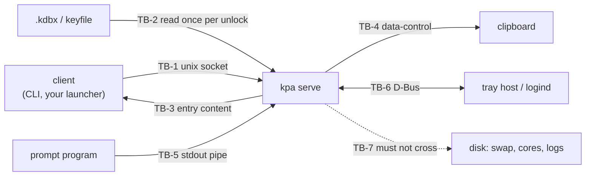

# kpa — threat model

What kpa defends, against whom, and what it deliberately doesn't. Written
to be the reference for triaging security findings: a finding is assessed
by which goal it breaks, via which actor, across which boundary.

Structure follows the four threat-modeling questions (what are we building,
what can go wrong, what do we do about it, did we do a good job); threats
were enumerated per trust boundary with STRIDE. The ID prefixes (`A-`,
`ACT-`, `TB-`, `ASM-`, `G-`, `T-`, `NG-`) are local to this document — cite
them in findings. IDs are stable: retire an entry rather than renumber.

Rationale lives in [`background.md`](./background.md); mechanisms live in
[`design.md`](./design.md). This file states *claims*, not implementation
status — whether the code meets a claim is exactly what a review checks.

## 1. System

kpa is a long-lived daemon (`kpa serve`) that holds one or more `.kdbx`
files decrypted in memory, plus short-lived clients (`kpa <subcommand>`,
or anything speaking the socket protocol). Clients can ask for status,
unlock, lock, an entry index (`list`), and to copy one field of one entry
to the clipboard (`copy`). An `unlock` can carry the master password from
the client, instead of the daemon prompting for it. There is no operation
that returns a secret to the caller, and none that writes a database.

## 2. Assets

| ID  | Asset                                                                           | Sensitivity |
| --- | ------------------------------------------------------------------------------- | ----------- |
| A-1 | Credentials: master password, keyfile contents, anything password-equivalent (e.g. derived keys) | Highest |
| A-2 | Protected field values: passwords, any field whose value carries `Protected="True"` or `ProtectInMemory="True"` (KeePassXC honours both), and Notes whether or not protected | High |
| A-3 | Entry metadata: titles, usernames, URLs, groups, custom field *names* (`list`'s `fields` array — never a custom field's *value*, which is A-2 like any other field value), and the database's own name and description stored in the `.kdbx`. kpa's config `name` labels are not A-3 | Medium |
| A-4 | Integrity of the `.kdbx` and keyfile on disk, and of their directories          | High        |
| A-5 | The user's clipboard contents that kpa didn't put there                         | Low         |

The daemon's availability is deliberately not an asset: when kpa is down
it releases nothing, and the user falls back to their main client.
Denial-of-service findings are triaged against G-9 and G-11.

The keyfile is plaintext at rest: its protection is the filesystem's
(ASM-1, ASM-6), not kpa's.

## 3. Actors

| ID     | Actor                                                                                                                 | In scope? |
| ------ | --------------------------------------------------------------------------------------------------------------------- | --------- |
| ACT-1  | Another local uid (other user, system service account)                                                                | Yes       |
| ACT-2  | Network attacker                                                                                                      | Yes — kpa has no network surface, and must not gain one |
| ACT-3  | Whoever can write the `.kdbx` or keyfile but doesn't know the key: a sync service or sync peer, a backup restore, a shared drive | Yes |
| ACT-4  | Author of entry content in a database the user can open: a colleague in a shared vault, an imported file              | Yes       |
| ACT-5  | Careless same-uid software: clipboard-history managers, shell history, terminal scrollback, log collectors, crash reporters, backup/indexing tools — records what passes by, doesn't target kpa | Yes |
| ACT-6  | Same-uid code running in a sandbox (Flatpak-style, container, browser renderer) that hasn't been granted the socket   | Yes       |
| ACT-7  | Someone with physical access: to a locked session, an unattended unlocked session (without the master password), a suspended machine, or a powered-off disk | Yes |
| ACT-8  | Malicious code running unsandboxed as the user, persistently: it can wait for an unlock, log keystrokes, replace binaries | **No** — NG-1 |
| ACT-9  | root, the kernel, firmware, hardware                                                                                  | **No** — NG-2 |
| ACT-10 | Short-lived malicious code running unsandboxed as the user: a package install script, a one-off exploited process. It runs once, briefly, and doesn't persist | Partly — T-18 |

## 4. Trust boundaries

| ID   | Boundary                                                                                       | Untrusted side |
| ---- | ---------------------------------------------------------------------------------------------- | -------------- |
| TB-1 | The Unix socket under `$XDG_RUNTIME_DIR`: uid separation via filesystem permissions. Inbound A-1 crosses it: the master password in an `unlock` from a same-uid client | Request bytes (ACT-1, ACT-6 must not reach it; ACT-5 clients may be buggy); for a client, whoever answers at the path (ACT-1 must not) |
| TB-2 | Reading `.kdbx` and keyfile: header and KDF parameters before authentication, payload after     | File bytes (ACT-3) |
| TB-3 | Decrypted entry content flowing out to clients, terminals, launchers, the tray                 | Entry content (ACT-4) |
| TB-4 | The clipboard (Wayland data-control): visible to every client of the compositor                | Readers (ACT-5) |
| TB-5 | The prompt subprocess: password arrives on its stdout                                          | The user's view of the prompt: anything that can draw on screen (ACT-6) can imitate it (NG-8). The program itself is trusted (ASM-3) |
| TB-6 | D-Bus: session bus (tray menu), system bus (logind `Lock`, `PrepareForSleep`)                  | Callers and signal senders (ACT-6) |
| TB-7 | Process memory → anything persistent: files, logs (including kpa's own operation log, which a supervisor may persist), stderr, swap, core dumps, child argv/env | Everything persistent (ACT-5, ACT-7) |

## 5. Assumptions

Findings that only work by breaking one of these are not vulnerabilities in
kpa (see §9).

- **ASM-1** — The kernel enforces uid separation, file permissions, and
  process isolation between uids.
- **ASM-2** — `$XDG_RUNTIME_DIR` is per-user, owned by the user, mode
  `0700`, and on a non-persistent filesystem.
- **ASM-3** — The config file, the prompt program it names (or the
  built-in default), every `$PATH` directory searched to find that
  program, and the paths the config points to are chosen by the user and
  writable only by them. The prompt program is trusted with the master
  password: it doesn't store or send it. Where its output channels lead is
  kpa's responsibility, not the prompt's (T-4).
- **ASM-4** — The compositor is trusted. Clipboard contents are visible to
  the session by design; kpa can only tag and expire them. The compositor
  is the one named by `WAYLAND_DISPLAY` in the service manager's
  environment, read on each `copy`. kpa hands it a secret only if that
  name is a bare socket name in the daemon's `$XDG_RUNTIME_DIR` and the
  socket's listener is the daemon's uid and on the desktop, judged like a
  requester (`docs/headless.md` § 3). That tells the desktop's compositor
  from a stale or foreign socket, not from a same-uid process serving one
  of its own (T-6).
- **ASM-5** — Dependencies are part of kpa: a bug in one that is reachable
  through kpa is a bug in kpa. Only their memory-hygiene limits are
  accepted (NG-4). `keepass` documents no security properties and fixes
  only its current major version, so tracking it is part of keeping these
  claims.
- **ASM-6** — Host hardening is the user's: hibernation, zram writeback,
  `kernel.yama.ptrace_scope`, `fs.suid_dumpable`, full-disk encryption.
- **ASM-7** — logind sees the user's screen lock in one of two ways, and
  kpa relies on both properties:
  (a) the locker asks logind to lock, through `Manager.LockSession`,
  `Manager.LockSessions` or `Session.Lock` (what `loginctl lock-session`
  and `loginctl lock-sessions` call, and what logind's own
  `IdleAction=lock` does). logind then emits the session's `Lock` signal;
  or (b) the desktop environment sets the session's `LockedHint` property
  through `Session.SetLockedHint`, which logind emits as a
  `PropertiesChanged` change. logind never sets `LockedHint` itself. A
  locker that does neither, including one started directly without calling
  logind, is invisible to kpa, and so is the screen lock it draws. kpa
  also relies on logind's `PrepareForSleep(true)` being emitted before the
  machine sleeps, and on logind's delay inhibitors holding sleep for at most
  `InhibitDelayMaxUSec` (5 s by default).

## 6. Security goals

What kpa claims. A finding is a vulnerability when it shows one of these
failing for an in-scope actor.

- **G-1 Read-only.** kpa never writes, creates, renames, truncates, or locks
  any file next to a database or keyfile, and never holds their fds beyond
  the read. No request can cause a write.
- **G-2 No access across the uid boundary.** No other uid and no network
  peer can issue requests, read responses, receive a client's requests in
  kpa's place, or obtain A-1–A-3 from kpa by any channel.
- **G-3 Secrets leave only by explicit `copy`, only to the clipboard.** A-1
  never leaves the process. It can also enter it over the socket, in an
  `unlock` that carries the master password: the daemon holds the request
  line and the decoded password in zeroizing buffers, for that one request
  only. On the CLI side, `kpa unlock` holds A-1 the same way, for one
  request: read from the terminal into a zeroizing buffer, carried in a
  `Password` the request is serialized around, and dropped once that
  request's response comes back. A-2 is never in a socket response, stdout,
  stderr, a log, an error string, the tray, a child's argv or environment —
  only in the clipboard offer, after a `copy` naming that exact field.
  `copy` itself offers only for a requester on the desktop, while the
  display session is active and unlocked (`docs/headless.md` § 5);
  anything else fails with `no_display` before the clipboard is touched.
  `list` omits every protected field and Notes rather than de-protecting
  them. `list`'s `fields` array is the one exception: it names which fields
  exist and are copyable, never a value, so a protected field's or a
  protected Notes' *name* still appears there — a name alone carries none
  of A-2, the same way a title's existence isn't A-2 either.

  **Known gap (keepass 0.15.0).** The `ProtectInMemory="True"` marker is
  part of A-2, but the pinned `keepass` crate cannot see it. Its XML
  string-value deserializer (`src/format/xml_db/entry.rs`, `StringValue`)
  reads only `@Protected`, so a value marked only with `ProtectInMemory`
  becomes an unprotected `Value`, `Value::is_protected()` is false, and
  `list` returns it. The crate's `format` module is `pub(crate)`, so kpa
  cannot reach the decrypted XML to check the attribute itself, and no
  in-repo change can make `list` honour the marker without reimplementing
  the KDBX decryption. The full fix is upstream: `StringValue` must
  deserialize `@ProtectInMemory` into `Value::protected`. Until then, a
  `list` that returns such a field violates G-3 and T-4 as written.
- **G-4 Nothing persisted.** kpa itself — the daemon and every CLI process
  that holds A-1 — never writes A-1–A-3 to disk or to its own
  stdout/stderr, and prevents its own core dumps. Memory holding A-1 and
  A-2 is locked against swap, best effort: if the locked-memory limit is
  too small (a KDF's working memory can exceed it), kpa says so and
  carries on.
- **G-5 Bounded exposure time.** A database locks on screen lock, on
  suspend (before the machine sleeps), after `idle_timeout` without a
  successful `list` of that database and without an unlock that installed
  it (each database has its own idle timer, so using one does not keep
  another unlocked), on explicit request, and when its file changes.
  `status`, `lock`, and refused or malformed requests are not activity. Locked means kpa has dropped that database and serves
  nothing from it. A lock that races an unlock wins. A lock ends any
  prompt in flight. A prompt ends after `prompt_timeout`. A copied secret
  expires after `clipboard_timeout`.
- **G-6 Lock clears what kpa owns.** On lock, every copy of A-1/A-2 that kpa
  itself made or controls is zeroized. (Copies inside dependencies: NG-4.)
- **G-7 Clipboard hygiene.** Every copy carries the
  `x-kde-passwordManagerHint: secret` tag; expiry never clears a clipboard
  kpa no longer owns.
- **G-8 Freshness.** kpa never serves data from a database whose file has
  changed since unlock.
- **G-9 Untrusted file input is only data.** A crafted `.kdbx` or keyfile
  (ACT-3) cannot corrupt memory, execute code, or affect other databases.
  It may fail to open, but a file that opens is authentic: kpa never
  serves content from a file whose header or payload was altered without
  the key.
- **G-10 Entry content is only data.** Entry fields (ACT-4) cannot alter
  protocol framing, inject into the CLI's terminal output, or change which
  entry or field a `copy` resolves to.
- **G-11 Robust socket.** Malformed, oversized, slow, or flooding clients
  are refused without crashing the daemon or starving other clients.
- **G-12 No prompt where nobody can see it.** A request from outside the
  desktop, or one that arrives while the screen is known to be locked,
  never raises the graphical prompt. `unlock` answers such a request with
  `no_display` instead, which `kpa unlock` turns into reading the master
  password from its own terminal.

## 7. Threats

Format: **ID · title** (STRIDE) — actor · boundary · asset → goal.
"Residual" is what remains after the design's response, and points to the
non-goal that accepts it.

**T-1 · Other uid reaches the socket, or answers in its place** (S, I, E) — ACT-1 · TB-1 · A-1–A-3 → G-2  
Response: socket lives in `$XDG_RUNTIME_DIR/kpa/`, created under umask
`0177` so it is never connectable by others, mode `0600`; an empty or
relative `$XDG_RUNTIME_DIR` is treated as unset; an existing parent
directory must be owned by the user and not group- or world-writable;
the daemon drops peers whose `SO_PEERCRED` uid differs, and clients check
the daemon's uid the same way before sending; no TCP, no
abstract-namespace socket (those ignore filesystem permissions and mount
namespaces). In scope: a fallback path when `$XDG_RUNTIME_DIR` is unset,
a pre-existing socket path or directory planted by someone else, a
permission window between bind and chmod, each of these for a
user-supplied `--socket`, and a client talking to a socket another uid
placed on its path.

**T-2 · Network exposure** (I, E) — ACT-2 · — · all → G-2  
Response: no listening network socket, no outbound connections. Any
network-reachable surface is a vulnerability.

**T-3 · kpa modifies the vault** (T) — any · TB-2 · A-4 → G-1  
Response: the protocol has no write op; the KDBX library is built without
save support; files are opened, read whole, and closed before the KDF
runs. In scope: any write, temp file, lock file, permission or timestamp
change, or long-held fd.

**T-4 · Secret leaks through an output channel** (I) — ACT-5 · TB-1, TB-5, TB-7 · A-1, A-2 → G-3  
Response: no `get` op; `list` is an index with protected fields and Notes
omitted; errors carry codes, not vault content; the prompt gets its own
stderr, never the daemon's; requests are never logged, decode errors carry
no request content, and a request's password has a redacting `Debug`. On
the CLI: the terminal-read password never reaches argv, an environment
variable, stdout, stderr, or a log; `kpa unlock` reads it with the
terminal's echo off, into a zeroizing buffer capped at `MAX_PASSWORD_LEN`
that never grows, and zeroizes it once the second request's response
comes back. In scope: a protected field in any response, error message,
`Debug`/`Display` output, panic message, log line, tray tooltip, or a
child process's argv/env; the prompt's stdout, stderr, or exit status
reaching a response, an error string, or kpa's own stdout/stderr/log; the
same for a password carried in a request, on either end of the socket.

**T-5 · Secret persisted to disk** (I) — ACT-5, ACT-7 · TB-7 · A-1, A-2 → G-4  
Response: `PR_SET_DUMPABLE=0` before config or unlock, in the daemon and in
any CLI process that holds A-1; secret-holding memory locked against swap;
no logging of secrets (T-4). Residual: hibernation, swap beyond the
locked-memory limit, `fs.suid_dumpable=2` root-owned dumps (NG-3).

**T-6 · Clipboard read by history managers** (I) — ACT-5 · TB-4 · A-2 → G-7, G-5  
Response: sensitivity tag; kpa owns the offer and drops it at expiry.
Residual: any data-control client can read the offer while it lives;
managers that ignore the tag (NG-5). A same-uid process that serves a
socket from inside the desktop and names it in the service manager's
environment receives the secret directly, no more than `copy` followed by
`wl-paste` gives it (T-18, NG-1). In scope: a copy without the tag, an
offer outliving its expiry or the database's lock, the secret lingering
after the offer is dropped, a secret sent to a socket outside the
daemon's runtime directory or served by another uid or from outside the
desktop.

**T-7 · Expiry clobbers the user's own clipboard** (T) — — · TB-4 · A-5 → G-7  
Response: expiry and lock destroy kpa's own source and nothing else; the
compositor clears the selection only if that source still holds it, so a
replaced offer's drop is a no-op.

**T-8 · Lock doesn't happen, or doesn't hold** (E, I) — ACT-7, ACT-5 · TB-6 · A-2, A-3 → G-5  
Response: logind's session `Lock` signal, and `LockedHint` becoming true
(ASM-7), on the user's graphical session. That session is `User.Display`
on the user object `Manager.GetUser(uid)`, re-read when its
`PropertiesChanged` says it changed. The daemon never resolves its own
session by PID, which fails for a daemon that is in no session. Whenever
the session's `LockedHint` is already true at subscription time, lock
at once. `PrepareForSleep(true)` locks every database, then releases a
`delay` sleep inhibitor. kpa holds that inhibitor while any database is
unlocked, takes it again on each successful unlock and after
`PrepareForSleep(false)`, and does not hold it while sleeping. If the
signal subscription drops, every database locks, and the subscription is
re-established with backoff. A per-database idle timer, reset only by a
successful `list` of that database or an unlock that installs it (`list`,
`copy`, a successful `unlock`); a per-database lock epoch so a lock beats an
in-flight unlock. In scope: a missed or dropped signal subscription
(including after a D-Bus reconnect); subscribing to a session other than
the user's graphical one; suspending before the lock completes; an idle
timer reset by `status`, `lock`, a refused or malformed request, or
anything other than a request; a database's idle timer reset by activity
on a different database; a request served after lock; an unlock
that installs after a lock; a prompt outliving a lock or
`prompt_timeout`; a clipboard offer outliving its database's lock.

**T-9 · Plaintext survives a lock in kpa-owned memory** (I) — ACT-7 · TB-7 · A-1, A-2 → G-6  
Response: protected values and every kpa-made copy (prompt buffer,
`list` entries, serialized responses) are zeroized on drop; the prompt
buffer never reallocates. In scope: clones, reallocating buffers, serde or
formatting intermediates, convenience getters that copy a protected value
into an unprotected type, and kpa's own use of `keepass` types whose
`Clone`, `Debug` or `Serialize` expose protected values. Residual: copies
inside `keepass` (NG-4).

**T-10 · Spoofed D-Bus input** (S, D) — ACT-6 · TB-6 · A-2, A-3 → G-5  
Response: signals only ever lock (fail-safe). In scope: anything on either
bus that can *unlock*, read entry data, or suppress a lock. Out of scope:
a spoofed or bus-reachable lock (NG-7).

**T-11 · Crafted `.kdbx` or keyfile** (T, D, E) — ACT-3 · TB-2 · all → G-9  
Response: memory-safe language; parsing in the `keepass` crate; ceilings
on KDF parameters and file size. In scope, by severity: memory corruption
or code execution; one database's file affecting another database's
state; a tampered file that opens with altered content (KDBX3's header is
authenticated only by `Meta/HeaderHash`, which `keepass` does not check);
unbounded memory or time from header or KDF parameters (these are read
before any keyed check, so ACT-3 controls them); hangs or panics.

**T-12 · Stale data after the file changes** (T) — ACT-3 · TB-2 · A-2, A-3 → G-8  
Response: `(dev, ino, size, mtime, ctime)`, with nanoseconds, recorded by
`fstat` on the fd that was read, before and after the read (a difference
fails the unlock); re-checked by `stat` on the path before serving; any
difference drops the database and answers `stale`. Residual: ctime is
only as good as the filesystem's; on coarse-timestamp, FUSE or network
mounts the guard is best effort.

**T-13 · Hostile entry content** (T, S) — ACT-4 · TB-3 · A-2, A-3 → G-10  
Response: line-delimited JSON is serialized, never concatenated; `copy`
addresses entries by `(db, uuid, field)`; the CLI escapes DEL, C1 controls
and Unicode bidi/format characters before writing to a terminal (JSON
escaping covers only C0). A custom field's key is entry content too: the
collision rule (`docs/design.md` § Protocol) makes a bare name that spells
a built-in case-insensitively always mean the built-in, by type rather than
by convention, so a custom key crafted to spell `password` or `title`
cannot stand in for the real field or intercept a `copy` meant for it. In
scope: terminal escape or control sequences reaching the CLI's terminal
output unescaped; a field breaking framing; a title or UUID collision
across databases that makes a `copy` resolve to a different entry than the
one listed; a custom field's key reaching a built-in's `copy` target or
vice versa.

**T-14 · Socket abuse** (D) — ACT-5 · TB-1 · — → G-11  
Response: 64 KiB line cap, 5 s total deadline per request and per
response, bounded concurrent connections, failed spawns drop one
connection. Low severity: any same-uid process can kill the daemon
outright (NG-7).

**T-15 · Sandboxed process reaches kpa** (E, I) — ACT-6 · TB-1, TB-6 · A-1–A-3 → G-2  
Response: the socket is a filesystem path, absent from a sandbox unless
granted. Residual: a sandbox with session-bus access can activate tray
menu items — lock, or raise an unlock prompt, but not read anything.

**T-16 · No trace of reads** (R) — ACT-10 · TB-1 · A-2 → —  
Unaddressed: a `copy` produces no user-visible notification, so an
unexpected read goes unnoticed. Not a goal today; the background research
ranks read notifications as worthwhile. Findings here are hardening.

**T-17 · Substituted or rolled-back file** (S, T) — ACT-3 · TB-2 · A-2, A-3 → —  
Unaddressed: whoever can write the path can replace it, while it is
locked, with any file that opens under the same credentials — an older
copy of the same vault, or another vault sharing the password — and kpa
serves it under the configured name. The format binds neither version nor
identity, so kpa cannot detect it in general; G-8 covers only a change
after unlock. Residual: NG-6.

**T-18 · Short-lived code harvests an unlocked vault** (I) — ACT-10 · TB-1 · A-2, A-3 → G-5  
Accepted risk. Response: time only — a locked database yields nothing,
and unlocking needs the user to answer a prompt. Residual: while a
database is unlocked, ACT-10 can `list` and `copy` everything; per-caller
authorization is ruled out for the reasons in NG-1, and read
notifications (T-16) are the planned mitigation. In scope: anything that
lets ACT-10 reach data while every database is locked, unlock without the
user, or leave something behind in kpa that outlives it.

**T-19 · Misrouted prompt** (S) — ACT-5, ACT-10 · TB-1 · A-1 → G-12  
A prompt raised where nobody can answer it, or answer it unnoticed: on an
unattended desk screen, or a terminal read happening somewhere other than
where the user expects it. Response: classification errs toward the
terminal rather than the screen (`docs/headless.md` § 3) — the worst a
misclassification does is ask on a terminal instead of on screen, never
the other way; an unanswered prompt times out (G-5); a lock kills any
prompt still open. Residual: a multiplexer attached over SSH runs in the
desktop's cgroup, so an unlock from it still raises the graphical prompt
on the desk's screen, which the remote user can't see — bounded by the
timeout (`docs/headless.md` § 3).

## 8. Non-goals

Explicitly not defended. A finding that reduces to one of these is out of
scope, or at most hardening.

- **NG-1 Persistent malicious same-uid code (ACT-8).** It can wait for an
  unlock, connect to the socket and copy any secret, read the clipboard,
  read the `.kdbx`, log keystrokes, replace the prompt program or the
  `kpa` binary, and edit the config. There is deliberately no per-caller
  authorization: inside the uid boundary it would be theater. This
  includes "a same-uid process can list/copy/lock/unlock" and "the socket
  has no authentication". Short-lived code (ACT-10) gets the same access
  but only while a database is unlocked (T-18).
- **NG-2 root, kernel, firmware, hardware (ACT-9)**, including cold-boot and
  DMA attacks on RAM.
- **NG-3 Host configuration (ASM-6).** Hibernation, zram writeback, swap
  beyond what kpa can lock, ptrace scope, `suid_dumpable`, unencrypted
  disks.
- **NG-4 Plaintext inside dependencies' memory.** `keepass` keeps
  unprotected fields as plain strings, and does not zeroize its decrypted
  payload buffers, KDF intermediates, or keyfile parser copies; these can
  survive a lock. This covers memory hygiene only: parser bugs are in
  scope (G-9, ASM-5). A finding that kpa could avoid such a copy (a
  different API, not cloning) is hardening.
- **NG-5 What other programs do with data kpa handed them**: the prompt
  program's memory, the compositor, clipboard managers ignoring the tag,
  a launcher's display or storage of the `list` index.
- **NG-6 Offline attacks on the `.kdbx`.** KDF strength, password quality,
  and the format's cryptography are the KeePass ecosystem's concern; kpa
  reads files with whatever parameters the user's client wrote, and cannot
  tell a validly encrypted older or substituted copy from the current one
  (T-17).
- **NG-7 Denial of service by anything already at the same uid** — killing
  the daemon, flooding it, locking databases, opening prompts.
- **NG-8 Trusted path for the prompt.** kpa cannot prove to the user that a
  password prompt is its own; a compositor client can draw a look-alike.
  Prompt authenticity is the prompt program's and the compositor's concern
  (ASM-3, ASM-4).

## 9. Triage

Classify each finding into exactly one bucket, citing IDs:

| Bucket | Test | Example |
| --- | --- | --- |
| **Vulnerability** | Breaks a `G-n` via an in-scope `ACT-n` | "Other uid can connect when `$XDG_RUNTIME_DIR` is unset (G-2, ACT-1, T-1)" |
| **Assumption violation** | Only works if an `ASM-n` is false | "If `$XDG_RUNTIME_DIR` is world-writable…" (ASM-2) |
| **Out of scope** | Reduces to an `NG-n` | "Any local process can copy passwords" (NG-1) |
| **Hardening** | No goal broken, but cheaper/safer to change | "kpa clones a value that `keepass` also leaks" (NG-4) |
| **Model gap** | Doesn't fit any entry, or shows an entry is wrong | Propose the new or corrected entry |

Severity follows the asset and the actor's reach, not CVSS:

- **Critical** — A-1/A-2 to ACT-1/ACT-2; any write to the vault (G-1);
  code execution from a crafted file (G-9).
- **High** — A-1/A-2 to a passive channel or disk (G-3, G-4); a lock that
  doesn't happen or doesn't hold (G-5); memory corruption from file input.
- **Medium** — A-3 across the uid boundary or to disk; kpa-owned secret
  copies surviving lock (G-6); stale or tampered data served (G-8, G-9);
  entry content breaking out of its field (G-10); clipboard missing its
  tag (G-7).
- **Low** — crash, hang, or resource exhaustion from file or socket input;
  anything reachable only by ACT-6 that can't read data.

Model gaps are the most useful findings: update this file alongside the fix.
